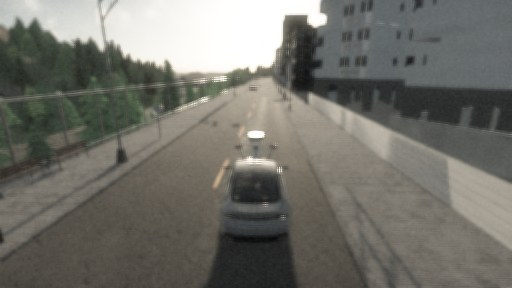

# Crosswalk Lab

A learned driver for a simulated city. A compact neural policy controls the steering wheel, accelerator and brake of a Lincoln sedan in CARLA Town01. A forward camera, 360° scanning lidar and Doppler radar observe approaching traffic and pedestrians. Driving decisions run at 10 simulated Hz. The live console shows which road users the camera detector recognized and what the vehicle did next.

[Watch recorded drives](https://yafi-s.github.io/crosswalk-lab/) · [Explore driving trials](https://yafi-s.github.io/crosswalk-lab/benchmarks.html) · [Experiment results](docs/results.md) · [Papers and asset credits](docs/research.md)



## Watch the learned driver live

On Windows, install Python 3.12 with the Python launcher and clone this repository. Run the following once in PowerShell from the repository root.

```powershell
powershell -ExecutionPolicy Bypass -File .\setup.ps1
```

Setup retrieves the free CARLA 0.9.16 package from the simulator project. Budget about 28 GB for the archive and unpacked files. An existing CARLA 0.9.16 installation can be supplied through the `CARLA_ROOT` environment variable. The trained policies and pretrained camera detector ship with the repository.

Double-click **Watch-Live.cmd**. It starts one offscreen simulator and opens the local browser console. The tour cycles through a pedestrian crossing, intersection turn, braking lead, stopped lead and clear street. Select the front camera to see road-user detections or the thermal view for an experimental long-wave infrared rendering. Press Ctrl+C in the launcher window to stop the simulator. The public website plays synchronized recordings of the same software.

For one drive, run the following command. Add `--loop` to repeat it until interrupted.

```powershell
.\.venv\Scripts\python.exe -m crosswalk.drive --serve --open-browser --scenario turn --seed 102
```

## What makes the decisions

- A frozen NanoDet convolutional network detects people, cyclists and vehicles from RGB pixels at 5 Hz. Image statistics, geometric range features from synchronized lidar and radar scans, and ego speed feed the learned pedal controller. One signed output represents accelerator or brake demand.
- A second neural head learns steering from speed and three route points in the car's local coordinate frame. Both heads learn from CARLA Traffic Manager demonstrations. Inference applies their outputs directly to the vehicle actuators.
- The navigation input assumes a known route and exact map localization. CARLA simulates wheel forces, contacts, vehicle dynamics and camera views. Traffic and pedestrians are scenario actors. The experimental thermal observer uses class temperature assumptions and depth to model radiance over 8–14 µm.
- The camera ablation trains the same architecture on the same demonstrations with the range inputs removed. Matched driving trials test the value of adding lidar and radar to the camera system. The comparison covers the specified sensors, maps, seeds and control problem.

## Reproduce the experiment

To refit the fusion controller from the published demonstration features, run the following command. The output path keeps the shipped model available for comparison.

```powershell
.\.venv\Scripts\python.exe -m crosswalk.train --data data/training.npz --out out/refit-fusion.npz --inputs fusion
```

The full study collects demonstrations on eight seeds, fits two policies, and drives five encounter types on four different seeds. The braking-lead family appears only in evaluation. Randomized initial lateral and yaw offsets exercise recovery. Episodes end at the route goal, a collision, a lateral departure, or a 34-second time limit. To rerun the study in a separate directory, install FFmpeg on PATH for the three synchronized video tracks and use the following commands.

```powershell
$env:OPENBLAS_NUM_THREADS = '1'
.\.venv\Scripts\python.exe -m crosswalk.experiment --output out/reproduction
.\.venv\Scripts\python.exe -m crosswalk.traction --output out/reproduction/results/traction.json
.\.venv\Scripts\python.exe -m unittest discover -s tests -v
```

Each episode is checkpointed. Reusing an output directory resumes matching runs. The vehicle server uses port 2468 by default. The camera console uses loopback port 8765. One simulator runs at a time.

## Evidence and scope

The repository includes model weights, demonstration features, per-episode outcomes, compressed per-tick evaluation traces, camera footage and a separate controlled tire-friction experiment. The results report defines metrics, identifies observed failures and gives résumé wording tied to the measurements. This is a low-speed Town01 experiment with scripted encounters and ideal route localization. Real-road generalization and commercial-system parity are unestablished.

[Results and résumé evidence](docs/results.md) · [Control, sensor and physics references](docs/research.md) · [Thermal model](docs/thermal.md) · [NanoDet weights and license](vendor/nanodet/README.md)

The project's code is MIT licensed. The simulator, imagery, fonts and pretrained detector carry their respective upstream credits and licenses. [License](LICENSE) · [CARLA imagery attribution](docs/research.md#software-and-rendered-media-credits)
