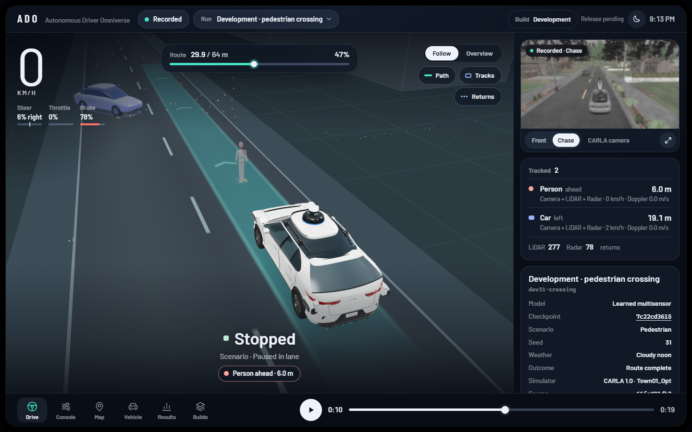

# ADO — Autonomous Driver Omniverse

**Real-data research track.** ADO's original three-camera trajectory model was trained on the Waymo Open Dataset using a Colab T4. It achieved 1.81 m mean open-loop displacement error, compared with 2.98 m for constant velocity and 1.78 m for history and route intent alone. The first two simulator transfer configurations did not complete a route. [Research results](waymo_training/RESULTS.md) · [Open the Colab notebook](https://colab.research.google.com/github/yafi-s/ADO/blob/main/waymo_training/ADO_Waymo_Colab.ipynb) · [Watch the labeled stopped-car trial](https://yafi-s.github.io/ADO/?run=waymo-research-v2-lead-seed41-start3)


[Windows build and checksums](https://github.com/yafi-s/ADO/releases/tag/v0.1.0) · [Scored results and résumé evidence](docs/results.md) · [Real Waymo training on Colab](https://github.com/yafi-s/ADO/tree/research/waymo-e2e/waymo_training)

The CARLA-trained policy completed 72 of 100 held-out drives. Seventy finished cleanly. The other outcomes included 17 timeouts, nine lane departures and two collisions. The downloadable logs include all trials. The 1080p Market film re-renders a recorded 184 m drive that stopped for a pedestrian and reached its destination. A separate High-quality pedestrian drive ran the learned policy closed-loop.

ADO also has a separate research track that trains original trajectory models on three camera views from the real Waymo Open Dataset using Google Colab. Its offline trajectory errors and simulator transfer checks are reported separately from this CARLA benchmark.

A learned robotaxi driving through an interactive CARLA 1.0 city. Select a destination, watch the sensor feeds, then drive the same route with a pedestrian stepping into the street a second later. The study focuses on ordinary urban interactions including crossings, stopped vehicles, signals, following traffic and left turns.

[Watch the perception display](https://yafi-s.github.io/ADO/) · [Builds and run logs](https://yafi-s.github.io/ADO/builds.html) · [3D city observer](https://yafi-s.github.io/ADO/city.html) · [Waymo Jaguar I-PACE model](https://yafi-s.github.io/ADO/vehicle.html?model=ipace) · [Benchmark design](docs/city-study.md) · [Research and asset credits](docs/research.md)

[](https://yafi-s.github.io/ADO/)

## Drive a route

Install Python 3.12 on Windows and clone the repository. From PowerShell in the project, run the setup command once. The installer downloads the official CARLA 1.0 server and Town01_Opt content, installs the matching Python client and keeps downloads resumable.

```powershell
powershell -ExecutionPolicy Bypass -File .\setup.ps1
```

**Start-ADO.cmd** verifies the installation. **Watch-Live.cmd** starts an offscreen simulator and opens the driving console after local setup and model fitting. Choose Market or Station for a two-intersection trip, or select an individual encounter. Choose a weather preset or a wheel grip setting, keep the seed fixed and change pedestrian entry timing. Press Ctrl+C in the launcher window to stop the simulator. The public site hosts synchronized recordings. The local program runs new drives.

The Windows profile uses Direct3D 12 and low graphics settings. Forward RGB stays at native 640×360 for small traffic lights. The side and chase cameras request DLSS Super Resolution at a 50% internal scale. Native depth and segmentation feed an uncalibrated long-wave infrared observer. The rig also includes a 32-channel roof lidar and forward Doppler radar. In a stationary signal-approach benchmark on an 8 GB RTX 3070, this five-view profile processed 10.65 updates per wall-clock second, including perception and JPEG encoding. The benchmark records actor settings and timings. [Measurements](results/rendering.json) · [CARLA rendering controls](https://carla-ue5.readthedocs.io/en/latest/core_dlss/) · [Thermal model](docs/thermal.md)

## What the vehicle learns

NanoDet detects road users in forward RGB images. The model also receives side-camera observations, compact traffic-light color measurements, ego speed and upcoming map route points. The feature archive includes a bird’s-eye grid of lidar and radar returns. The released base fusion head uses five local range and Doppler features alongside 16 shared inputs. Restricting these inputs helped the car resume on clear streets during development. Two neural networks learn steering and signed pedal demand. Their outputs control the car directly.

Traffic Manager provides training demonstrations. During demonstrations of red lights and unprotected left turns, an instructor can give Traffic Manager a stopping point. The steering head first learns the demonstrated controls. Cross-entropy search then tunes its final layer by scoring how well it follows training routes in a low-speed bicycle simulation. The evaluated policy sees sensors and navigation, and it has no interface for reading traffic-light state, actor coordinates or the scenario script. Navigation assumes accurate ego localization and a known route.

Two editable Blender vehicles are included. Meridian is an original design. The Jaguar I-PACE is an independently modeled interpretation of Waymo's fifth-generation robotaxi, based on public exterior references. Each comes with a GLB and a skeletal FBX. The 3D city observer displays a chosen exterior at the measured CARLA pose. The native camera views show CARLA's Lincoln with a physically attached sensor carrier. [Meridian files](assets/robotaxi/vehicle/README.md) · [Waymo I-PACE files](assets/waymo-ipace/) · [Native attachment measurements](assets/robotaxi/simulator-verification.json)

## Reproduce the study

The study separates training and held-out streets and intersections within Town01_Opt. Its primary evaluation specifies 100 multisensor drives, plus 20 matched camera-policy drives and one supplemental timing experiment. A collision, traffic violation or stalled car is an outcome to report. One simulator runs at a time and each finished episode is checkpointed.

Install FFmpeg on PATH for synchronized replay export. A fresh experiment directory keeps published evidence available for comparison.

```powershell
$env:OPENBLAS_NUM_THREADS = '1'
.\.venv-city\Scripts\python.exe -m ado study --stage all --output out/reproduction
.\.venv-city\Scripts\python.exe -m ado traction --output out/reproduction/results/traction.json
.\.venv-city\Scripts\python.exe -m ado render-benchmark --output out/reproduction/results/rendering.json
.\.venv-city\Scripts\python.exe -m ado report --root out/reproduction
.\.venv-city\Scripts\python.exe -m unittest discover -s tests -v
```

The project measures low-speed urban driving in controlled simulation. Commercial-system parity and real-road driving performance are unestablished. Project code uses the MIT license. Third-party software, fonts, simulator art and pretrained weights carry their upstream licenses. [Project license](LICENSE) · [Credits](docs/research.md#software-and-rendered-media-credits) · [Detector provenance](vendor/nanodet/README.md)
