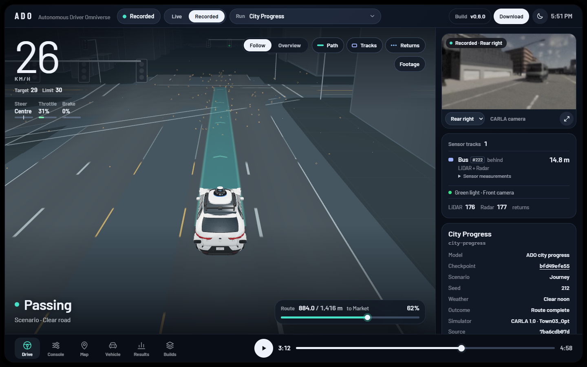

# ADO — Autonomous Driver Omniverse

**Watch City Progress.** ADO drove the same populated 1.42 km Market route in **4 minutes 58.7 seconds**, down from 5 minutes 32 seconds. Both drives handled all 11 encounters and all 11 junctions with zero recorded collisions, red-light violations or missed yields. Across six nearly straight intersections, median speed increased from **13.1 to 17.5 km/h**. [Watch the new drive](https://yafi-s.github.io/ADO/?run=city-progress) · [Compare both controllers in the same road situations](https://yafi-s.github.io/ADO/media/city-progress-tests/comparison.mp4) · [Full route audit and tradeoffs](results/city-progress/README.md)

[](https://yafi-s.github.io/ADO/?run=city-progress&frame=2017&camera=rear_right)

Alongside the stopped bus, median speed rose from **6.1 to 7.2 km/h**. The driver still slowed near the blind nose. In the 10 m approaching the next junction it recovered to a median **25.9 km/h**, compared with 15.1 km/h previously. In a separate occupied test it stopped for a pedestrian emerging from behind the bus. The Results timeline links the current camera to the previous driver's exposure at the same route position. [Inspect the bus pass](https://yafi-s.github.io/ADO/inspect.html?run=city-progress&frame=1960&camera=chase) · [Explore the timeline](https://yafi-s.github.io/ADO/benchmarks.html#traffic-study)

**Earlier City Life recording.** ADO drove 1.42 km through a populated Town03, with 22 background cars and 30 walkers. It handled all **11 encounters and 11 junctions** in 5 minutes 32 seconds, with zero recorded collisions, red-light violations or missed yields. Moving cars and pedestrians were nearby together for **49.9%** of the drive. The 3D rider screen and six camera movies share all 3,320 native exposures. [Watch the drive](https://yafi-s.github.io/ADO/?run=city-life) · [Two pedestrians, a moving car and a distant van together](https://yafi-s.github.io/ADO/?run=city-life&frame=342&track=26&camera=front) · [Full review and limitations](results/city-life/README.md)

**Earlier sightings and better work-zone pace.** On identical exposures, the van appeared in 3D at **76.7 m**, up from 58.4 m with the earlier observer. A sidewalk pedestrian was visible in the camera at **64.4 m**, then acquired an accurate 3D location at 13.7 m. In matched driving tests the car increased median speed through the six-drum taper from 5.1 to **14.7 km/h** and still stopped at the blocked lane. [Inspect the distant van](https://yafi-s.github.io/ADO/?run=city-life&frame=281&track=20&camera=front) · [Explore the speed and traffic timeline](https://yafi-s.github.io/ADO/benchmarks.html#traffic-study) · [Matched roadworks footage](https://yafi-s.github.io/ADO/media/roadworks-pace/roadside-comparison.mp4)

**Earlier v0.4 Urban Pace drive.** ADO drove 1.42 km through Town03 in 5 minutes 35 seconds, handling **11 encounters and 11 junctions** with zero contacts, red-light violations or yield violations. Five onboard cameras, roof LiDAR, five radars and a separate chase camera share a clock across **3,354 native exposures**. The driver stopped for a pedestrian emerging behind a van and an oncoming car at a left turn. It passed two roadside barricades with 1.047 m minimum side clearance. [Watch the full drive](https://yafi-s.github.io/ADO/?run=urban-pace) · [Inspect the barricade approach at frame 3460](https://yafi-s.github.io/ADO/inspect.html?run=urban-pace&frame=3460&camera=front) · [Release measurements and known limits](results/urban-pace/README.md)

**How steadily does it cruise?** On the empty 285 m boulevard, the new Colab-fitted driver raised median speed from 28.42 to **39.58 km/h** in the measured interior. Speed standard deviation fell from 3.37 to 1.75 km/h. On the staged city route, the shared 81 m section had a 37.74 km/h median and 39.08 km/h peak in the High recording. The car still slowed for a camera person detection. In the Low seed-211 comparison, speed variation on that section increased from 0.75 to 1.90 km/h. A separate test of a signed 30 km/h zone found that previewing the sign reduced entry speed from 39.35 to **30.16 km/h**. These are measured vehicle speeds on a known simulation course. [Trials, traces and distributions](results/city-pace/README.md) · [Model and training recipe](models/city-pace/README.md)

**Blocked lane or clear path?** ADO held a stop for 9.9 s when a barricade blocked the lane, then drove through after it moved aside. On the same approach with the board at the curb, the car slowed and passed without stopping. Both outcomes also held in wet conditions with reduced simulated tire grip. In a separate moving overtake, ADO held zero throttle for 7.5 s while the passing lane was occupied. [Watch the lane reopen](https://yafi-s.github.io/ADO/media/workzone-tests/closed-then-open.mp4) · [Watch the curbside pass](https://yafi-s.github.io/ADO/media/workzone-tests/curbside.mp4) · [Work-zone evidence and wet films](results/workzone-stop/README.md) · [Occupied-lane overtake film and controls](results/tactical-pass/v04/README.md)

**Town01 crossing and yield assessment.** The v0.4 Town01 policy finished **16/16** assessment drives cleanly. They included six earlier failures, four previously passing controls and six fresh seed/case combinations. Two additional interactive launcher trips also passed. The matched clear-road drive took 15.1 s, down from 19.6 s for the first correction and 1.6 s slower than v0.2. The earlier, larger v0.2 study compared **47/50 against 32/50** on fresh cases and **97/100 against 70/100** on the historical cohort. Those scores belong to the archived policies. [v0.4 assessment and launcher traces](results/town01-yield-gated-v04/README.md) · [Earlier matched comparison](results/behavior-v2/README.md) · [Browse cases and seeds](https://yafi-s.github.io/ADO/benchmarks.html)

**Waymo-data research.** Two research controllers fitted to CARLA demonstrations completed all four tested Town01 scenarios on one development seed. Both stopped for the lead, visible pedestrian and occluded pedestrian where the original motion-forecast transfer had collided. Adding the Waymo motion forecast yielded no additional successful outcome in those four cases. The public city driver uses its own CARLA-trained model. The separate three-camera Waymo model achieved 1.81 m mean open-loop displacement error, compared with 1.78 m from history and route intent alone. [Calibration experiment and native trials](waymo_training/CARLA_SPEED_CALIBRATION.md) · [Original Waymo results](waymo_training/RESULTS.md) · [Colab notebook](https://colab.research.google.com/github/yafi-s/ADO/blob/main/waymo_training/ADO_Waymo_Colab.ipynb)

**Earlier films and studies.** The v0.3 surround drive handled ten encounters in 3,173 exposures and reached 36.6 km/h. The v0.2 Town03 film retains its 3,543-frame drive and planned bus pass. The original v0.1 fusion policy completed 72 of 100 held-out Town01 drives, with 70 clean finishes. [v0.3 surround film](https://yafi-s.github.io/ADO/?run=surround-city) · [v0.2 city film](https://yafi-s.github.io/ADO/?run=long-city-drive) · [v0.3 open-lane overtake](https://yafi-s.github.io/ADO/?run=overtake-clear) · [v0.3 occupied-lane overtake](https://yafi-s.github.io/ADO/?run=overtake-yield) · [Original benchmark](docs/results.md)

[Windows build and checksums](https://github.com/yafi-s/ADO/releases/latest) · [Windows setup and offline replay](docs/release.md) · [3D city observer](https://yafi-s.github.io/ADO/city.html) · [Waymo Jaguar I-PACE model](https://yafi-s.github.io/ADO/vehicle.html?model=ipace) · [Research and asset credits](docs/research.md)

## Drive a route

On Windows, install Python 3.12 and extract the release ZIP or clone the repository. From PowerShell in the project, run the setup command once. The installer downloads the official CARLA 1.0 server and the Town01_Opt and Town03_Opt maps, installs the matching Python client and keeps downloads resumable.

```powershell
powershell -ExecutionPolicy Bypass -File .\setup.ps1
```

**Watch-City.cmd** opens the learned Town03 Market drive with a live perception display. **Start-ADO.cmd** verifies the installation. **Watch-Live.cmd** starts an offscreen simulator and opens the driving console after local setup and model fitting. Choose Market or Station for a two-intersection trip, or select an individual encounter. Choose a weather preset or a wheel grip setting, keep the seed fixed and change pedestrian entry timing. Press Ctrl+C in the launcher window to stop the simulator. The public site hosts synchronized recordings. The local program runs new drives.

Watch-City selects the v0.4 Town03 driver and its eleven-encounter route. The release ZIP can also play the recordings offline. [City route and controls](docs/city-driving.md) · [Offline replay instructions](docs/release.md)

The Windows profile uses Direct3D 12 and low graphics settings. Forward RGB stays at native 640×360 for small traffic lights. The side and chase cameras request DLSS Super Resolution at a 50% internal scale. Native depth and segmentation feed an uncalibrated long-wave infrared observer. The rig also includes a 32-channel roof lidar and forward Doppler radar. In a stationary signal-approach benchmark on an 8 GB RTX 3070, this five-view profile processed 10.65 updates per wall-clock second, including perception and JPEG encoding. The benchmark records actor settings and timings. [Measurements](results/rendering.json) · [CARLA rendering controls](https://carla-ue5.readthedocs.io/en/latest/core_dlss/) · [Thermal model](docs/thermal.md)

## What the vehicle learns

The original Town01 fusion study used NanoDet to detect road users in forward RGB images. The model also receives side-camera observations, compact traffic-light color measurements, ego speed and upcoming map route points. The feature archive includes a bird’s-eye grid of lidar and radar returns. The released base fusion head uses five local range and Doppler features alongside 16 shared inputs. Restricting these inputs helped the car resume on clear streets during development. Two neural networks learn steering and signed pedal demand. Their outputs control the car directly.

Traffic Manager provides training demonstrations. During demonstrations of red lights and unprotected left turns, an instructor can give Traffic Manager a stopping point. The steering head first learns the demonstrated controls. Cross-entropy search then tunes its final layer by scoring how well it follows training routes in a low-speed bicycle simulation. The evaluated policy sees sensors and navigation, and it has no interface for reading traffic-light state, actor coordinates or the scenario script. Navigation assumes accurate ego localization and a known route.

The Town03 city model learns cruise targets from sensor observations and demonstration speeds, then fits pedal effort against measured changes in vehicle speed. It bounds those requests using lane clearance, upcoming junctions and mapped posted limits. The five-camera rider display estimates nearby road users and work-zone objects. [City fit](models/city-pace/README.md) · [Surround display and sensing](docs/surround-city.md)

Two editable Blender vehicles are included. Meridian is an original design. The Jaguar I-PACE is an independently modeled interpretation of Waymo's fifth-generation robotaxi, based on public exterior references. Each comes with a GLB and a skeletal FBX. The 3D city observer displays a chosen exterior at the measured CARLA pose. The native camera views show CARLA's Lincoln with a physically attached sensor carrier. [Meridian files](assets/robotaxi/vehicle/README.md) · [Waymo I-PACE files](assets/waymo-ipace/) · [Native attachment measurements](assets/robotaxi/simulator-verification.json)

## Reproduce the study

The study separates training and held-out streets and intersections within Town01_Opt. Its primary evaluation specifies 100 multisensor drives, plus 20 matched camera-policy drives and one supplemental timing experiment. A collision, traffic violation or stalled car is an outcome to report. One simulator runs at a time and each finished episode is checkpointed.

Install FFmpeg on PATH for synchronized replay export. A fresh experiment directory keeps published evidence available for comparison.

```powershell
$env:OPENBLAS_NUM_THREADS = '1'
.\.venv-city\Scripts\python.exe -m ado study --stage all --output out/reproduction
.\.venv-city\Scripts\python.exe -m ado traction --output out/reproduction/results/traction.json
.\.venv-city\Scripts\python.exe -m ado render-benchmark --output out/reproduction/results/rendering.json
.\.venv-city\Scripts\python.exe -m ado report --root out/reproduction
.\.venv-city\Scripts\python.exe -m unittest discover -s tests -v
```

The project measures low-speed urban driving in controlled simulation. Commercial-system parity and real-road driving performance are unestablished. Project code uses the MIT license. Third-party software, fonts, simulator art and pretrained weights carry their upstream licenses. [Project license](LICENSE) · [Credits](docs/research.md#software-and-rendered-media-credits) · [Detector provenance](vendor/nanodet/README.md)
