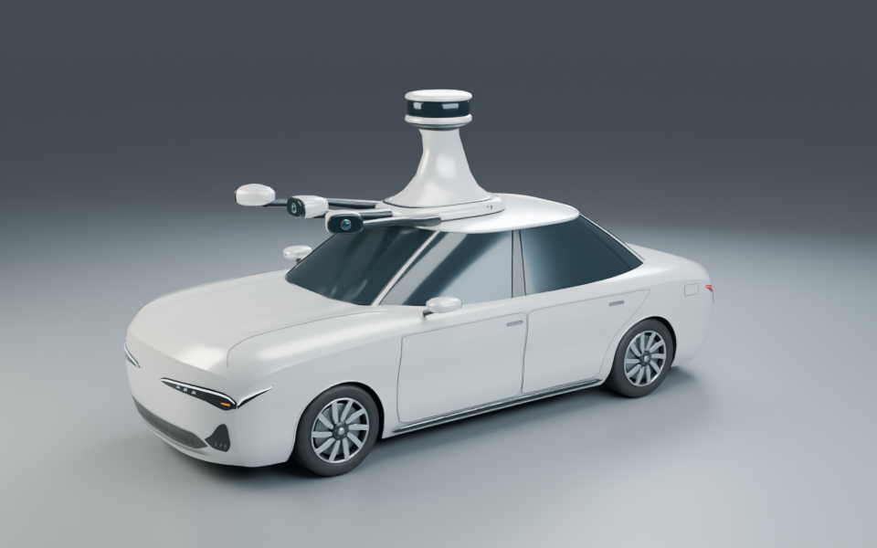

# Crosswalk Lab

A learned robotaxi driving through an interactive CARLA 1.0 city. Select a destination, watch the sensor feeds, then drive the same route with a pedestrian stepping into the street a second later. The study focuses on ordinary urban interactions including crossings, stopped vehicles, signals, following traffic and left turns.

[Driving console](https://yafi-s.github.io/crosswalk-lab/) · [Explore the Meridian robotaxi in 3D](https://yafi-s.github.io/crosswalk-lab/vehicle.html) · [Benchmark design](docs/city-study.md) · [Research and asset credits](docs/research.md)

[](https://yafi-s.github.io/crosswalk-lab/vehicle.html)

## Drive a route

Install Python 3.12 on Windows and clone the repository. From PowerShell in the project, run the setup command once. The installer downloads the official CARLA 1.0 server and Town01_Opt content, installs the matching Python client and keeps downloads resumable.

```powershell
powershell -ExecutionPolicy Bypass -File .\setup.ps1
```

**Watch-Live.cmd** starts an offscreen simulator and opens the driving console after local setup and model fitting. Choose Market or Station for a two-intersection trip, or select an individual encounter. Choose a weather preset or a wheel grip setting, keep the seed fixed and change pedestrian entry timing. Press Ctrl+C in the launcher window to stop the simulator. The public site hosts synchronized recordings. The local program runs new drives.

The Windows profile uses Direct3D 12 and low graphics settings. RGB camera DLSS Super Resolution can be requested independently of the output image dimensions. Depth and segmentation feed an uncalibrated long-wave infrared observer and require native pixels. The rig also includes a 32-channel roof lidar and forward Doppler radar. [Rendering controls](https://carla-ue5.readthedocs.io/en/latest/core_dlss/) · [Thermal model](docs/thermal.md)

## What the vehicle learns

NanoDet detects road users in forward RGB images. The model also receives side-camera observations, compact traffic-light color measurements, ego speed and upcoming map route points. The multisensor version additionally receives lidar and radar measurements, including a bird's-eye grid of return density and Doppler velocity. Two neural networks learn steering and signed pedal demand. Their outputs control the car directly.

Traffic Manager provides training demonstrations. During demonstrations of red lights and unprotected left turns, an instructor can give Traffic Manager a stopping point. The steering head first learns the demonstrated controls. Cross-entropy search then tunes its final layer by scoring how well it follows training routes in a low-speed bicycle simulation. The evaluated policy sees sensors and navigation, and it has no interface for reading traffic-light state, actor coordinates or the scenario script. Navigation assumes accurate ego localization and a known route.

The full Meridian car is an original Blender asset with editable bodywork, a roof carrier, a skeletal FBX and a portable GLB. The runtime vehicle uses CARLA's Lincoln physics and an attached sensor assembly. [Vehicle files and dimensions](assets/robotaxi/vehicle/README.md)

## Reproduce the study

The study separates training and held-out streets and intersections within Town01_Opt. Its primary evaluation specifies 100 multisensor drives, plus 20 matched camera-policy drives and one supplemental timing experiment. A collision, traffic violation or stalled car is an outcome to report. One simulator runs at a time and each finished episode is checkpointed.

Install FFmpeg on PATH for synchronized replay export. A fresh experiment directory keeps published evidence available for comparison.

```powershell
$env:OPENBLAS_NUM_THREADS = '1'
.\.venv-city\Scripts\python.exe -m crosswalk.experiment --stage all --output out/reproduction
.\.venv-city\Scripts\python.exe -m crosswalk.traction --output out/reproduction/results/traction.json
.\.venv-city\Scripts\python.exe -m crosswalk.render_benchmark --output out/reproduction/results/rendering.json
.\.venv-city\Scripts\python.exe -m crosswalk.report --root out/reproduction
.\.venv-city\Scripts\python.exe -m unittest discover -s tests -v
```

The project measures low-speed urban driving in controlled simulation. Commercial-system parity and real-road driving performance are unestablished. Project code uses the MIT license. Third-party software, fonts, simulator art and pretrained weights carry their upstream licenses. [Project license](LICENSE) · [Credits](docs/research.md#software-and-rendered-media-credits) · [Detector provenance](vendor/nanodet/README.md)
