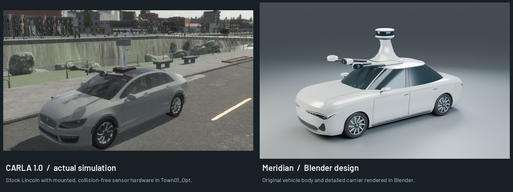

# Meridian sensor carrier

The detachable carrier includes a roof-mounted 360-degree LiDAR, three camera pods and a forward radar behind the grille. The native Blender model includes 48 editable mesh objects, seven materials and five named sensor-origin markers. Its rain cap reaches 2.407 m above the vehicle actor origin. The [complete Meridian model](vehicle/README.md) uses this assembly.

## Files and mounting

- [roof-carrier.glb](roof-carrier.glb) is the self-contained detailed design. Import at the vehicle actor origin with unit scale.
- [SM_RobotaxiCarrier.fbx](SM_RobotaxiCarrier.fbx) contains the same geometry and material slots for Unreal Editor import. Choose **Combine Meshes** to create a single static-mesh prop.
- [build_model.py](build_model.py) creates both assets. In an existing Blender scene, call `build_carrier()` to add the objects to the active collection. Run the file as a Blender background script to rebuild the exports.
- [robotaxi.py](../../crosswalk/robotaxi.py) defines the five physical sensor poses and builds the simulator's visible carrier from cooked mesh assets. The original Blender mesh and its FBX can also serve as source art for a cooked content pack. [CARLA content-pack authoring](https://carla-ue5.readthedocs.io/en/latest/content_authoring_packs/)

Coordinates below use CARLA metres, with X forward, Y right and Z up. The four values give X, Y, Z and yaw in degrees.

- Forward camera `(1.30, 0.00, 1.65, 0)`
- Left camera `(1.30, -0.75, 1.65, -70)`
- Right camera `(1.30, 0.75, 1.65, 70)`
- LiDAR `(0.00, 0.00, 2.30, 0)`
- Radar `(2.00, 0.00, 0.90, 0)`

Blender uses `(x, -y, z)` in metres. The GLB uses `(x, z, y)`. The right-handed model markers point along local +X. An asset-registration test compares the exported GLB origins and headings with the transforms passed to CARLA's sensor actors.

## Simulator verification

The shipping simulator drives its Lincoln MKZ with an original 48-piece rigid carrier assembled from cooked assets. A pair of pale pillars supports a closed, nine-sided scanner. Three camera housings face the actual camera headings. The Blender render shows the detailed Meridian exterior.

A paired test in CARLA 1.0 on Town01_Opt used the same stationary car and camera poses before and after installation. Both LiDAR captures contained 11,836 positions, identical at one-millimetre resolution. The nearest point was 2.451 m away. Each radar frame contained 1,200 returns and none fell within one metre. Across the front and both side-camera frames, the mean absolute channel difference ranged from 1.88 to 1.94 on a 0–255 scale. No pixel in these frames exceeded a 64-level difference in any channel. These measurements apply to this test pose and lighting.

A powered 1.391 m maneuver measured less than 0.033 mm of relative drift among the mounted components. The step that teleported and turned the car measured less than 0.061 mm. [Recorded measurements](simulator-verification.json)
