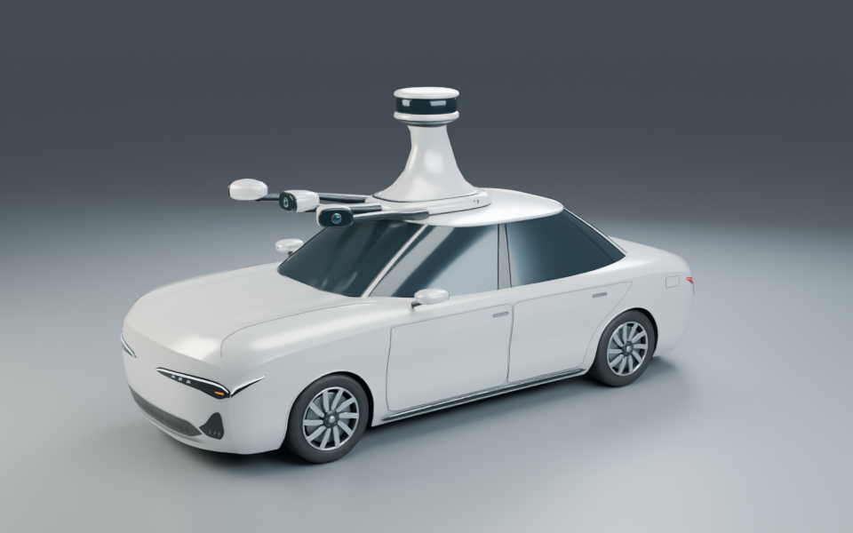

# Meridian research robotaxi



Meridian is an original four-door electric research sedan designed for this project. Its pearl body, flush glazing, directional wheels and front light guides surround the project's roof-mounted perception equipment. The bonnet encloses the forward radar. The smoked windows give the exterior model its finished appearance. The passenger cabin is unmodeled.

## Files

- **meridian.blend** is the editable Blender 5.2 source. Collections separate the coachwork, windows, closures, running gear, lighting, fittings and perception hardware. The wheel assemblies follow their corresponding suspension bones in Pose Mode. A separate studio collection holds the floor, lights and render camera.
- **meridian.glb** is a self-contained exterior asset for viewers and scene composition. It includes 280 mesh objects, 263,320 triangles, 21 materials and five named sensor-origin markers. The GLB contains no studio objects or external texture dependencies.
- **meridian-skeletal.fbx** is a triangulated skeletal interchange asset. One chassis mesh carries the body, glazing, lamps and perception hardware. Four independent wheel meshes each have rigid 1.0 weights to their own wheel bone. Material slots preserve the exterior finishes.
- **meridian-studio.png** is the 960 × 600 front three-quarter render from the Blender scene.
- **build_vehicle.py** regenerates those files. **verify_vehicle.py** reopens each model format and checks the dimensions, sensor markers, bone locations, vertex weights and wheel movement.

## Coordinate frame and dimensions

The Blender asset uses metres, with +X forward, +Y left and +Z up. Its origin matches the simulation vehicle actor. Convert CARLA coordinates to Blender with `(x, -y, z)`. Import the asset at unit scale. The visible body is approximately 4.89 m long and 1.93 m across the front fenders. The complete vehicle measures 2.22 m across its mirrors and 2.47 m from the tire contact plane to the top of the scanner. The tire contact plane is approximately 0.0624 m below the actor origin.

`Vehicle_Base` sits at the actor origin. The front hubs are at X = +1.472 m and the rear hubs at X = −1.389 m. Both axles have Z = +0.269 m, with left/right offsets of +0.796 m and −0.796 m. The FBX uses the CARLA wheel names `Wheel_Front_Left`, `Wheel_Front_Right`, `Wheel_Back_Left` and `Wheel_Back_Right`.

The editable asset and GLB preserve the origins of the forward, left and right cameras, roof LiDAR and fascia radar. Their positions and headings come from the [project mount definition](../../../crosswalk/robotaxi.py). The original sensor hardware comes from the [companion carrier model](../build_model.py).

## Simulator integration

The skeletal FBX is an Unreal Editor authoring input. Spawning this body as a CARLA vehicle requires a matching Unreal/CARLA authoring project, configured vehicle and wheel blueprints, physics and raycast geometry, lighting, registration and a cooked content package. These asset checks cover Blender and interchange-file behavior. An in-engine drive using the Meridian body has not been verified. The existing simulation workflow uses a stock vehicle blueprint with attached sensors. See [CARLA's vehicle authoring guide](https://carla-ue5.readthedocs.io/en/latest/content_authoring_vehicles/).

## Reproduce

Run from the repository root with Blender available on your path. The generator writes to this directory. The render option uses Cycles OptiX and requires a compatible NVIDIA GPU. Omit `-- --render` to rebuild only the vehicle assets.

```powershell
blender -b -t 2 --factory-startup --python-exit-code 2 --python assets/robotaxi/vehicle/build_vehicle.py -- --render
blender -b -t 2 --factory-startup --python-exit-code 2 --python assets/robotaxi/vehicle/verify_vehicle.py
```

## Credits

Original Meridian body, optics, running gear, sensor carrier and studio scene created for ADO. The design draws inspiration from research robotaxis. The geometry, materials and render use project-authored assets and carry no manufacturer marks. Distributed under the [repository MIT license](../../../LICENSE).
