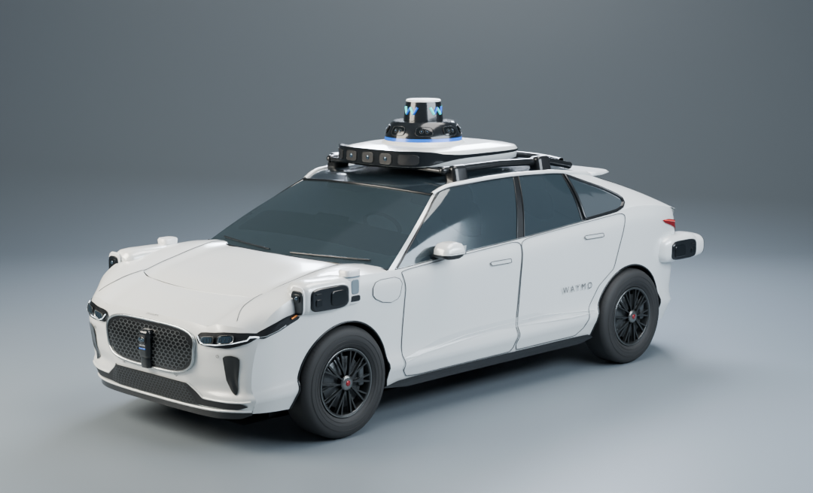

# Waymo fifth-generation Jaguar I-PACE

An independently modeled exterior of the electric Jaguar I-PACE with the fifth-generation Waymo Driver. The original geometry includes the pressed body, glasshouse, hatch spoiler, flush handles, mirrors, wheel arches, forked alloy spokes, brakes, lamps and roof carrier. Six named reference frames identify approximated sensor locations. The cabin has simple seat and instrument silhouettes.



## Files

- **waymo-ipace.blend** contains the individual editable parts, wheel skeleton, photographic lighting and camera.
- **waymo-ipace.glb** contains five rigidly skinned meshes, the wheel skeleton, six sensor anchors and self-contained materials. Use it for the complete model in a glTF viewer or DCC.
- **waymo-ipace.fbx** contains the chassis, four wheels and five-bone skeleton for Unreal/CARLA vehicle asset authoring.
- **studio.png** is the CPU Cycles render of the native model.
- [**front-rear.png**](front-rear.png) shows larger orthographic views of the headlights, grille, liftgate, front and rear instruments and valances.
- [**inspection.png**](inspection.png) shows the rendered left profile, front, rear, roof, rear three-quarter and roof-carrier detail. **inspection_views.py** renders and assembles that sheet.
- **build.py** regenerates the model and exchanges in Blender 5.2. It uses the repository's mesh, material, interpolation and studio helpers in [build_vehicle.py](../robotaxi/vehicle/build_vehicle.py). The body, closures, glass, wheels, lighting and sensor forms are defined here. **verify.py** reopens all three model files, checks bounds, skin weights and wheel centers and rotates every imported wheel independently.

## Scale and frame

The origin is on the ground midway between the axles. Native Blender coordinates use metres, +X forward, +Y to the vehicle's left, and +Z up. A CARLA vehicle-space point with the same origin uses (x, −y, z) in metres. A native Blender point (x, y, z) maps to (x, z, −y) in glTF's Y-up convention. Importers such as Blender apply that last conversion automatically.

Jaguar lists a body length of **4.682 m**, a **2.990 m** wheelbase, a width of **2.139 m** with mirrors extended, and a stock height with antenna of **1.566 m**. The model's tires have a rolling radius of **0.365 m**. The modeled sensor-equipped roof reaches **2.039 m**. The independently reimported vehicle measures **4.8050 × 2.1390 × 2.0390 m** including the central front grille and rear hatch instruments. The GLB contains 379,782 triangles across five meshes and 28 materials. Track and wheelbase follow Jaguar's technical data. Sensor and trim dimensions were estimated from public photos.

| Bone | Blender wheel centre in m, X / Y / Z |
| --- | --- |
| Vehicle_Base | 0 / 0 / 0 |
| Wheel_Front_Left | 1.495 / 0.8205 / 0.365 |
| Wheel_Front_Right | 1.495 / −0.8205 / 0.365 |
| Wheel_Back_Left | −1.495 / 0.8305 / 0.365 |
| Wheel_Back_Right | −1.495 / −0.8305 / 0.365 |

The body, sensor package and brake calipers follow Vehicle_Base. Each tire, rim, rotor and hub follows its wheel. Reading the wheel mesh after rigid skin deformation preserves the axle pivot even though the five runtime meshes share the vehicle origin.

| Native/GLB empty | Native X / Y / Z in m | Forward direction |
| --- | --- | --- |
| sensor_origin_roof_lidar | −0.176 / 0 / 1.958 | +X datum for 360° head |
| sensor_origin_roof_camera_front | 0.399 / 0 / 1.656 | +X |
| sensor_origin_perimeter_front_left | 1.688 / 1.006 / 0.952 | +Y |
| sensor_origin_perimeter_front_right | 1.688 / −1.006 / 0.952 | −Y |
| sensor_origin_perimeter_rear_left | −2.075 / 1.006 / 0.826 | +Y |
| sensor_origin_perimeter_rear_right | −2.075 / −1.006 / 0.826 | −Y |

## What the references constrain

| Feature | Evidence and fit |
| --- | --- |
| Body and axles | Jaguar publishes 4.682 m overall stock length, a 2.990 m wheelbase and 2.139 m width across mirrors. Wheel-centre tracks in this asset are 1.641 m front and 1.661 m rear. Reopening the three model formats checks their dimensions and wheel pivots. Jaguar’s 1.566 m height includes the stock roof antenna. |
| Side silhouette | The official 800-pixel-wide side image places the wheel centres approximately 330 pixels apart. Registering these against the published wheelbase gives about 9 mm per pixel near the vehicle centreline. Relative to the axle midpoint and tyre contact line, the front perimeter enclosure centre reads approximately X +1.69 m, Z 0.95 m, and the rear enclosure centre reads approximately X −2.08 m, Z 0.83 m. The side projection also informed the rounded rear quarter-light, rim-to-tyre proportion, charging flap and rear door lettering. |
| Roof package | The side image puts the drum centre near X −0.16 m. The side projection suggests approximately 2.00 m overall height, while a scale taken from the extended mirrors in the head-on photo suggests about 2.09 m. The modeled top is 2.039 m. Carrier length and wheel-arch placement were fitted from the side. The frontal image and dedicated roof photo establish carrier width, the black forward band, radial crown windows, blue collar and tapered upper drum. |
| Front, top and rear surfaces | Jaguar’s four-view drawing locates the transverse bonnet outlet, panoramic roof, spoiler bridge, hatch perimeter, wraparound rear lamps and lower plate recess. Waymo’s overhead lidar illustration and oblique design views locate the carrier relative to the glass roof. Waymo’s open-hatch rear image shows the bumper valance and outward-facing black perimeter windows. |
| Remaining uncertainty | Choosing a point two or three pixels differently in the side reference changes the projected coordinate by about 18–27 mm before perspective or lens effects. The fleet-equipped height example illustrates larger cross-view disagreement. Lateral depth, internal optical origins, sensor alignment, glass curvature, suspension travel, materials and wheel design are approximations. The images do not establish a calibrated one-to-one replica. |

The four body and glazing elevations in the inspection sheet use orthographic cameras. The detail and three-quarter panels also use orthographic projection so neighbouring parts can be compared without lens distortion. Each panel is framed independently.

## Use in CARLA

Import the FBX as a skeletal mesh in the Unreal Editor used for the target CARLA release. Check the 299 cm wheelbase and forward direction in the importer. Assign the four named wheel bones to the target vehicle's wheel/animation setup, set wheel radius to 36.5 cm, author the chassis collision and physics configuration, and register/cook the vehicle blueprint for that CARLA build. Import alone does not create a spawnable actor. The six empty frames are visual approximations for placing simulator sensors; this package does not supply sensor calibration or vehicle dynamics.

## References and licensing

- Waymo's [media resources](https://waymo.com/media-resources/) include the fifth-generation I-PACE in side, head-on and front-left views and a roof-sensor detail. Those views informed the long black carrier band, pearl fairing, camera crown, illuminated upper display, blue collar, four perimeter pods, dark split-spoke wheels and door lettering.
- Page 9 of Waymo's [March 2025 Jaguar I-PACE emergency response guide](https://storage.googleapis.com/waymo-uploads/files/first%20responder/Jaguar%20I-PACE%20California%20Emergency%20Response%20Guide%20and%20Law%20Enforcement%20Interaction%20Protocol%20March%202025.pdf#page=9) shows both ends of the equipped vehicle head-on. The model follows the two rectangular headlamp optics per side, flattened grille cells, upright front corner optics, dual-aperture rear bumper housings, white central hatch instrument, twin-window centre roof-rail camera and full-width lower rear trim. Lens depths and the precise positions inside each housing are visual estimates.
- Waymo describes the [fifth-generation Driver](https://waymo.com/blog/2020/03/introducing-5th-generation-waymo-driver/) and its [industrial design](https://waymo.com/blog/2020/03/designing-5th-generation-waymo-driver/), including the roof-mounted 360° lidar and four perimeter lidars.
- Waymo’s [overhead lidar illustration](https://lh3.googleusercontent.com/Kg6mPt8nNXpfh7VkcqksvPMMJhe2T-NH32JwCkhQ-JGH0OYIDBzbQY9T2DlH44Fan8ZdMjv25akaswrPrLrJzOVD4eXLixsU5bI=e365-s1000) and [open-hatch view](https://storage.googleapis.com/waymo-prod-cdn/uploads/f78f7b88f532a158af4209d3508610ee-Blog_Migrated_image1.gif) provide additional upper and rear angles.
- Jaguar's [I-PACE dimensions sheet](https://www.jaguar.com/content/dam/jdx/pdfs/uk/wltp/Jaguar-I-PACE-TD-Insert-1X5902400000GBEN01P.pdf) gives exterior size, track and wheelbase.
- The independently authored geometry, materials and build scripts are provided under the repository's [MIT license](../../LICENSE). The package contains original meshes and procedural materials. Waymo, Jaguar and I-PACE are trademarks of their respective owners. Manufacturer reference photography is linked and is not distributed with the asset. This is an unofficial visual reconstruction.

## Regeneration

The build requires Blender 5.2. Sheet compositing uses Python with Pillow. From the repository root:

```powershell
blender -b -t 2 --python-exit-code 1 --python assets/waymo-ipace/build.py -- --render
blender -b -t 2 --python-exit-code 1 --python assets/waymo-ipace/verify.py
blender -b -t 2 --python-exit-code 1 --python assets/waymo-ipace/inspection_views.py
python assets/waymo-ipace/inspection_views.py --compose
```

