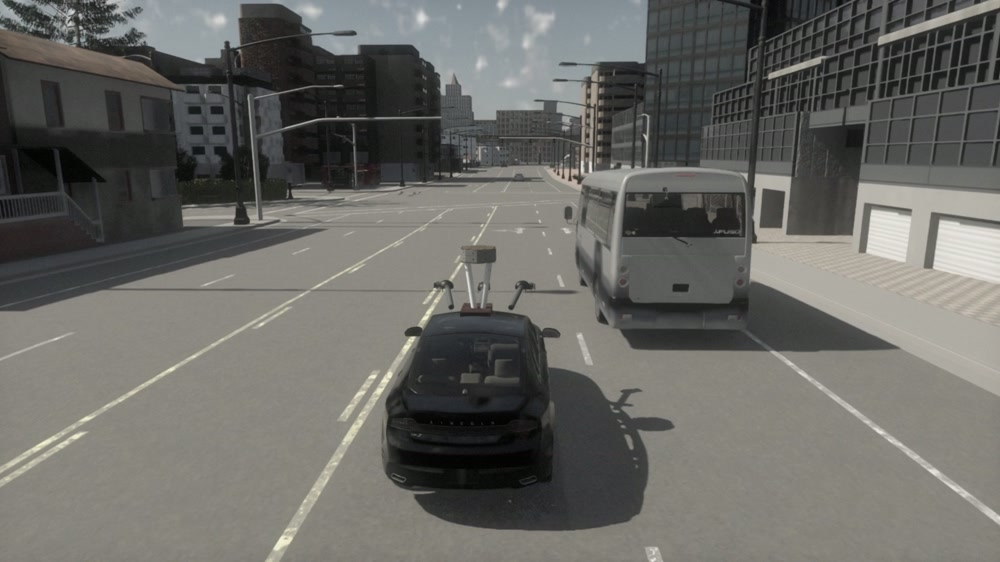

# City driving in ADO

The v0.6 Town03 launcher runs City Progress on the populated Market route. Start `Watch-City.cmd` to see its cameras and decisions live. To run the previous City Life controller on the same streets, use `Watch-City.cmd --model models/city-clearance/candidate.npz --population-profile city-life`. [Watch the v0.6 recording](https://yafi-s.github.io/ADO/?run=city-progress) · [Compare driving pace](../results/city-progress/README.md)

The earlier v0.5 Town03 live launcher ran the fitted clearance driver through City Life. Start `Watch-City.cmd` for the populated streets or `Watch-City.cmd --population-profile standard` for the earlier traffic layout. The hosted film includes the five onboard cameras and a separate spectator view. [Watch City Life](https://yafi-s.github.io/ADO/?run=city-life) · [Route, model and traffic evaluation](../results/city-life/README.md)

The Town03 Market route covers roughly 1.42 km and passes through 11 junctions. CARLA advances the car from its measured steering, throttle and brake inputs. Its cameras, roof lidar and forward radar observe the resulting world on the next simulation tick. A website recording can therefore be checked against what the sensors saw and what the driver commanded.

## Watch the v0.4 drive

The current High-rendering film follows seed 212 across 3,354 matched exposures, including a 0.5 s additional delay for crossing pedestrians. ADO passed all eleven encounters and eleven junctions with zero contacts or recorded red-light or yield violations. Two roadside barricades form the additional encounter on this version of the Market route. The car passed them with 1.047 m minimum side clearance. [Watch v0.4](https://yafi-s.github.io/ADO/?run=urban-pace) · [Inspect frame 3460](https://yafi-s.github.io/ADO/inspect.html?run=urban-pace&frame=3460&camera=front) · [Release review](../results/urban-pace/README.md) · [Speed and braking traces](../results/city-pace/README.md)

## Archived v0.2 drive

The original v0.2 seed-211 recording ran for **354.3 simulated seconds**. The car traveled 1,415.16 m along the 1,415.44 m Market route, passed eleven junctions and reached 18.66 km/h. CARLA recorded zero contacts, red-light violations or yield violations. The chase camera captured 1920×1080 at ten frames per simulated second with High rendering and DLSS at 67%. The forward policy camera stayed at 640×360. The mounted sensors move with CARLA's native Lincoln. The separate perception display renders ADO's Blender robotaxi at the recorded ego pose. [Watch the synchronized recording](https://yafi-s.github.io/ADO/?run=long-city-drive) · [Run and camera manifest](../web/media/long-city-drive/manifest.json)

[](https://yafi-s.github.io/ADO/?run=long-city-drive&at=210)

- **0:36** — A pedestrian emerges from behind a parked van. ADO stops before passing. [Watch the occluded crossing](https://yafi-s.github.io/ADO/?run=long-city-drive&at=33)
- **1:15** — A queue is stopped at a red light. ADO stops, then crosses on green. [Watch the queue](https://yafi-s.github.io/ADO/?run=long-city-drive&at=72)
- **1:36** — The car enters the six-cone work zone. The scorer measures 0.27 m minimum vehicle-body clearance. [Watch the taper](https://yafi-s.github.io/ADO/?run=long-city-drive&at=93)
- **3:28** — ADO crosses into the neighboring lane and clears the stopped bus with 0.928 m of lateral clearance. [Watch the bus pass](https://yafi-s.github.io/ADO/?run=long-city-drive&at=202)
- **4:12** — ADO yields to oncoming traffic before its left turn. [Watch the turn](https://yafi-s.github.io/ADO/?run=long-city-drive&at=249)
- **4:52** — A cyclist rides ahead before taking a side road. [Watch the cyclist](https://yafi-s.github.io/ADO/?run=long-city-drive&at=289)

## The city route

- A pedestrian crosses the street, a second crossing starts late, and a third pedestrian emerges from behind a parked van. The occlusion case records the blocked sightline and the moment the pedestrian becomes visible.
- A stopped vehicle departs, a moving lead brakes, and a queued car waits at an actual red signal. The scorer records the lead's deceleration, release of the queue and the signal state when the ego crosses the line.
- The navigation route requests a lane change around a stationary Mitsubishi Fuso bus. The car has to steer across a broken line into the adjacent same-direction lane. Its actual lane IDs, lateral displacement and clearance alongside the bus determine the score. The experiment supplies the route choice in advance. It tests the learned driver's execution of the pass.
- A cyclist rides ahead and turns away. A six-cone work zone narrows the available space. The run log measures physical exposure and passage for each.
- An unprotected left turn crosses the path of an oncoming vehicle. Junction headings, route progress and time on open road are also recorded.

For each encounter, the log distinguishes the planned location, actual exposure, clearance, passage and any violation. An event beyond a drive's stopping point earns no credit. CARLA actor positions and signal states are available to the scenario scorer. The evaluated driver receives measured sensor features, ego motion and navigation geometry. Scripted NPC movement determines what traffic the car encounters.

## Run it locally

Double-click **Watch-City.cmd** on Windows to install or verify CARLA 1.0 and open the local perception display. After setup, the equivalent command from the project root is below.

```powershell
.\.venv-city\Scripts\python.exe -m ado city-drive --serve --open-browser --seed 212 --crossing-delay 0.5
```

Each attempt writes its own summary and compressed frame log under `out/city-drives`. The lower-cost live profile is the default. To record the current five onboard views and a 1080p chase camera at High quality, run the film command with a fresh output path. This captures one ego car over one continuous simulation.

```powershell
.\.venv-city\Scripts\python.exe -m ado city-film --model models/city-pace/candidate.npz --map Town03_Opt --destination market --seed 212 --crossing-delay 0.5 --output out/my-city-film
```

## Training and evaluation

The original v0.2 city policy retains the Town01 steering and pedal feedback and learns speed from range measurements, measured traffic-light color and map geometry. Its Colab fit includes two Town03 teaching episodes using this course. The public recording is a development demonstration with staged traffic. [City model](../models/city-v1/README.md) · [Native fixture checks and recorded failures](../results/city-development/README.md)

The Town01-trained controller uses 17,236 examples from 80 CARLA driving demonstrations. The public Colab recipe reproduces the saved model and training report byte-for-byte. Town03 is a separate city integration test. The model also has a controlled Town01 comparison using ten encounter types. The real Waymo research track has its own Colab training, validation and simulator transfer results. [CARLA training and Colab notebook](../data/behavior-v2/README.md) · [Matched comparison protocol](behavior-v2-protocol.md) · [Real Waymo model and transfer trial](../waymo_training/MOTION_TRANSFER.md)

CARLA supplies the roads, traffic actors, signals and vehicle physics. The experiment separates training streets, closed-loop evaluation and attributed failure modes following the concerns examined in the NoCrash study. The Waymo Open Motion Dataset supplies logged multi-agent trajectories for the separate forecasting experiment. [Dosovitskiy et al., CARLA](https://proceedings.mlr.press/v78/dosovitskiy17a.html) · [Codevilla et al., Exploring the Limitations of Behavior Cloning for Autonomous Driving](https://openaccess.thecvf.com/content_ICCV_2019/html/Codevilla_Exploring_the_Limitations_of_Behavior_Cloning_for_Autonomous_Driving_ICCV_2019_paper.html) · [Ettinger et al., Large Scale Interactive Motion Forecasting for Autonomous Driving](https://arxiv.org/abs/2104.10133) · [Software, sensor and asset credits](research.md)
