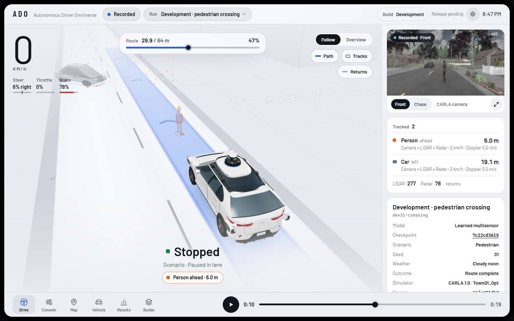

# ADO perception display

The home screen follows the simulated vehicle from above and behind. The independently modeled I-PACE shows the vehicle's measured position and heading. The route ribbon comes from mapped lane geometry. Speed, steering, throttle, braking and elapsed time come from the current simulation frame. A native CARLA camera view and the run log let a viewer inspect the same moment from another perspective.

The object visualization uses measurements. Earlier recordings use the front camera. Surround recordings use five registered RGB cameras, full-sweep lidar and forward and corner radar. Each camera detection supplies a class and image box. The tracker projects lidar returns into that box, rejects the road surface and looks for coherent depth support. A nearby radar detection can supply radial velocity. Observations are associated across frames in world coordinates so ego motion does not create a false trail on a stationary object. The display estimates unobserved portions of object boxes and heading. An image detection without usable depth remains an image detection.

Claude Fable 5.2 authored the primary display layout, styling and interaction code. Its visual direction links speed to ground-plane trail length and planned travel to a fading route ribbon. Opacity, which first followed detector confidence, now separates an object measured in the current frames from one the display is remembering. A separate map observer can show scenario ground truth. Tesla’s published driving visualization and Waymo’s descriptions of perception informed the choice to make spatial context visible, and the look of those in-car displays informed the screen framing. ADO uses its own layout, icons and typeface. [Tesla driving visualization](https://www.tesla.com/ownersmanual/model3/en_us/GUID-2CB60804-9CEA-4F4B-8B04-09B991368DC5.html) · [Waymo perception](https://waymo.com/blog/2021/10/the-waymo-driver-handbook-perception/)

Every page is framed as one in-car screen. A status bar shows what the screen is playing and the local time. An app dock moves between Drive, Console, Map, Vehicle, Results and Builds, and on the Drive page it also holds playback where a car would put its media player. Speed and control inputs sit at the top left. Driving activity and route progress sit below the scene so the road ahead stays visible. The display has a night mode and a day mode, switched from the status bar or with the D key and remembered in the browser. Night uses a dark navy scene with a teal path. Day uses a light scene with clay-grey road users and a blue path. Both modes draw the same measurements. Apart from the local clock, the screen shows only values the simulation recorded. Claude Mythos 5.2 authored this framing and the two palettes.

Cars, trucks, buses, riders and pedestrians are drawn as symbols for their class from `web/road-users.js`. They are not models of the simulator's actors. The tracker sees one or two faces of an object at a time, so its heading, length, width and height are estimates. It starts a track parallel to the vehicle's own heading, or across it for a broadside view, changes that heading only after sustained straight travel, and lets the dimensions settle per track. Drives recorded before that rule still carry the earlier estimates, in which a stopped car could swing sideways as the vehicle approached and a length could change by a metre between frames. The display therefore does not draw the reported heading directly. A vehicle on or beside a mapped lane is drawn along that lane, its own sustained travel decides which way it faces and overrides the lane when it is crossing or turning, and a pedestrian faces the way they have been walking. A stopped object's reported position also wanders by a few tenths of a metre as the view of it changes, and a coast can carry it along a velocity that wander suggested. The display treats an object as travelling only once its measured positions show net, straight movement spread over several measurements, and asks for more of it from an object that has stood still for a while; until then it holds the object where it is and lets it drift slowly toward where it is measured. A travelling object is followed with a short alpha-beta filter, and sizes ease toward each new estimate. Symbols stay within sizes their class can have, and the outline on the ground keeps the estimate itself. The distances and speeds in the Tracked list are the tracker's values, unfiltered. The vehicle's rear lamps brighten with the recorded brake input. The follow camera looks straight down the road from behind and above the vehicle, and turns with it after a short lag.

The tracker's list is not drawn as reported. In the v0.2 recordings its detector runs on the front camera every other frame, a track ends half a second after its last measurement, and a re-detected object returns under a new number, sometimes as another class: in one recording a parked van appears as 18 separate tracks named car, bicycle and bus. Drawn directly, objects flicker at the detector's rate, vanish beside the vehicle and reappear. `web/object-memory.mjs` keeps one drawn object per physical object instead, using only what the recording holds:

- **Confirm.** An object is drawn once it has been measured twice, three times if the detector's score stayed near its threshold, or once at close range with a high score. A near pedestrian can also appear on its first observation when the camera classification has both lidar depth and radar support.
- **Stitch.** A measurement beside a remembered object of the same family (pedestrian, or anything on wheels) continues that object, whatever number or class the tracker gave it. The class that has gathered the most confidence names it, and a box of another class does not move or resize it.
- **Hold.** A stopped object stays where it was last measured, drawn fainter as remembered. In clear view of the camera it lasts two seconds without a detection box of its family over it, or up to ten while lidar returns keep landing on its footprint. A vehicle close by with neither a box nor returns goes after one second, and so does any object the camera can see past: a much smaller box of its family where it would stand is something farther off. Beside the vehicle, outside the camera's view, a vehicle lasts until those returns stop and a pedestrian for three seconds. The legacy front-only view drops objects well behind the vehicle. Surround tracks can continue behind the vehicle while sensors measure them. Returns from the vehicle's own body count for nothing.
- **Carry.** A travelling object continues along its course for a second after its last measurement, longer while lidar returns keep pace with it, then fades. If returns show it stopped short, it settles there.
- **Leave out.** On legacy recordings, a vehicle-class detection more than 4.5 m from every mapped driving-lane centre is not drawn. In the recordings these were planters, a kiosk, a shed and street furniture. A vehicle parked that far off the road is left out with them.

Objects fade in and out over a few tenths of a second. The Tracked list beside the scene is still the tracker's own list, so it can name an object the scene leaves out and miss one the scene is holding. Replay reconstructs the same track history on a cold seek and during continuous playback, using checkpoints every 100 frames. Ego and road-user poses interpolate between adjacent observations on the footage clock. Range points stay at their acquisition pose. It has no access to the simulator's actors. The city drive's recording also lists every physical actor near the vehicle, which scores the result: an earlier v0.2 audit found that the tracker's list had an object appear 112 times in that drive and the scene 18 times, and 84% of what the scene draws stands within 3 m of a real actor against 66% of the tracker's list (96% of objects measured in the current frames, 63% of remembered ones). The remembered misses are mostly a van or bus whose centre the tracker placed several metres off, and a car that pulled away while the detector missed it, which stays drawn for about two seconds.

Traffic signals, lane directions and lane paint come from each town's OpenDRIVE road description, read without a simulator by `crosswalk/map_features.py` into `web/media/map-features/<town>.json`. The files reproduce the exported lane centres of Town01 and Town03 to within a centimetre. They give each signal's post, the direction of the traffic it governs and how far its head reaches over the governed lanes; which way each lane is driven, so a vehicle first seen in a lane faces the right way; how each lane edge is painted, such as Town01's broken yellow centre line and unpainted kerbs; and the outline of each marked crosswalk. Town03 lists 73, drawn as the two lines across the road that its cameras show, and Town01 lists none. A town without a features file falls back to a schematic with a dashed divider between neighbouring lanes. Signals are symbols, drawn half again as large as life.

Surround recordings put each surveyed luminous head at its own world-space XYZ position. Several heads can share an OpenDRIVE pole ID. An explicit camera estimate colors the head red, yellow or green. A head without a resolved color stays unlit. Drive, Map and the Console plot use the same readings. Older recordings can identify an explicit pole state in `observer_map.signals`; an event name or route scenario alone supplies no lamp state.

The rider display and console offer the cameras included with each recorded or live drive. On a multi-view recording the rider camera picker switches views at the same video time. The Console overlay shows detections from the selected RGB camera and labels bearing-only boxes when the detector lacks depth support. A moving lidar cluster without a camera class appears as a neutral obstacle, and later classification keeps the display identity. Three-dimensional range returns use their measured elevations when available.

On a surround recording, select a numbered track in the sidebar to inspect its native camera, image box and 3D identity at the same instant. A camera-only detection appears immediately with its label and contributing view. Its image box can stay for one skipped inference with the age shown. A bicycle and person detected together receive one rider symbol only after their camera boxes move together over several observations. The displayed distance comes from the person's lidar track.

Recordings with a per-frame planner preview show its selected near-term path in Follow. Overview keeps the destination route visible beyond it. A link can open a run, time, camera and scene view together, for example `?run=surround-city&at=270.8&camera=front&view=follow`.

The surround rider display checks vehicle motion against recorded radar rays after compensating for ego motion. It registers overlapping lidar surfaces across camera handoffs and uses surveyed road elevation under grounded objects. Once a stationary vehicle has been observed from both ends, its accumulated surface returns can refine its center and dimensions. The [continuous-frame comparison](../results/perception/rider-motion/README.md) includes the original camera frames, display comparisons and acquisition-time checks.

The public site reads recorded evidence. A local session reads the live simulator. The camera inset, graph and controls share the original recorded frame numbers and simulation times. The Builds & Logs page identifies the source revision and checkpoint and exposes the control trace behind each published drive. The driving benchmark, development recordings and higher-quality showcase runs have separate labels.
