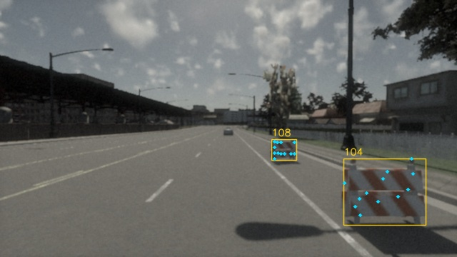

# Native striped barricades in Town03

On two held-out approaches, the front RGB camera and roof lidar classified the physical construction barricade at every tested distance from 5 to 20 m. Six distances at each of two sites yielded 12 matched observations. Median horizontal center error was 0.111 m and the largest was 0.344 m. The same 48 held-out captures of an empty street, cone, parked Mini Cooper and empty planter yielded zero barrier tracks. Each of the four controls was presented at the same six poses as the barricade at both sites.


Two manually outlined striped panels from close native training exposures supply the fitted appearance template. Inference searches for that pattern at several image scales. The shape and height of a compatible surface in the synchronized roof lidar must support the classification. The surround tracker then demands an independently ranged object with unambiguous laser hits. Each scored camera exposure competes with the ordinary YOLOX road-user boxes for the same laser returns. Actor blueprint, ID, target position and scenario station are available only to the setup and grader. Every rating in this study starts with a fresh tracker.

The two fit locations produced ten matches in twelve positive captures. At 10 m on the second training street the median laser hit fell below the acceptance height. At 20 m the candidate had only two hits on the barricade. The 48 fit controls produced zero barrier tracks. A separate five-camera Town03 exposure at a previously documented hedge misclassification yielded zero new barricade candidates in all five views. [Native hedge exposure and independent vegetation reference](../surround-rig/README.md)

The collection uses one CARLA 1.0 striped street-barrier model, the same simulator and one lighting setting. The two held-out locations use different background blocks and prop angles. This evidence covers this striped model on these approaches. Unpainted concrete barriers, night, occlusion and other simulators require separate examples. The result counts correlated camera poses from two held-out sites. It supplies no fleet-level error rate.

In two additional closed-loop work-zone drives, the city model finished both approaches. With the barricade across the lane, it stopped for 9.9 s, 3.19 m behind the board, before the crew moved the board and passed with 1.32 m lateral clearance. With the board initially at the curb, it passed without an approach stop and left 1.32 m clearance. The tracker was within 1 m of the barricade on 180 and 58 frames respectively. These counts include range-supported track updates between camera exposures. The route controller uses its obstacle stopping envelope. The scored behavior does not identify a causal contribution from the new semantic class. [Blocked-lane trial](../workzone-stop/closed-then-open.json) / [Curbside trial](../workzone-stop/curbside.json)

On the complete 3,351-frame seed-211 city journey, the car passed the two striped boards in its original driving lane. The independent footprint grader measured a minimum lateral clearance of 1.046 m and zero barricade displacement. This Low-quality run scored the physical passage. [Native journey score](../city-pace/seed-211/summary.json)

At 124.8 s in the High-quality seed-212 recording, both physical roadwork boards are visible in the same front-camera exposure. The recorder captured 46 lidar hits on the nearer track and 12 on the farther one. Their centers were 0.134 m and 0.150 m from the two independent actor references. The annotated image shows the actual camera boxes and a bounded sample of the recorded laser points. [Original camera exposure](hero-two-boards-front.jpg) / [Exact synchronized journal row](hero-two-boards-frame.json.gz)



## Post-and-chain barriers

CARLA's native chain section has a metal bollard and a sagging chain with a free end. A second native terminal bollard completes the assembly. We tested that assembly alongside two identically spaced, unlinked bollards, one bollard, and the open-ended section. The production detector requires two independently ranged vertical supports, an RGB curve spanning between them, and a real roof-lidar return at a compatible height on the suspended span. It emits the subtype, a pattern score, the separate support counts and a measured heading. The display draws two posts and a chain only for this subtype. The numerical score measures local image contrast and coverage.


The detector was frozen after commissioning on four Town03 sites. The independent test then used two new roads with different approach angles, three distances and three successive synchronized sweeps per pose. For each camera exposure the production road-user detector, barrier classifiers and tracker start fresh. These are repeated measurements of two physically placed assemblies.

**Nine of 18 connected-chain exposures were classified**, including five of six at 5 m, three of six at 7 m, and one of six at 10 m. At least one correct fresh classification occurred on four of six site-and-distance pairs across both sites. Every missed exposure had fewer than two reference returns on one post or lacked a reference return through the middle span. The nine measured centers were 0.003 to 0.077 m from the corresponding target centers. The two new sites also produced 18 of 18 correctly identified striped boards. The seven control conditions each had 18 exposures. Across 126 total there were zero false barrier classifications, including zero on unlinked posts, warning signs and cones. The remaining controls were one post, the free-ended chain section, a barrel and an empty street.

The original camera-curve and laser detector was also replayed on 162 new High-quality camera exposures at the same two roads, angles and distances. All 162 synchronized lidar packets were byte-identical to their Low-quality counterparts, while all 162 camera images differed. The same nine chain sweeps and all 18 striped-board sweeps were recognized, with zero false calls on the 126 controls. This compares rendering on the same geometry and laser samples. [High-quality per-frame scores](chain-high.json) / [High-quality sensor packets](../../data/barrier-recognition/town03-chain-high.zip)

Across the earlier four-site development collection, chain recognition was six of 24 at distances from 5 to 20 m. The board subtype was 24 of 24. The chain detector limits recognition to the near field. Its lidar and RGB requirements leave a substantial number of real chains unclassified. [Independent test and per-frame measurements](chain-validation.json) / [Independent sensor packets](../../data/barrier-recognition/town03-chain-validation.zip) / [Development measurements](chain-development.json) / [Development sensor packets](../../data/barrier-recognition/town03-chains.zip)

## Confirming the shape of the posts

The continuous High-quality drive exposed a failure absent from the controlled fixtures. Two trash bins and a pair of trash bags could supply two short vertical laser surfaces, while a background edge resembled a chain. A separate camera check now compares the sides, top and foot of each laser-localized post with the visible profiles of four genuine development bollards. Both posts must clear the fixed normalized gradient-similarity threshold of 0.34. The comparison uses only measured endpoints, camera registration and RGB pixels. The independent map registry identifies confounders during scoring. The numeric similarity is a matching score, not a calibrated probability.

The post profiles were fit from the two original 5 m development images. The same four profiles and threshold retained six of six previously recognized development chains and all nine previously recognized chains in both the Low- and High-quality two-road tests. A rider-facing chain additionally needs a second appearance-qualified measurement of the same two post sites within 0.45 s and 0.32 m, or a single sweep with at least three exclusive returns on each post and two on the suspended span. A second camera receiving the same laser sweep does not count twice. This rule retains six of 18 fresh observations at each quality. The original nine detections and their post scores remain available to audit. Two of 24 isolated development exposures qualified for immediate presentation. [Post fit and fixture replay](post-appearance-fit.json) / [Profile model](../../models/barrier-post-appearance.npz)

A striped paint pattern can also overlap a pole in the camera. In the High drive at 189.9 s, the raw detector gave a streetlight a board label. All 11 supporting laser returns fit within 0.213 m horizontally. To present a striped board, the exclusive measured surface must span at least 0.30 m horizontally, approximately one quarter of the native board length. The check retained all 82 earlier ranged board detections across four fixture archives. Their smallest measured span was 0.552 m. [Streetlight proposal](hero-pole-board-proposal.jpg) / [Two-bin chain proposal](hero-bins-chain-proposal.jpg)

## Full High-quality city drive

The seed-212 car completed all 11 encounters without a collision. It passed both deliberately placed boards in its lane with 1.047 m minimum lateral clearance and zero board displacement. Against the two independent actor poses, the first board had 25 fresh RGB-and-lidar matches and the second had 24. Each was seen from the front on approach and the rear-right camera after passing. Median center errors were 0.086 m and 0.107 m. Each board acquired a second tracker identity during this handoff. [Physical and perception results](hero-journey.json)

Over all 3,354 frames, the raw observer produced 28 camera proposals for connected chains, including 20 fresh spatial measurements. Two camera proposals passed the post-appearance score. One lacked exclusive range support and the other was an isolated view of a bus shelter. Zero chain symbols passed the final rule. The cooked Town03 registry has 32 named striped-board objects and no named chain object. A close match to a named asset and inspection of the original camera image are independent scoring evidence. [Native map registry extract](town03-barrier-scoring-registry.json.gz)

The raw observer also produced 180 striped-board camera proposals and 158 fresh spatial board measurements. The frozen breadth test retained 155 spatial measurements. Of those, 49 matched the staged boards and 104 matched ten distinct named map boards within 0.65 m. The two remaining images show striped boards, but their estimated centers were 0.744 m and 7.783 m from the nearest named board. The larger error was a distant group of boards beneath the overhead structure. The test rejected the streetlight false positive, one board measured 1.584 m from its reference, and one correctly located board whose sampled surface spanned only 0.280 m. These counts cover fresh measurements. The display can carry a previously supported object during a short camera gap.

The raw recording preserves all provisional boxes and tracks. Each displayed chain or board decision can be recomputed from the candidate geometry and native camera inputs in the witness archive. The condensed trip extract retains the original barrier observations, vehicle pose and independent barrier actors from every scored frame. [Per-frame display decisions](../../web/media/urban-pace/barrier-review.json) / [Native candidate JPEGs and measured geometry](../../data/barrier-recognition/hero-post-proposals.zip) / [Full-journey scoring inputs](../../data/barrier-recognition/hero-barrier-audit-rows.zip)

```powershell
.venv-city/Scripts/python -m crosswalk.barrier_review --witness data/barrier-recognition/hero-post-proposals.zip --output .local/hero-barrier-review.json
.venv-city/Scripts/python -m crosswalk.barrier_trip_evidence data/barrier-recognition/hero-barrier-audit-rows.zip .local/hero-barrier-review.json --output .local/hero-barrier-score.json
```

## Reproduction

From the repository root, run the following with the project's city Python environment.

```powershell
.venv-city/Scripts/python -m crosswalk.barrier_study --fit --output .local/barrier-reproduced.json
.venv-city/Scripts/python -m unittest discover -s tests -p test_barrier.py
```

The independent chain test and the later post qualification can be replayed from its archived camera exposures and laser scans.

```powershell
.venv-city/Scripts/python -m crosswalk.barrier_chain_study data/barrier-recognition/town03-chain-validation.zip --output .local/chain-reproduced.json
.venv-city/Scripts/python -m crosswalk.barrier_post_study --fit
```

The striped-panel fit uses only the two training image rectangles published in the validation file. The evaluator reruns the production road-user model, striped-panel detector and range tracker on 120 archived front-camera/laser captures. A detection scores once when its measured center falls within 0.65 m of the separately recorded target. Additional tracks count against precision. The source archive stores native camera exposures as quality-96 JPEGs and front-facing laser returns in half precision. The simulator runtime consumes the original RGB arrays and full precision full sweep. [Validation and per-exposure outputs](validation.json) / [Source capture archive](../../data/barrier-recognition/town03-native.zip) / [Fitted template](../../models/barrier-appearance.json) / [Fit and scoring source](../../crosswalk/barrier_study.py)

To collect a new set, reserve an idle CARLA 1.0 Town03_Opt server configured for synchronous 0.1 s ticks. The collector creates its own calibrated front camera and roof lidar, moves both across the fixed approach poses, and removes the temporary sensors and props at the end.

```powershell
.venv-city/Scripts/python -m crosswalk.barrier_collect --port 2968 --output .local/barrier-recapture --archive .local/barrier-recapture.zip
.venv-city/Scripts/python -m crosswalk.barrier_study --archive .local/barrier-recapture.zip --output .local/barrier-recapture.json
```

To repeat the independent two-road chain capture on that server, use a new directory and archive name. The three samples at each distance are successive synchronized sweeps.

```powershell
.venv-city/Scripts/python -m crosswalk.barrier_collect --port 2968 --chain-validation --output .local/chain-new-roads --archive .local/chain-new-roads.zip
.venv-city/Scripts/python -m crosswalk.barrier_chain_study .local/chain-new-roads.zip --output .local/chain-new-roads-score.json
```

## Simulator assets

The source images and range returns were rendered locally using CARLA 1.0 Town03_Opt and its native streetbarrier, chainbarrier, chainbarrierend, warningconstruction, barrel, trafficcone01, plantpot07 and Mini Cooper assets. The fitted template derives from those simulator images. The production tracking comparison also uses the repository's bundled OpenCV Zoo YOLOX-S model. See the simulator distribution and [the bundled detector notices](../../vendor/yolox).
