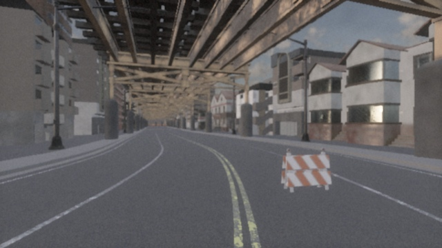
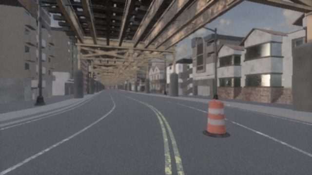
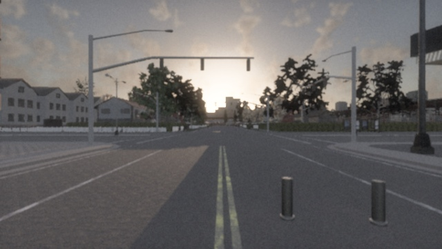

# Native striped barricades in Town03

On two held-out approaches, the front RGB camera and roof lidar classified the physical construction barricade at every tested distance from 5 to 20 m. Six distances at each of two sites yielded 12 matched observations. Median horizontal center error was 0.111 m and the largest was 0.344 m. The same 48 held-out captures of an empty street, cone, parked Mini Cooper and empty planter yielded zero barrier tracks. Each of the four controls was presented at the same six poses as the barricade at both sites.





Two manually outlined striped panels from close native training exposures supply the fitted appearance template. Inference searches for that pattern at several image scales. The shape and height of a compatible surface in the synchronized roof lidar must support the classification. The surround tracker then demands an independently ranged object with unambiguous laser hits. Each scored camera exposure competes with the ordinary YOLOX road-user boxes for the same laser returns. Actor blueprint, ID, target position and scenario station are available only to the setup and grader. Every rating in this study starts with a fresh tracker.

The two fit locations produced ten matches in twelve positive captures. At 10 m on the second training street the median laser hit fell below the acceptance height. At 20 m the candidate had only two hits on the barricade. The 48 fit controls produced zero barrier tracks. A separate five-camera Town03 exposure at a previously documented hedge misclassification yielded zero new barricade candidates in all five views. [Native hedge exposure and independent vegetation reference](../surround-rig/README.md)

The collection uses one CARLA 1.0 striped street-barrier model, the same simulator and one lighting setting. The two held-out locations use different background blocks and prop angles. This evidence covers this striped model on these approaches. Unpainted concrete barriers, night, occlusion and other simulators require separate examples. The result counts correlated camera poses from two held-out sites. It supplies no fleet-level error rate.

In two additional closed-loop work-zone drives, the city model finished both approaches. With the barricade across the lane, it stopped for 9.9 s, 3.19 m behind the board, before the crew moved the board and passed with 1.32 m lateral clearance. With the board initially at the curb, it passed without an approach stop and left 1.32 m clearance. The tracker was within 1 m of the barricade on 180 and 58 frames respectively. These counts include range-supported track updates between camera exposures. The route controller uses its obstacle stopping envelope. The scored behavior does not identify a causal contribution from the new semantic class. [Blocked-lane trial](../workzone-stop/closed-then-open.json) · [Curbside trial](../workzone-stop/curbside.json)

On the complete 3,351-frame seed-211 city journey, the car passed the two striped boards in its original driving lane. The independent footprint grader measured a minimum lateral clearance of 1.046 m and zero barricade displacement. This Low-quality run scored the physical passage. [Native journey score](../city-pace/seed-211/summary.json)

## Post-and-chain barriers

CARLA’s native chain section has a metal bollard and a sagging chain with a free end. A second native terminal bollard completes the assembly. We tested that assembly alongside two identically spaced, unlinked bollards, one bollard, and the open-ended section. The production detector requires two independently ranged vertical supports, an RGB curve spanning between them, and a real roof-lidar return at a compatible height on the suspended span. It emits the subtype, a pattern score, the separate support counts and a measured heading. The display draws two posts and a chain only for this subtype. The numerical score measures local image contrast and coverage.




The detector was frozen after commissioning on four Town03 sites. The independent test then used two new roads with different approach angles, three distances and three successive synchronized sweeps per pose. For each camera exposure the production road-user detector, barrier classifiers and tracker start fresh. These are repeated measurements of two physically placed assemblies.

**Nine of 18 connected-chain exposures were classified**, including five of six at 5 m, three of six at 7 m, and one of six at 10 m. At least one correct fresh classification occurred on four of six site-and-distance pairs across both sites. Every missed exposure had fewer than two reference returns on one post or lacked a reference return through the middle span. The nine measured centers were 0.003–0.077 m from the corresponding target centers. The two new sites also produced 18 of 18 correctly identified striped boards. The seven control conditions each had 18 exposures. Across 126 total there were zero false barrier classifications, including zero on unlinked posts, warning signs and cones. The remaining controls were one post, the free-ended chain section, a barrel and an empty street.

Across the earlier four-site development collection, chain recognition was six of 24 at distances from 5 to 20 m; the board subtype was 24 of 24. The chain detector limits recognition to the near field. Its lidar and RGB requirements leave a substantial number of real chains unclassified. [Independent test and per-frame measurements](chain-validation.json) · [Independent sensor packets](../../data/barrier-recognition/town03-chain-validation.zip) · [Development measurements](chain-development.json) · [Development sensor packets](../../data/barrier-recognition/town03-chains.zip)

## Reproduction

From the repository root, run the following with the project’s city Python environment:

```powershell
.venv-city/Scripts/python -m crosswalk.barrier_study --fit --output .local/barrier-reproduced.json
.venv-city/Scripts/python -m unittest discover -s tests -p test_barrier.py
```

The independent chain test can also be replayed from its archived camera exposures and laser scans.

```powershell
.venv-city/Scripts/python -m crosswalk.barrier_chain_study data/barrier-recognition/town03-chain-validation.zip --output .local/chain-reproduced.json
```

The striped-panel fit uses only the two training image rectangles published in the validation file. The evaluator reruns the production road-user model, striped-panel detector and range tracker on 120 archived front-camera/laser captures. A detection scores once when its measured center falls within 0.65 m of the separately recorded target. Additional tracks count against precision. The source archive stores native camera exposures as quality-96 JPEGs and front-facing laser returns in half precision. The simulator runtime consumes the original RGB arrays and full precision full sweep. [Validation and per-exposure outputs](validation.json) · [Source capture archive](../../data/barrier-recognition/town03-native.zip) · [Fitted template](../../models/barrier-appearance.json) · [Fit and scoring source](../../crosswalk/barrier_study.py)

To collect a new set, reserve an idle CARLA 1.0 Town03_Opt server configured for synchronous 0.1 s ticks. The collector creates its own calibrated front camera and roof lidar, moves both across the fixed approach poses, and removes the temporary sensors and props at the end.

```powershell
.venv-city/Scripts/python -m crosswalk.barrier_collect --port 2968 --output .local/barrier-recapture --archive .local/barrier-recapture.zip
.venv-city/Scripts/python -m crosswalk.barrier_study --archive .local/barrier-recapture.zip --output .local/barrier-recapture.json
```

To repeat the independent two-road chain capture on that server, use a new directory and archive name. The three samples at each distance are successive synchronized sweeps.

```powershell
.venv-city/Scripts/python -m crosswalk.barrier_collect --port 2968 --chain-validation --output .local/chain-new-roads --archive .local/chain-new-roads.zip
.venv-city/Scripts/python -m crosswalk.barrier_chain_study .local/chain-new-roads.zip --output .local/chain-new-roads-score.json
```

## Simulator assets

The source images and range returns were rendered locally using CARLA 1.0 Town03_Opt and its native streetbarrier, chainbarrier, chainbarrierend, warningconstruction, barrel, trafficcone01, plantpot07 and Mini Cooper assets. The fitted template derives from those simulator images. The production tracking comparison also uses the repository's bundled OpenCV Zoo YOLOX-S model. See the simulator distribution and [the bundled detector notices](../../vendor/yolox).
