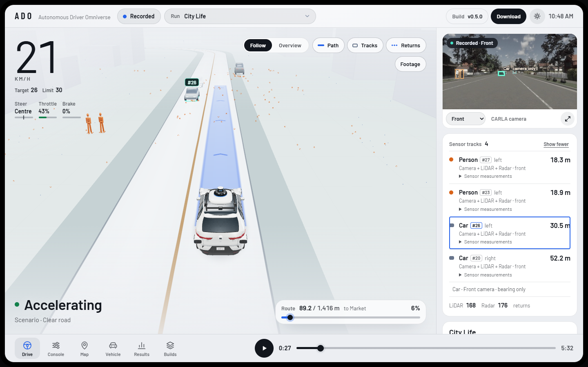

# City Life driving and perception review

**ADO drove 1.42 km through Town03 in 5 minutes 32 seconds alongside 22 background cars and 30 walkers.** It handled all 11 staged encounters and crossed all 11 junctions. CARLA recorded zero ego collisions, red-light violations and missed yields. The 3,320 native exposures share a 10 Hz clock with the five onboard camera movies and independent chase camera. [Watch City Life](https://yafi-s.github.io/ADO/?run=city-life) · [Open the measured pace and traffic timeline](https://yafi-s.github.io/ADO/benchmarks.html#traffic-study) · [Get the 1080p original, Windows build and optional sensor data](https://github.com/yafi-s/ADO/releases/tag/v0.5.0)

## How busy the street actually was

Moving cars and pedestrians were simultaneously within 50 m for **165.4 of 331.5 scored seconds (49.9%)**. The old recording measured 11.3 of 334.9 seconds (3.4%) under the same definition. For 40 seconds the new drive had at least two moving vehicles and two moving pedestrians nearby. The earlier drive never reached that combination. All 22 background vehicles and all 30 walkers physically moved during the run. Eighteen background cars drove within 16 m, and 29 walkers moved at least a metre while within 35 m. The independent audit measures body movement across six consecutive exposures. [Population results](POPULATION.md) · [Measurement protocol](PROTOCOL.md)

What the car could **actually see** is a separate question. There were 41 native exposures on which a vehicle and pedestrian both had a fresh front-camera box, measured range, and a correctly located current 3D drawing. The earlier film had zero under those strict criteria. At 27.8 s the screen draws two walkers at roughly 18–19 m, an approaching car at 30.5 m and a parked van at 52.9 m. At 170.8 s it draws two moving cars and a walking pedestrian. The road-user IDs and position residuals for each exposure are available in the audit. [Four objects together](https://yafi-s.github.io/ADO/?run=city-life&frame=342&camera=front&track=26) · [Three moving road users](https://yafi-s.github.io/ADO/?run=city-life&frame=1772&camera=front) · [Physical and screen audit](interactions/README.md)

## Why the drums disappeared and the car crawled

The previous perception pipeline had a striped-board class and generic road-user classes. The roadworks props are orange channelizer drums. The cameras had recorded their bands and the laser had sampled their surfaces, but the rider display had no matching class. Reprocessing all five onboard camera streams from the original drive recovered 420 fresh range-supported observations. All 420 matched one of the six drums within 0.65 m. There were 765 other drum-frames within 20 m without a fresh measurement. An independent set of camera exposures yielded 11/12 positive identifications and no false call on 48 negative controls. [Inspect the front camera and the cone drawings at the taper](https://yafi-s.github.io/ADO/inspect.html?run=urban-pace&frame=3195&camera=front) · [Matched positions and missed exposures](../cone-perception/README.md)

Solving perception alone would have left the car crawling. Its distance-to-roadside-object input treated a row of narrow markers much like the side of a van that could conceal a crossing pedestrian. On the original six-camera film, the posted limit was 90 km/h, the policy requested 5.41 km/h and the car drove at a median 5.14 km/h along the 20 m taper. The revised driver estimates how much pavement is visible between the roadside objects and beyond their outer edge, then uses a measured stopping-distance curve. Four native stops fit the curve. The absolute errors on three held-out braking trials were 0.006–0.039 m. Steering and pedals still come from the driving policy. [Calibration, features and fitted parameters](../../models/city-clearance/README.md)

In matched short drives the first-to-last drum interval took **5.3 seconds instead of 13.7**. Median speed increased to **14.66 km/h**, with the same minimum side clearance of **0.269 m**. The blocked-lane control still produced a 9.9-second stop 3.19 m from the board. On an independently placed row of five markers on the other side of the street, median speed rose from 5.16 to 7.32 km/h. These are measured simulator gaps, including the narrow clearance on the demonstration street. [Watch the synchronized comparison](https://yafi-s.github.io/ADO/media/roadworks-pace/roadside-comparison.mp4) · [Driving tests](../roadworks-pace/README.md)

## Seeing sooner

The front observer now makes two passes on each classified exposure. A full image supplies context and a second crop preserves native detail near the horizon. On the new rig the front camera acquires 1280 × 720, while the driver and front video use a registered 640 × 360 image. The roof lidar reaches 100 m for perception. A camera-only detection can be shown immediately on the matching image. A drawing in the 3D scene also needs sufficiently reliable depth. The observer and the driver use different range budgets. [Rig and optical processing](../distant-awareness/README.md) · [Research basis](PROTOCOL.md)

In the populated film **a van first appeared as a correctly located 3D vehicle at 76.66 m**. Replaying the same drive through the older observer first drew it at 58.42 m. One sidewalk pedestrian was correctly identified in the image at **64.39 m**, 8.6 seconds earlier than with single-scale processing. That person acquired an accurate 3D symbol only at 13.68 m. A different person had a correct 3D symbol at 36.51 m. [Inspect the 76.7 m vehicle](https://yafi-s.github.io/ADO/?run=city-life&frame=281&camera=front&track=20) · [See the 64.4 m camera observation](https://yafi-s.github.io/ADO/inspect.html?run=city-life&frame=1358&camera=front)

At 50–100 m the updated 3D view correctly matched **181 actor-frames versus 59** with the older processing on the same drive. There were 9,070 projected actor-frames in this band, including occluded actors. Across all distances the new view gained 358 correct actor-frame matches and lost 11. Unmatched drawings increased from 435 to 454. A vehicle being correctly placed at 76.7 m is an individual observation, not a universal detection distance. [Complete paired scores and ranges](../distant-awareness/city-comparison.json) · [Verification, controls and missed observations](../distant-awareness/README.md)

Replaying the earlier Urban Pace film with its original sensor inputs, the lead car first became a correctly located and visible 3D body at **49.83 m** instead of **43.14 m**, 1.3 seconds sooner. Running the crop offline on the earlier front images found the first crossing pedestrian at 22.26 m instead of 17.26 m. Those retrospective image boxes are recorded in the study. The earlier movie retains its original optical inputs. [Actual lead-car exposure](https://yafi-s.github.io/ADO/?run=urban-pace&frame=3452&track=106&camera=front)

## Remaining driving and display limitations

- The original route regression finished 7.0 seconds sooner and still passed all eleven encounters and junctions. Its shared boulevard segment slowed from a 37.74 to a 31.57 km/h median. At 433.55 m a centered person detection triggered braking, even though the forward ranging corridor was clear. The run retained the detector features and applied controls. The matching road position in the older film shows a pedestrian on the right sidewalk, at a different time and image location. In the populated film ADO passed the same station at 37.59 km/h alongside a red sedan, with zero applied brake. A direct image from the braking frame would be needed to establish its cause more precisely. [Native image from the populated drive](../roadworks-pace/corridor-city-life/front.jpg) · [Slowdown and road-section analysis](../roadworks-pace/README.md)
- Thin chains, far or partly hidden pedestrians, and signal colors still have limited coverage. A distant vehicle detection says little about a person at the same distance. Projected actor opportunities in the range study include occluded actors. Unmatched detections can include real objects outside the reference registry and actual errors. No human reaction-time or detection-distance comparison was run. [Range breakdown](../distant-awareness/README.md) · [Signal audit](../surround-city/signal-reader-transition.md) · [Chain tests](../barrier-recognition/README.md)
- The car is evaluated on one staged town and purpose-built control drives. Neither the route nor the screen is a benchmark of Waymo, Tesla or real-road driving. The way the car was trained and the separate Waymo-data experiment are documented with their source data. [City driver](../../models/city-clearance/README.md) · [Waymo transfer comparison](../../waymo_training/CARLA_SPEED_CALIBRATION.md)
