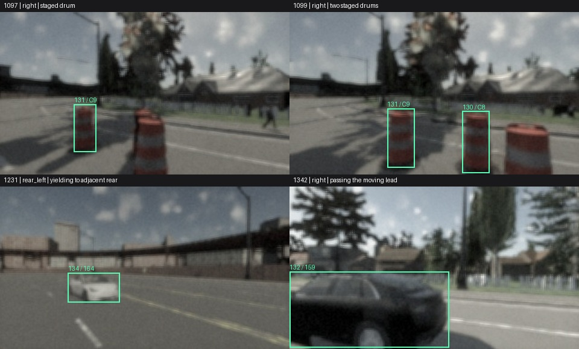

# Rider display on the first High attempt

This audit uses the sealed six-camera capture from driving source `ef514ca2`. It covers 1,824 native frames, 75–1898. The car passed the obstruction, yielded to moving traffic and overtook the moving lead. It stopped at 584.55 m before the second return and the run timed out. [Frame-by-frame display evidence](display.json) · [Native camera exposures with the recorded detector rectangles](camera-exposures.jpg)

- **First obstruction exposure, frame 1027 at 95.2 s.** Front footage shows prominent drums from the earlier roadside layout. The staged drums were farther ahead, clustered near the center of the image. No rider symbol met the position and opacity criteria for those staged drums at this exposure.
- **Alongside the obstruction, frame 1097 at 102.2 s.** The Right camera and 31 lidar returns corroborated actor 131 as `C9`. Actor 129 had a range-supported `C7` symbol without a current camera box. Actor 130 projected near the closer drum and the Right camera detector did not report it on this exposure. At frame 1099 (102.4 s), Right camera rectangles and lidar supported both actor 130 as `C8` and actor 131 as `C9`. At the return at frame 1197 (112.2 s), all three drums were beyond 46 m.
- **First occupied yield, frame 1224 at 114.9 s.** The white adjacent-rear car, actor 134, is visible in Rear Left footage. That view skipped inference on this exposure, the previous Rear Left exposure had no matching box and track `162` was coasting with zero fresh lidar hits. The lead, actor 132, remained as symbol `112`. Rear Left reacquired actor 134 one frame later using image `539`, track `163` and 28 lidar hits. The first corroborated symbol during an occupied yield was `117` at frame 1231 (115.6 s), linked to Rear Left image `539` and track `164`.
- **Alongside the moving lead, frame 1342 at 126.7 s.** The Right rectangle for track `159` overlapped the projected body of actor 132 by 0.95 IoU and supported symbol `112`. The same symbol later had corroborated Rear Right evidence from track `172` at frame 1348 (127.3 s). Chase shows the pass from outside the car and has no detector overlay.

Within 35 m, the three staged drums had 363 combined actor-frames, 160 matched symbols, 129 current camera-and-lidar links and 91 links corroborated against the correct native body. The moving lead matched on 646 of 648 nearby frames and had 279 corroborated frames. The adjacent-rear car matched on 747 of 785 nearby frames and had 356 corroborated frames. Actor 133, the adjacent-front car, was recorded on 898 exposures and came within 45.80 m at best.

Nearby counts include occluded actors and symbols outside the Follow viewport. Current camera attribution requires a linked same-exposure rectangle and lidar, and the reported corroboration rejects competing projected bodies. These checks used the public replay code offline and inspected the native camera exposures.

An isolated test let freshly detected rear cars confirm early when the rear camera rectangle, compact lidar surface and matching closing Doppler all agreed. It advanced the first corroborated yield symbol from frame 1231 to frame 1225. The two added drawings matched actor 134 on frames 1225–1226. Both frames still displayed an older symbol for that car 4.17–5.30 m from the actor, so earlier confirmation would show two symbols for one car. The same test added zero qualifying car drawings over 3,320 historical City Life frames. The rule was rejected because it did not resolve the duplicate on this attempt. [Comparative counts](rear-confirmation.json)
