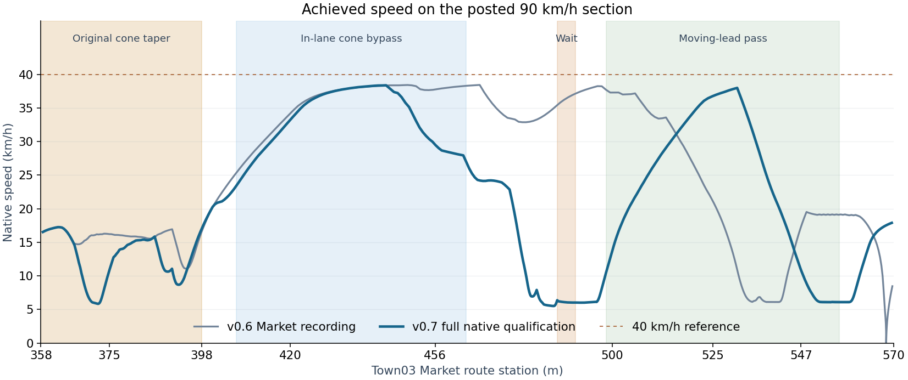

# Native Market route audit

The original High City Progress run took 298.7 seconds to travel the
1.42 km Town03 Market route. Its one posted 90 km/h section took
39.4 seconds and peaked at 38.42 km/h. The audit identifies each
curve, roadside prop and in-path vehicle by route position and
synchronized camera frame. [Original drive and its physical context](baseline.md)

## Full native qualification

The full native qualification used driving source `9bd6dafa`. It
completed 1,416.44 m in 311.2 seconds across 3,112 exposures. All 13
encounters and 11 junctions passed. It recorded zero vehicle contacts
among the ego or traffic, zero red-light violations and zero missed
yields. The independent audit found zero moving overlaps and zero
body gaps below 1 m in 84 moving-vehicle divider comparisons.
[Source pin](../qualification/full-market/qualification.json) ·
[Independent full qualification](full-qualification-pinned01.json)

The qualifying 90 km/h zone took 51.5 seconds at 11.31 km/h median
and reached 38.37 km/h. The car first held at least 35 km/h after
15.9 seconds and spent 3.9 seconds at or above 35. Its maximum
actual excess against any posted limit was 0.586 km/h. No exposure
exceeded a posted limit by more than 1 km/h. The active maneuvers
and signed speed differences across this full route are scored
separately from the isolated faster road tests.

Within 50 m, moving cars and pedestrians shared 1,690 of 3,107
scored exposures, compared with 1,605 of 2,982 in v0.6. At least
two of each shared 814 exposures, up from 506. Twenty-three of 27
ambient cars moved near the ego, up from 18 of 22. The independent
score includes density by station so the longer duration is visible
in each denominator.

## Held-out timing variation failed to finish

The preregistered later-gap variation used the same driving source
`9bd6dafa`. It completed the cone bypass, yielded to fast adjacent
traffic for 23 logged policy exposures, stopped for 2.5 seconds
during observed adjacent occupancy and passed the moving lead.
The second return never completed. The car waited in the alternate
lane at 584.724 m until the run timed out. Its bumper gap to the next
car was 3.66 m. A stationary sedan in the source lane was only 3.33 m
behind its rear bumper.

The earlier gap was measured separately. Across 51 samples from
physical clearance of the moving car through 570 m, the source lane
never provided the required front and rear clearance at the measured
closing speeds. At the closest opportunity the gap was 15.53 m
ahead and 11.50 m behind. The 4.32 m/s closing speed required 21.61 m
ahead. The laser had pavement returns up to 50.35 m forward and
42.11 m rearward, and the passed vehicle was tracked. Once the rear
gap reached 12 m, the front gap had already closed to 14.24 m.
After 570 m the sedan stayed stationary. The ego first drew alongside
and then gained at most 3.33 m ahead of its front bumper before
remaining at a standstill for 44.7 seconds. The recorded trajectory
shows a completion failure with unavailable rejoin clearance.
Different earlier timing could produce a different gap.
The 49 moving straddle samples all cleared 1 m,
with a minimum of 10.67 m and zero sampled overlaps.
[Physical gap and sensor chronology](timing-variation-rejoin-gap.json) ·
[Held-out native grade](timing-variation-registered01.json)

## Passing and waiting

On Road 67 the source lane is −2 and the legal same-direction passing
lane is −1. Both surveyed driving lanes share a broken divider.
The audit checks the entire ego footprint throughout each move, the
ordering of the actual vehicle bodies while alongside, and the
settled return to lane −2. Fixed props have a separate clearance
measurement. Moving vehicles must leave at least 1 m of sampled body
clearance while the ego straddles the divider.

The focused uncooperative-rear trial used the archived moving rear car,
release driving source `9bd6dafa`, and evaluator `5510f55c`. At its closest exposure
the rear car was traveling 11.42 m/s. The ego was stationary and its
whole body was in lane −2. The independent body gap was 1.509 m,
compared with the native grader's 1.507 m. All 45 observed moving-vehicle
straddle comparisons met the 1 m requirement. Earlier in that test the
rear car was still about 31 m back as the last corners of the ego crossed
into the source lane. The exact native corner projection first places
the entire body in lane −2 at frame 18128.
[Pinned focused trial and frame-level score](uncooperative-pinned-v07.json)

The integrated native sector completed both required passes and the
original bus bypass. It met the moving clearance threshold in each of
105 exposed straddle samples. While yielding in its original lane the
car's median achieved speed was 6.27 km/h and median requested speed
was 5.79 km/h. While already in the passing lane and preparing a
return, its median achieved speed was 29.88 km/h and median request
was 10.8 km/h. The latter group includes deceleration before the return.
The sector records zero samples above 40 km/h of either actual speed
or request during divider straddles or confirmed waits.
[Integrated sector evidence](integrated-section01.json)

On the full qualification, the ego's median actual/requested speeds
were 6.06/5.69 km/h while yielding in its source lane and
37.08/26.02 km/h while already in the alternate lane and waiting
to return. The alternate group captures preparatory deceleration
before the lane crossing. The whole-body divider straddle itself
peaked at 33.02 km/h actual and 36.24 km/h requested. Neither
actual nor requested speed exceeded 40 during straddles, source
yields, alternate return waits or the planned bus merge. The same
holds for the original lead, the later braking lead, the unprotected
left turn, the cyclist and the delayed pedestrian crossing.
At the unprotected left the observed crawl lasts 1.8 seconds.
[Synchronized speed and maneuver checks](full-qualification-pinned01.json)

## Pace and comfort

The fixed subsections below compare v0.6 with the full native
qualification along the same route stations. Times and median speeds
describe each drive's actual traffic and lane choice.

- **358–375 m, taper approach.** 3.7 to 5.7 s and 16.20 to 8.65 km/h.
  The original cones are beside the source sweep and the new rear
  vehicle is briefly stationary in the next lane.
- **375–398 m, taper.** 5.6 to 6.5 s and 15.84 to 13.14 km/h. The
  extra in-lane cone group begins to occupy the forward source sweep.
- **398–420 m, curve entrance.** 3.0 to 3.4 s and 25.76 to 24.30 km/h.
  The revised car enters the passing lane to go around that group.
- **420–456 m, tighter bend.** 3.5 to 3.8 s and 37.79 to 37.10 km/h.
  The map turns 42.4°. The revised car clears the last cone and starts
  preparing its return.
- **456–500 m, easing bend.** 4.4 to 15.3 s and 36.75 to 6.16 km/h.
  The original source sweep was clear. The new moving car occupies it
  while the adjacent rear car approaches.
- **500–525 m, curve exit.** 2.9 to 3.7 s and 32.71 to 25.38 km/h.
  The revised car uses the alternate lane to go past the moving lead
  as the boards come into view on the right.
- **525–547 m, roadside boards.** 8.9 to 3.2 s and 6.65 to 22.68 km/h.
  The revised car is already passing in the alternate lane.
- **547–570 m, original stopped lead.** 7.4 to 9.9 s and 14.20 to
  6.22 km/h. The revised car finishes rejoining and the original lead
  remains physically ahead before departing.

The clear-source control at the existing J1932 bend isolates the pace
change. Median measured speed increased from 15.42 to 22.26 km/h and
the matched interval took 5.8 seconds instead of 6.8. In the separate
matched case with the original roadside boards outside the source
sweep, the whole window took 11.2 seconds instead of 9.3 and median
speed fell from 6.62 to 5.32 km/h. The controller held a zero request
for 5.3 seconds while adjacent traffic was closing. Both drivers
maintained 1.046 m of native clearance to the boards. The deliberate
in-lane cones used to test the bypass appear at the curve entrance.
[Matched native controls](../pace/comparison.json)

The separate curb placement controls measured 2.87 m and 4.07 m of
body clearance, depending on the physical board placement. Both
drivers had the same 28.62 km/h local median in those controls.
[Native board footprints](curb-footprints.json)

The full qualification reached a 4.40 m/s² half-second kinematic
lateral estimate as the ego settled into the passing lane at the
first bend. The displacement-based check is 4.06 m/s² at the same
exposure. The peak lasts 0.4 seconds above 4 m/s². The original
peaked at 2.37 m/s² in its posted-90 section. The candidate's
strongest braking there was 4.53 m/s² while yielding to traffic,
compared with 4.43 m/s² while the original approached its stopped
lead. The quieter matched J1932 runs reached 1.32 and 1.57 m/s²
lateral, respectively. The earlier integrated sector preserves
similar lane-change and braking transients.
[Timing, steering and actual velocity](integrated-section01-comfort.json)

The isolated higher-speed experiments use different traffic and report
measured speed alongside the active native limit. On the matched longer
clear route, enabling the higher-speed head raised straight-section
median speed from 38.49 to 40.95 km/h. It reached 43.92 km/h and spent
7.4 seconds above 40. In the separate release-source queue trial it
briefly reached 50.37 km/h and stopped 4.09 m behind its lead in its own
lane. [Qualification and stopping evidence](../speed/README.md)

## Evidence limits

The recorded body and actor positions enter only the offline scorer.
The driver uses onboard measurements, navigation, ego motion and
measured actuator feedback. The population differs between the
original and revised Market setups. Route differences can reflect the
new maneuvers and different traffic arrival times. The native
evidence covers simulated Town03 and the named test controls.
The full clearance check samples every 0.1 seconds. The earlier
rehearsal's 0.36 m moving near miss, failed return attempts and incomplete
focused cases remain available for comparison.
[Audit protocol](protocol.md) · [Development and qualification attempts](native-attempts.md)
