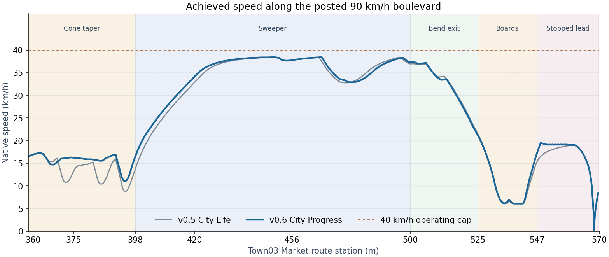

# The original Market drive

The sealed City Progress drive spends **39.4 s** in one continuous native
90 km/h zone on Road 67, from 358.46 to 569.69 m. Its median is **16.48 km/h**
and its peak is **38.42 km/h** against a maximum native request of
39.29 km/h in that zone. It first sustains 35 km/h 12.5 s after entry,
spends 7.0 s at or above 35 and 5.3 s at or above 37, and holds 35 for up to
4.8 s continuously. The older City Life drive takes 41.5 s in the same zone
and reaches 38.38 km/h. City Progress reduces the time below 15 km/h from
19.7 to 13.8 s. Both runs use the same Market route and traffic setup with
seed 212. [City Progress score](v06.json) · [City Life score](v05.json)

## Road 67 in order

- **358–375 m, taper approach.** The road is straight and median speed is
  16.20 km/h. The work-zone actors are right of the body-width path. At
  frame 977 the approaching taper is visible in the front camera.
- **375–398 m, taper.** The six cones narrow the available space. Median
  speed is 15.84 km/h. The independent minimum sampled cone footprint
  gap is 0.322 m. The existing conservative native score is 0.269 m. Both
  are close enough to justify slowing. The parallel Tesla is temporarily
  stopped in the left lane near the end of the taper.
- **398–420 m, acceleration into the bend.** Median speed rises to
  25.76 km/h. The mapped road turns 10.4° and the Tesla in the left lane
  starts moving. Its body stays outside the source vehicle sweep.
- **420–456 m, tighter bend.** This is a real 42.4° bend with sampled
  curvature p95 of 0.021/m. Median speed reaches 37.79 km/h. The
  native yaw/speed estimate reaches 2.37 m/s² lateral acceleration.
  The moving Tesla remains in the left lane, visible closely at frame
  1118. The source path records zero road-user blockages here.
- **456–500 m, easing bend.** Road heading changes another 26.1° and the
  curvature p95 falls to 0.014/m. Median speed is 36.75 km/h and the
  next 32 m of source path records zero actor intrusions. The nearby Tesla
  drops behind. Peak speed is 38.42 km/h.
- **500–525 m, curve exit and board approach.** The road turns another
  6.9° before opening to a straight. Median speed is 32.71 km/h.
  At frame 1197 the original policy reports 0.49 m of sight and
  both forward body sensors report 36 m. The front view shows the
  right-side boards, left lane and open path.
- **525–547 m, boards.** Median speed falls to 6.65 km/h. The boards
  stay physically on the right side, clear of both the source body
  sweep and the target lane to the left. The independent minimum sampled
  gap is 1.49 m, measured from CARLA's pre-rotated board box. The
  scenario's conservative world-aligned estimate is 1.047 m. At frame
  1250, the lead is still about 35 m away and the request is 5.41 km/h.
  The controller starts recovering by frame 1296 as it clears both
  boards, with the real lead about 25 m away.
- **547–570 m, stopped lead.** A real source-lane Tesla warrants
  braking. Median speed is 14.20 km/h and the car reaches zero.
  At frame 1344 the native estimate from both forward body sensors is
  about 3.84 m, versus 3.59 m independent sampled body clearance.
  At frame 1370 the lead is departing. The signed 60 km/h section
  first becomes active on the next exposure, at 569.94 m.

[Front exposures](v06-front-proof.jpg) · [Left exposures](v06-left-proof.jpg) ·
[Rear-left exposures](v06-rear_left-proof.jpg)

## Whether a pass made sense

The strongest original opportunity was the stopped Tesla on Road 67.
OpenDRIVE permits a left move from lane −2 to same-direction lane −1
across broken paint and a legal return before the junction at 649.6 m.
The right side is a shoulder. The two roadside boards sit there.
Native actor positions and conservative gap timing identify a continuous
10.6 s plausible window from frame 1250 at 536.8 m to frame 1355 at
568.2 m. At its start, the target lane's stationary red Tesla is already
20.66 m behind by measured body separation along the route. The timing
screen puts a hypothetical return at 613.6 m from the first eligible
frame. The map's continuous legal interval ends at 648.65 m.

The archived lidar agrees with the camera views at selected frames.
At frame 1250 the adjacent lane has pavement returns from 4 to 52 m
ahead and 4 to 41 m behind, with a rear surface around 23.2 m and zero
above-road returns in the forward target corridor through 58 m.
At frame 1296 the rear surface is about 34.0 m back. These individual
exposures establish visible pavement and physical gap plausibility.
The staged lead was commanded to release at 125.1 s and soon erased the
closing advantage. Its behavior would have been different if the ego
had maintained speed. Estimating time saved requires a new native drive
under those controls. The original planner's mapped pass implementation
was limited to the Road 4 bus corridor and the High tape contains no
tactical request in this section.

The braking lead later on Road 3 screened into a 6.4 s apparent right-side
gap. The adjacent right lane has same-direction traffic and broken paint.
Its left neighbor is bidirectional and separated by mixed solid paint.
The planned left turn immediately after the straight and the lead's
quick release leave limited value in a right pass. The planner implements
left passes. Across the solid double centerline on the cyclist's Road 20,
the only driving lane carries opposing traffic.
Following there is appropriate. The earlier bus pass on Road 4 follows
the route's deliberately mapped lane center transition.

## Other road users

The longer route contains clear reasons for other slowdowns. The queue
at the signal physically occupies the source path before 323 m, crossing
pedestrians enter the footprint ahead at the first crossing and again
near 1,268 m, and the parked van near 147 m masks a pedestrian whose
native body enters the forward path around frame 439. The oncoming
car enters the approach's future footprint near 1,041 m. In the 90 km/h
zone, the slow windows split into close props, curve geometry, caution
beside visible roadside boards, and following a lead. Its sampled source
path contains zero crossing pedestrians. [Full route score and crossing frames](v06.json)

Moving cars and pedestrians are present on the same exposure for 1,074
of 2,982 scored frames within 35 m and 1,605 within 50 m. At least two
of each are present in 154 and 506 frames, respectively. Eighteen of 22
background vehicles move near the ego along the full route. Counts
require 0.5 s of native motion history, with thresholds of 1 m/s for
cars and 0.5 m/s for pedestrians. [Population breakdown by station](v06.json)
