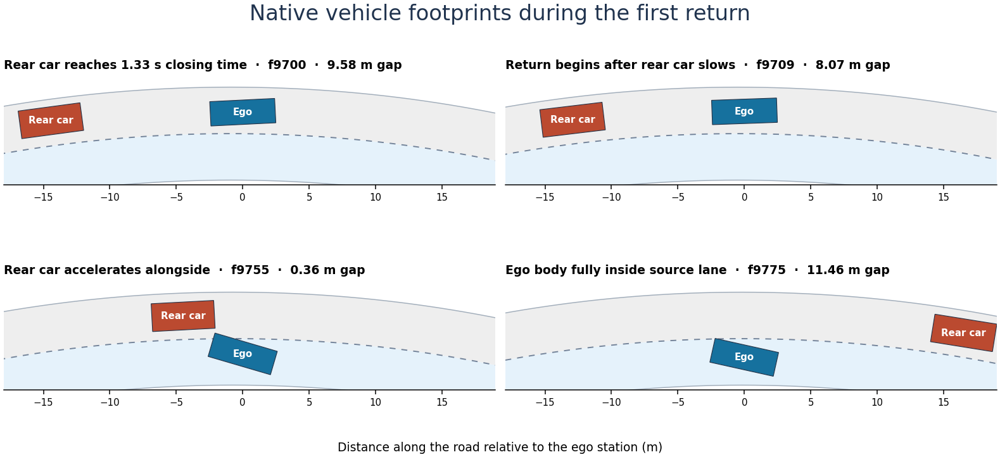

# Native maneuver attempts

## Duo06 stopped short of the second return

The car cleared and rejoined after the cones. It later waited 27 samples
for a moving adjacent gap before passing the slow car, but the
second return never started. In the strongest missed window
(32.1–34.6 s), the controller accepted the gap for 26 consecutive
exposures. Independent reconstructed minimum bumper room was about
25.39 m ahead and 13.52 m behind. The controller's own estimates were
25.12 m and 12.97 m. The pass landmark stayed undefined, so its return
counter never advanced. By the end of the probe, the stopped lead ahead
had also reduced available forward room. [Gap, scans, and pose evidence](duo06-return-window.json)

## Duo07 began the second return and withdrew

Propagating the measured lead's position kept the pass landmark through
the outbound lane change. The native car started returning at frame
7244, then withdrew three times. At frame 7251, rear pavement reach was
23.66 m against a 24 m requirement. At frame 7263 the pavement gates
passed and the rearward range reference shifted by more than two metres
between consecutive samples, evidence of uncertain association. At
frame 7281 the pavement gates passed and the stopped lead ahead left
4.90 s of longitudinal closing time against a 5 s requirement.
[Raw coverage and closing evidence](duo07-return-aborts.json)

## Duo08 completed two physical returns in the shorter corridor

The car cleared and rejoined after both the cones and the moving car.
Native body clearance was 1.675 m while beside the cones and 1.702 m
while beside the moving lead. It waited through 17 observed occupied-gap
exposures and stopped for 0.3 s with the fast rear vehicle arriving. The
ego hull remained within the two surveyed driving lanes in all 187
retained 5 Hz pose samples. The probe ended as a third maneuver began
around the original lead, at about 572 m along the route.
[Native passes and sampled footprints](duo08-native-returns.json)

## Duo09 repeated the two shorter-corridor returns

The car again cleared and rejoined after both obstacles. It waited in 26
occupied-gap samples and came to a stop for 0.8 s. The native scorer
measured a 1.586 m minimum gap to the moving adjacent rear car, 1.675 m
to the cones and 1.678 m to the moving lead. All 201 retained ego pose
samples stayed inside the two surveyed lanes. The probe ended near 572 m.
[Native passes and sampled footprints](duo09-native-returns.json)

## Full rehearsal 02 failed the moving separation check

The car physically returned after both Road 67 passes. Four brief
withdrawals during the first return left the car in the adjacent lane
as a fast rear vehicle approached. The rear car briefly braked behind
the ego. As the ego crossed toward the source lane, the moving car
accelerated and passed the partly straddling body. Eight consecutive
10 Hz samples came within 1 m, with a minimum reconstructed body gap
of **0.361 m** at frame 9755 and about **6.68 m/s** of relative
longitudinal speed. The sampled footprint check found zero overlaps.
The native collision sensor reported zero contacts.

The original Road 4 bus pass also stalled. At 821.935 m along the
route, the lane projection capped observable rear pavement at 22.05 m
while the merge required more than 24 m. The ego was stationary and the
bus was still about 42.4 m ahead by lidar. The attempt ended there.
[Actor clearance timeline](rehearsal02-physical-gap-timeline.json) ·
[Independent native rehearsal grade](full-rehearsal02.json)

## The integrated section completed both passes and the bus bypass

The revised run began near 278 m and continued to its planned stop near
907 m. The first whole-body return was at 475.280 m. The fast adjacent
vehicle passed after the ego was fully in its source lane and the closest
sample measured 1.561 m of side clearance. The next outbound and return
motions cleared the moving car and restored the whole body to its lane at
557.112 m. Both passes together recorded 105 straddling samples near
moving vehicles. Every measured body gap in those samples met 1 m.
The sequence includes 30 verified waiting samples and passes the original
bus with 0.926 m of sampled clearance.

The added maneuvers change the posted-90 section. It takes 53.3 s at
11.07 km/h median, compared with 39.4 s at 16.48 km/h median in the
original setup. The board subsection is faster during the new alternate
lane pass. The tighter bend and easing bend include the added obstruction
and the new wait for closing traffic. In the paired original-board scene,
the candidate's median falls from 6.62 to 5.32 km/h and passage takes
11.2 s versus 9.3 s. The native board clearance stays at 1.046 m.
A closing car in the adjacent lane requires a yield. The controller
holds its current-lane speed request at zero for 5.3 s while the front
lead is still about 35 m away. The paired
clear-source portion of the original 420–500 m bend stays close to
38 km/h in both runs. [Matched pace controls](../pace/comparison.json)

The candidate's brief maximum lateral acceleration estimate is **4.27
m/s²** while settling into the alternate lane at frame 13934, compared
with **2.37 m/s²** anywhere in the original posted-90 section. The direct
world-trajectory estimate for that exposure is **3.93 m/s²**.
The candidate has two half-second braking bursts above 4 m/s² while
preparing to return. The original posts one such burst lasting 0.3 s
while approaching the stopped lead. The first candidate request drops
from 39.29 to 11.20 km/h in one exposure. These comfort costs are part
of the physical maneuver demonstration.

[Independent section grade](integrated-section01.json) ·
[Speed, steering, and comfort exposures](integrated-section01-comfort.json)

## Focused qualification results

- **Uncooperative rear car.** The full ego footprint returned to its
  source lane before the rear car drew alongside. The ego was stopped
  at frame 18164, where independent body clearance was 1.509 m and
  native rear-car movement was 11.423 m/s. All 45 moving-vehicle
  straddle samples cleared 1 m. The focused run ends on the next
  outbound maneuver. [Sealed focused audit](uncooperative-pinned-v07.json)
- **In-lane board.** The ego passed the physical board in the alternate
  lane and restored its full body to source at frame 18382. The
  fixture contains no moving vehicles in the divider comparisons.
  [Sealed focused audit](board-pinned-v07.json)
- **Slow vehicle.** The ego drew physically alongside and restored
  its full body to the source lane at frame 18853. The minimum
  moving-vehicle gap was 2.89 m across 64 straddle comparisons. The run
  timed out and failed its declared occupied-gap and completion checks.
  [Sealed focused audit](slow-pinned-v07.json)
- **Blocked alternate.** The ego stayed in the source lane through
  453 logged yield exposures. The scene records 167 native
  occupied-gap samples. The run timed out before its finish.
  [Sealed focused audit](blocked-pinned-v07.json)

The amended pair uses the same release driving source `9bd6dafa`
and fixture evaluator `0e9fa722`. In the moving-lead test, the ego
waited through 33 occupied samples with 1.6 seconds stopped. It passed
with 1.701 m of native moving-lead clearance and restored its full body
to source at frame 24844. The minimum body gap across 34 moving
straddle samples was 12.439 m. The amended blocked case reached the
specified end and stayed in the source lane through all 167 occupied
samples. Both completed with zero contacts and sampled overlaps.
[Amended moving-lead audit](slow-amended-v07.json) ·
[Amended blocked-control audit](blocked-amended-v07.json)

## The spaced High sector combined the two passes

Source `da8d343` moved the original stopped sedan to 613.65 m.
Starting from the predeclared sector launch near 278 m, the driver
passed both the cones and moving car during the same alternate-lane
excursion. It entered that lane around 416 m and restored its whole
body to source at 549.087 m. The required intermediate return and
separate occupied-gap wait were absent. All 20 moving-vehicle divider
observations cleared 1 m, and no collision, signal or yield violation
was recorded.

The sector then timed out at 581.841 m while stopped in source.
The native staged sedan remained parked with 27.01 m of bumper room.
Its scripted release requires approaching within 20 m. Adjacent
occupancy blocked a pass, and the source-lane request stayed at zero.
[Exact six-axis pose and sector score](spaced-continuous-failed.json)

The corresponding later-gap sector also combined the two physical
passes in a single alternate-lane excursion. It restored the source
lane at 553.017 m and timed out at 582.523 m with the relocated
sedan's bumper 26.33 m ahead. Its 18 moving divider comparisons
all exceeded 1 m. Native contacts and signal and yield
violations were all zero.
[Later-gap six-axis sector score](spaced-later-gap-failed.json)
