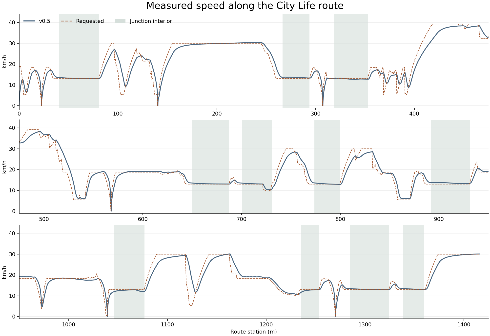

# Why City Life slows down

The published v0.5 car reached Market in 332.0 simulated seconds. It spent 202.0 s below 15 km/h and 51.8 s below 10. The repeated slowdown is a requested speed near 13 km/h on very different junctions. Six nearly straight junction interiors alone occupied 55.0 s. Recoveries after a pedestrian cleared or a stopped vehicle began moving usually took about one or two seconds to reach 10 km/h. [Original drive](https://yafi-s.github.io/ADO/?run=city-life) · [Sealed v0.5 manifest](https://github.com/yafi-s/ADO/blob/v0.5.0/web/media/city-life/manifest.json) · [All 57 station bins, 11 junctions, 14 release marks and slow spells](v05.json) · [Registered measurements](PROTOCOL.md) · [Bus station correction](BUS-LOCATION.md)

## Junctions

Each line gives the CARLA junction ID, measured heading range, median speed and time inside its fixed route interval. The median request was 13.0 km/h at every junction. The source instructor sets 3.6 m/s for every junction. The driver's fitted approach speed also limits its cruise increment, and its junction-distance envelope approaches that fitted speed inside the junction. Those mechanisms and the source telemetry support an explanation for the repeated plateau. The film did not retain every original controller feature needed to attribute each frame to one branch. [Front views](v05-camera/front-junctions.jpg) · [Chase views](v05-camera/chase-junctions.jpg) · [Instructor](../../../crosswalk/city_collect.py) · [Original planner](https://github.com/yafi-s/ADO/blob/v0.5.0/crosswalk/city_pace.py)

- J103, 40–81 m. Heading spanned 2.6°, median 13.1 km/h, 11.2 s. The first pedestrian had cleared at 22.9 m. [Frame 268](https://yafi-s.github.io/ADO/inspect.html?run=city-life&frame=268&camera=front)
- J1038, 267–294 m. This right turn spanned 90.5°, median 13.6 km/h, 7.2 s. Its eventual signal queue occupied the forward path for 2.4 s inside the turn. [Frame 713](https://yafi-s.github.io/ADO/inspect.html?run=city-life&frame=713&camera=front)
- J1352, 319–353 m. This right turn spanned 92.2°, median 12.8 km/h, 9.4 s. It followed the queue's green release. [Frame 915](https://yafi-s.github.io/ADO/inspect.html?run=city-life&frame=915&camera=front)
- J82, 650–688 m. Heading spanned less than 0.1°, median 13.1 km/h, 10.4 s. The departing lead had taken its exit at 641.1 m. [Frame 1603](https://yafi-s.github.io/ADO/inspect.html?run=city-life&frame=1603&camera=front)
- J1932, 701–731 m. Although the route calls this straight, the car changed heading by 40°. Median 13.1 km/h, 8.9 s. Across J82, their connecting street and J1932, speed stayed below 15 km/h for 25.2 s. [Frame 1733](https://yafi-s.github.io/ADO/inspect.html?run=city-life&frame=1733&camera=front)
- J238, 774–800 m. Heading spanned 3.5°, median 13.1 km/h, 7.1 s. The bus encounter label was already active, but its targeted pass had yet to begin. [Frame 1890](https://yafi-s.github.io/ADO/inspect.html?run=city-life&frame=1890&camera=front)
- J861, 892–931 m. Heading spanned less than 0.1°, median 13.5 km/h, 10.3 s. The original telemetry held both pedals below 0.05 throughout while speed tracked the low request. The bus had cleared at 876.3 m. [Frame 2203](https://yafi-s.github.io/ADO/inspect.html?run=city-life&frame=2203&camera=front)
- J730, 1046–1077 m. This left turn spanned 88°, median 12.6 km/h, 8.7 s. The car first stopped for an oncoming vehicle. [Frame 2592](https://yafi-s.github.io/ADO/inspect.html?run=city-life&frame=2592&camera=chase)
- J1820, 1236–1254 m. Heading spanned less than 0.1°, median 12.8 km/h, 5.1 s. A cyclist was leaving and the delayed pedestrian would enter the path near the end. [Frame 2960](https://yafi-s.github.io/ADO/inspect.html?run=city-life&frame=2960&camera=front)
- J1901, 1285–1325 m. Heading spanned less than 0.1°, median 13.1 km/h, 10.9 s. The delayed pedestrian had cleared at 1270.3 m. [Frame 3154](https://yafi-s.github.io/ADO/inspect.html?run=city-life&frame=3154&camera=front)
- J1669, 1339–1360 m. The other curved nominal straight spanned 10°, median 13.2 km/h, 5.8 s. Pedestrians were present on the right sidewalk. [Frame 3274](https://yafi-s.github.io/ADO/inspect.html?run=city-life&frame=3274&camera=front)

Across all 69.7 s inside the eight nominal straight junctions, no sampled road-user body occupied the next 25 m of the driven lane and no vulnerable road user was within 1.5 m of that strip. A second check took recorded actor positions at +0.5, +1, +1.5 and +2 s. Only one exposure in those junctions had a later actor inside the strip, the delayed pedestrian at J1820. The mid-junction native images show the difference between open pavement, views obscured by buildings or bridge columns, sidewalk activity, and the nominal straight with a substantial bend. The simulation sets compatible route lights green except for its staged red queue. The controller measures applicable signals through onboard inputs. The offline actor check cannot establish what those sensors could see at every approach. [Capture source archive](../../city-life/capture-source.zip)

The six junctions with at most 5° measured heading span had a pooled median of **13.12 km/h across 550 exposures**. Every one of these exposures was below 15 km/h. A separate signal check found fresh front-camera green classifications at confidence 0.90 or higher, independently corroborated by the same nearby native lamp ID and an aligned governing heading, for 6.4 s inside J103, 4.1 s inside J238, 6.6 s inside J861 and 1.9 s inside J1820. The first three showed open pavement in the fixed midpoint views. J1820 was close in time to the cyclist and delayed crossing. The camera classifier belongs to the display observer. Its available view is evidence about these scenes, while the driving policy has its own signal model. The evidence does not resolve lane-level signal ownership in every case. [Per-frame green evidence and matching conditions](v05-green.json)

## Between junctions

- **The original car already cruised on several stretches.** At 150–250 m it achieved 29.7 km/h against a 30.0 km/h median request, with oncoming traffic visible on a bend. At 420–500 m it achieved 37.5 against 39.3 on a 60 km/h posted stretch, with a red vehicle in the adjoining lane. The final 1365–1415 m also had medians of 29.1 achieved and 30.0 requested. At 1080–1180 m the median was 24.6 against 25.8. Its sharp braking at 1123 m coincided with an oncoming dark sedan near the centerline on a bend. Measured minimum edge separation from that moving car was 1.328 m. [Early road](v05-camera/front-route-1.jpg) · [Boulevard](v05-camera/front-route-2.jpg) · [Oncoming car and closest approaches](v05-camera/chase-close.jpg)
- **Near the two wide barricades,** 525–550 m took 9.7 s at median 6.6 km/h, with a 5.4 km/h median request. For 5.2 s in 525–548 m the request matched the checkpoint's low curbside speed to 0.005 km/h. Both boards stood just outside the lane. The minimum scored side clearance was 1.046 m. A stopped white sedan then occupied the lane. The active event advanced to “lead” while the boards still flanked the car. The six earlier drums formed a separate taper with only 0.269 m minimum side clearance. [Boards and stopped sedan](v05-camera/front-route-2.jpg) · [Recorded checkpoint](../../../models/city-clearance/fit.json)
- **Behind the departing lead,** 600–645 m took 8.7 s at median 18.8 km/h against 18.4 requested. The native hazard gap grew from roughly 26 m to its 60 m sentinel during this section. At 641.1 m the lead had left the route. The next pair of junctions then maintained a lower target. A road user beyond the forward 25 m screen can still constrain following. [Lead and two junctions](v05-camera/front-route-3.jpg)
- **Along the bus,** 858–872 m took 7.7 s at median 6.1 km/h. The request coincided with the learned 5.408 km/h curbside speed for 6.8 s. The passing car was already approximately 3.5 m left of its original lane center, and the recorded target-lane front and rear gaps were 60 m while the source-lane range fell to about 2.8 m. The tactical module's speed ceiling was absent at 199 s. The downstream speed request accounted for the crawl. The spectator camera confirms a close pass in a separate lane. The native oriented-body gap bottomed at 0.923 m. There were 72 exposures at or below 1 m. At 872–882 m the car recovered to a 15.4 km/h median, before the next junction again reduced the request. [Bus at 199.2 s](https://yafi-s.github.io/ADO/inspect.html?run=city-life&frame=2056&camera=chase) · [Full physical clearance audit](../../city-life/interactions/README.md)
- **The real cyclists and pedestrians affected different portions of the route.** Near 1200–1225 m, the cyclist occupied the forward lane for all 6.3 s and the car achieved a median 13.4 km/h. Around 1250–1275 m the delayed pedestrian physically occupied it for 3.7 s of a 9.9 s window. At 105–112 m, a short pre-occlusion slowdown coincided with a dark vehicle alongside and the parked white van visible ahead. The tape cannot isolate which observation reduced the speed at that early point. [Cyclist and crossing](v05-camera/front-route-5.jpg) · [Approach to van](v05-camera/front-route-1.jpg)

## Releases and safety controls

The car reached 10 km/h 1.4 s after the first pedestrian cleared, 2.1 s after the occluded pedestrian cleared, and 1.6 s after the delayed pedestrian cleared. The green signal preceded the queue car's departure by 1.5 s. The ego reached 10 km/h 0.9 s after the queue began moving. It reached 10 km/h in 1.0 and 0.6 s after the two lead vehicles restarted, and 1.7 s after the oncoming actor cleared the left turn. Immediately accelerating after the barricades, braking lead or cyclist cleared would encounter another real hazard on this layout. On the other hand, the 13 km/h plateau did persist after several genuine clears. [First releases](v05-camera/front-releases-1.jpg) · [Mid-route releases](v05-camera/front-releases-2.jpg) · [Final releases](v05-camera/front-releases-3.jpg)

All 11 staged encounters were exposed, handled and passed. CARLA recorded zero contacts, red-light crossings or missed yields. The minimum edge gap to a staged pedestrian was 3.317 m, to a background pedestrian 4.146 m, to the cyclist 5.512 m and to the occluding van 1.594 m. The whole run peaked at 38.38 km/h, with zero frames above the posted limit plus 1 km/h. Peak deceleration was 6.02 m/s² over one simulation step and 4.43 m/s² over 0.5 s. There were 4.2 s with 0.5 s braking harder than 3 m/s². The moving 95th percentile of absolute 0.5 s acceleration was 2.03 m/s². The 95th percentile of absolute jerk was 2.77 m/s³ and the peak magnitude was 7.75 m/s³. [Original close interactions and limitations](../../city-life/interactions/README.md) · [All native grades](v05.json)

### Measurement details

In a separate empty J1221 transfer trial, the revision-3 candidate's front radar body range went from 24.10 to 23.84 m at frame 520. Its target immediately dropped from 29.07 to 13.01 km/h, with the recorded limiting condition changing to an occupied corridor. The car was traveling 26.14 km/h at that exposure. The road rises ahead. Across the next 37 consecutive occupied-corridor exposures, all 178 supporting lidar hits were within 8.57 mm and all 744 supporting radar hits within 1.87 mm of the native road surface. The locally flat ground estimate mistook the grade for an obstacle. This conclusion applies to that measured hill. Half-second peak deceleration increased from 1.22 to 2.69 m/s² versus the earlier driver. Neither run spent time over 3 m/s². At the junction center the measured speeds were 13.10 and 13.61 km/h. This fixture supplies a concrete comfort and progress limitation independent of the populated route. In the original full City Life drive, 10 single-tick request drops exceeded 5 km/h, six exceeded 8 km/h, and several coincided with real cones or vehicles. [Independent crossing study](../junction-transfer/transfer-r3-first/audit.json) · [Native road elevation and sensor returns](../junction-transfer/clear-grade-projection.json) · [Locked full-route transition comparison](TRANSITIONS.md)

On its first fresh J1221 clear transfer, revision 4 added speed from grade evidence on 21 exposures and reached 17.54 km/h at the center. Frame 1111 still saw a 29.07 to 13.01 km/h request reduction when the general sight observer lacked confirmation. The achieved half-second deceleration peak remained 2.70 m/s². Resolving the grade return improved center speed while the separate confirmation drop persisted. [Revision-4 J1221 measurements](../junction-transfer/j1221-r4-first/audit.json)

The scorer verified the published telemetry and sealed replay hashes, native actor-reference hash and exact synchronized 10 Hz frame count. Contact sheets use hashed native front and chase JPEG streams with separate chase warmup indexing. All 57 consecutive station bins have a front-camera midpoint frame in [sheet 1](v05-camera/front-route-1.jpg), [sheet 2](v05-camera/front-route-2.jpg), [sheet 3](v05-camera/front-route-3.jpg), [sheet 4](v05-camera/front-route-4.jpg) and [sheet 5](v05-camera/front-route-5.jpg). These stills illustrate the measured windows. Quantitative claims use the whole window.

The evaluator projects actor boxes onto a 25 m strip aligned with the ego's subsequently measured path, beginning at the nose, with the native Lincoln's half-width. It includes dynamic actors and mapped parked vehicles, considers elevation, and checks the four future offsets separately. At the destination 3.4 s lack a full forward horizon. Unknown visibility, an actor outside the footprint, lane entry between checks, bridge occlusion, and props are separate from the absence of a recorded road user. At 10 Hz a minimum measured gap can exceed the continuous-time minimum. Controls are the native applied pedals. Coasting means both are below 0.05 while moving at least 1 km/h. Statistics use the frames inside each station interval, independently of event labels. [Scorer](measure.py) · [Native camera extraction](camera_sheets.py)

