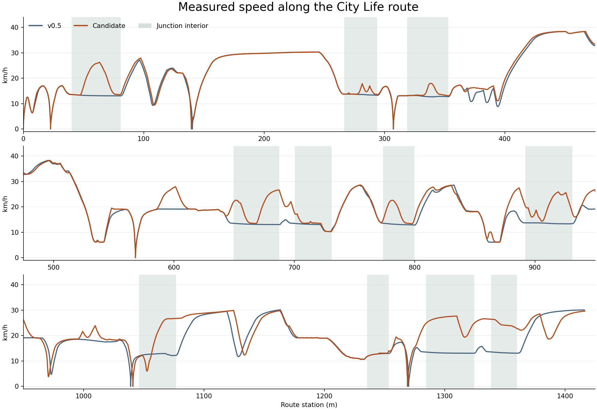

# City Life v0.6 compared with v0.5

**ADO completed the 1.42 km Market route in 298.7 s, 33.3 s faster than v0.5.** Six nearly straight junctions accounted for 15.5 s of that saving. Their pooled per-exposure median rose from 13.12 to 17.52 km/h. Time below 15 km/h across the route fell from 202.0 to 124.3 s. Time below 10 km/h remained 51.8 s, and time below 5 rose from 23.7 to 25.8 s. The car still crept beside the striped boards and the far end of the bus. [Watch v0.6](https://yafi-s.github.io/ADO/?run=city-progress) · [Original analysis](README.md) · [Registered windows](PROTOCOL.md) · [All matched measurements](comparison.json)

Both High-rendering drives used seed 212, ClearNoon, the same Town03 Market route, City Life population, five-camera rig, 0.5 s crossing delay and 0.1 s time step. Traffic moves in simulation time, so reaching the same station earlier changes the exact encounter. The report retains every exposure, all 57 consecutive 25 m bins, all eleven junctions and all eleven encounters. The displayed film is one closed-loop run per policy. [v0.5 telemetry measures](v05.json) · [v0.6 telemetry measures](v06.json) · [Scoring code](measure.py)

## Where it gained time

- The six nearly straight junctions took 55.0 s in v0.5 and 39.5 s in v0.6. Median speeds at J103, J82, J238, J861, J1820 and J1901 individually changed from **13.10→14.69, 13.11→18.71, 13.06→15.42, 13.51→19.02, 12.78→12.78 and 13.10→26.26 km/h**. Each original interior spanned under 5° of ego heading. The later-pedestrian and cyclist interaction at J1820 remained slow. Across all eight nominal straight junctions neither run recorded a road-user body on the forward 25 m strip at the current exposure. In each run one J1820 exposure had a pedestrian on that strip at a later half-second sample within two seconds. These recordings supply little evidence about conflicting cars at straight junctions. [Every junction](comparison.json) · [Native front and chase views](v06-camera/chase-junctions.jpg)
- Two other junctions called straight by the route include bends. At the 40° J1932, median speed rose only from 13.08 to 13.59 km/h. At the 10° J1669 it rose from 13.21 to 24.11. The actual left and two right turns changed from 12.64 to 12.12, 13.58 to 13.94 and 12.82 to 13.35 km/h respectively. The sharper lateral-acceleration peak below occurred within one of those right turns despite its modest median change.
- The pre-existing fast sections kept similar speeds. At 150–250 m both medians were 29.74 km/h. At 420–500 m the median rose from 37.46 to 37.65. Along 1080–1180 m it rose from 24.61 to 27.39, with a real oncoming car at the bend. Behind the departing white sedan at 600–645 m it remained about 18.8. At 1365–1415 m the median fell from 29.08 to 25.93. At frames 3029 and 3030 a measured left-edge return of 7.56 then 6.45 m coincided with a target change from 30.00 to 13.55 then 11.47. A dark oncoming car was 9.27 m forward and 6.52 m left at the first exposure, with pedestrians on the right. The edge cue cleared at frame 3031. The camera shows a real changed encounter, although the tape cannot identify each reflecting surface. [End-road front and chase views](v06-camera/chase-comfort.jpg)

## Remaining slow sections, in order of sustained time below 15 km/h

1. **304.5–335.0 m, 13.8 s.** The queue occupied the forward strip for 8.2 s. The car waited for green, followed a departing vehicle, and entered a real right turn. It reached 10 km/h 0.9 s after the queued vehicle started moving in both runs. There was no 13.8 s stationary wait on an empty street. [Queue and turn](v06-camera/front-releases-1.jpg)
2. **1211.7–1256.4 m, 13.3 s.** The cyclist occupied the strip for 5.8 s and a vulnerable road user was on or near it for 6.7 s. The delayed pedestrian approached as the cyclist departed. The low target continuing through J1820 covers different exposures from the initial following interval. It also coincides with 31 unconfirmed-sight and 10 vulnerable-user samples inside that junction. [Cyclist and subsequent pedestrian](v06-camera/front-route-5.jpg)
3. **1037.7–1057.3 m, 9.8 s.** A real oncoming car crossed the intended left turn. The driver stopped, then reached 10 km/h 1.3 s after clearance, compared with 1.7 s previously. It approached closer to the yield line. The measured safety margin is below. [Yield and restart](v06-camera/front-releases-3.jpg)
4. **137.6–146.0 m, 9.2 s.** A pedestrian stepped out from behind the van. The new driver was stopped at native clearance and took 3.5 s to reach 10 km/h, up from 2.1. Its strongest 0.5 s braking occurred here. This is a measurable recovery regression in a real occlusion. After the first and delayed pedestrians, release-to-10 took 1.4 and 1.7 s versus 1.4 and 1.6 s previously. [Van, pedestrian, and departure](v06-camera/front-releases-1.jpg)
5. **704.7–735.4 m, 8.9 s.** The 40° bend at J1932 had no current, near-vulnerable or sampled future path occupancy in this interval. The feature tape shows 79 unconfirmed-sight exposures and 10 recovery exposures. The camera shows curbside activity along the bend. The matched road-user check and native image do not justify attributing every frame of this low target to an active conflict. This is the longest remaining clear-path plateau. Other clear-path interruptions occurred on genuinely straight junctions, including J103 and J861. [J1932 and its approaches](v06-camera/front-route-3.jpg) · [Recorded control evidence](v06-reasons.json)
6. **856.3–874.5 m, 8.0 s.** In the fixed 858–872 m bus pass the median rose from **6.13 to 7.19 km/h** and elapsed time fell from 7.7 to 6.7 s. At the first physical overlap, the ego traveled 9.90 versus 6.11 km/h. When the ego's nose reached the far end of the bus both runs were near 6.1. Available sight past that flank had fallen to zero. The new car reached 15 km/h 1.7 s after its nose passed the far end, before its rear fully cleared the bus. The original took 2.1 s. At complete physical clearance it was moving 16.78 versus 14.71 km/h. Across the following 882–892 m junction approach the median rose from 15.05 to 25.87. The protected blind end and the improved recovery are distinct. [Native bus views](v06-camera/chase-close.jpg) · [v0.5 physical alignment](v05-bus.json) · [v0.6 physical alignment](v06-bus.json)
7. **529.3–545.5 m, 7.8 s.** Two wide barricades remain a slow roadside class. Over 525–550 m the median rose just 6.62→6.81 km/h. When the target first fell to 5.41 at frame 1218, forward radar/lidar returned the 36 m clear sentinel, the first board was 3.94 m ahead of the ego nose and 1.07 m outside its side, and the stopped lead was still 41.70 m ahead. The sight evidence had reset. By frame 1225 it measured 24 m of forward corridor but only 2.04 m of lateral sight. These cues retained the inherited curbside target. There were 52 actual board-overlap samples with the lead still outside 25 m. Frame 1296 was the first exposure with both boards behind and the lead within 25 m. The car was already at 17.02 km/h, requesting 21.99. The 550–560 m median was 19.10 before slowing for the stopped sedan. This separates the curbside crawl from the later real lead and finds no intervening open-road crawl. [Sequence of twelve native images](v06-camera/front-boards.jpg) · [Measured board, body and lead positions](v06-boards.json)

The remaining twelve sustained low-speed spells, including the first and delayed pedestrian stops, staged vehicle and shorter approach slowdowns, are retained with duration, speed, phases and actor exposure. Across the route's staged releases, v0.6 reached 10 km/h 1.0 s after the first lead restarted and 0.6 s after the braking lead restarted, matching v0.5. [All nineteen spells and fourteen release marks](v06.json)

## Why the speed still oscillates

The candidate made **26** one-tick target reductions of at least 5 km/h, compared with **10** in v0.5. Fourteen versus six exceeded or equaled 8 km/h. Seventeen candidate reductions withdrew an above-inherited speed allowance in a single tick. Twelve of those had the “unconfirmed” label. All twelve had valid odometry, nonempty native radar and adequate camera exposure on the saved JPEG. Rerunning the original policy detector on the synchronized JPEG reproduced a tall-enough person cue in eleven. Four of the twelve frames had at least one compatible native pedestrian body projection, typically well to one side. Seven had only unmatched boxes. At frame 2033 a person box covers the edge of a building on a clear through junction. One case did not reproduce. Compression and imperfect box matching limit exact attribution. A real roadside pedestrian or unseen crosser remains different from the unmatched building cue. [All twelve annotated front frames](v06-withdrawals.jpg) · [Independent radar, projection and detector measurements](v06-withdrawals.json)

The driver used the brake above 0.05 in 16 of the seventeen 1.5 s windows immediately after these withdrawals. **Neither drive recorded any 0.5 s braking harder than 3 m/s² in the matched immediate windows.** The maximum purely post-withdrawal half-second deceleration across the seventeen was below 3 m/s². Over the next 5 s, the matched physical stretches took 61.9 s versus 70.8 and included 20.1 s versus 43.4 below 15 km/h. Hard-braking time on those stretches was 2.3 versus 1.0 s. The later braking occurred around the signal queue, stopped lead, braking lead and delayed pedestrian. Those are time associations. They do not isolate the effect of hypothetically retaining permission through a hazard. All overlaps are deduplicated. [Transition protocol](TRANSITIONS.md) · [Every pedal window and its matched stations](v06-transition-effects.json)

Across all 57 fixed 25 m bins, 35 were faster, 14 tied to 0.1 s and eight were slower. The 36.5 s gained in faster bins was offset by 3.2 s in slower ones, or 8.8% of gross gains. Among the 13 bins containing a withdrawal, 12 were faster and one slower. The offset there was 0.5 s against 14.1 s of gross gain. In the six near-straights, the withdrawal-adjacent stations themselves saved 4.6 s and had 13.6 fewer seconds below 15. No abrupt withdrawal window overlapped the registered 858–872 m bus pass. These measurements establish a recurring comfort issue and a localized source of hesitation without attributing route time to an unrun counterfactual.

The camera saw a nearby aligned high-confidence green on J103, J238, J861 and J1820 for 4.8, 2.8, 4.9 and 1.9 s inside those junctions. None of those green exposures simultaneously had a mapped governing-light gap below 59 m in the driving policy's feature tape. The route contains a camera-visible-green subset, but this tape does not establish an across-the-board failure to release for positively identified governing green. Some low targets aligned with sight uncertainty, a vulnerable-user detector cue, or recovery after the cue. [Fresh green images, geometry and governing features](v06-green.json)

## Safety and comfort

All eleven staged encounters were exposed, handled and passed in both runs, with all eleven junctions completed and zero recorded ego contacts, participant contacts, red-light crossings or missed yields. No sampled ego/actor boxes overlapped at matching elevation. Closest body separations were 0.9231→0.9233 m for the stopped bus, 3.3166→3.3337 m for the staged pedestrians, 4.1464→4.1499 m for background pedestrians, 5.5121→5.5207 m for the cyclist and 1.3282→1.3264 m for a moving background car. The bus had 72→62 samples at or below 1 m. The native prop scorer measured 0.269 m beside the drums in both runs and 1.046→1.047 m beside the boards. These are 10 Hz sampled footprints. [Per-actor physical audit](v06-interactions.json) · [Closest camera exposures](v06-camera/chase-close.jpg)

The protected left turn had **2.54→0.69 m minimum yield-line margin**. At frames 2330 and 2331 the moving ego was 0.890 and 0.802 m from that line at 3.65 and 2.76 km/h respectively, producing the two new native “moving within 1 m” flags. It stopped before the line and yielded. Minimum physical separation from the oncoming car itself was **4.675→4.635 m**. These two measures use different objects. [Native left approach](v06-camera/front-comfort.jpg) · [Grading implementation](../../../crosswalk/journey.py)

Peak speed changed 38.38→38.42 km/h, with zero samples above 40 or above the posted limit plus 1. Whole-drive half-second peak braking rose from 4.43 to 4.70 m/s², moving p95 absolute half-second acceleration from 2.03 to 2.25 m/s², hard-braking time from 4.2 to 5.3 s, and p95 absolute half-second jerk from 2.77 to 3.80 m/s³. The candidate's stiffest brake occurred at the hidden pedestrian, followed by the delayed pedestrian and the stopped lead. Its largest jerk occurred while meeting an oncoming car on the bend at 1128.3 m. [Near interactions and native camera views](v06-camera/chase-close.jpg)

The pooled p95 lateral-acceleration estimate in the eleven junctions rose **1.27→2.07 m/s²**, and the peak rose **1.74→3.10 m/s²**. There were 895 original versus 678 candidate overlapping 0.5 s windows entirely inside one junction. The new peak ended at frame 930, at 339.81 m in the 92° right turn J1352. Heading changed from 43.31° to 61.19° in 0.5 s at approximately 17.7 km/h. At J1932 the p95 and peak rose only 0.434→0.472 and 0.435→0.474 m/s² (84 and 79 windows). The estimate is absolute unwrapped body yaw rate times trapezoidal average speed. It omits tire slip, suspension, roll and acceleration at the seat. [Front and chase at the peak](v06-camera/chase-comfort.jpg) · [Statistics for each physical junction](comparison.json)

The grade-aware branch added speed on **zero of 2,987 City Life exposures**, with no detected or confirmed grade extent. Its separate J1221 uphill result therefore contributes no measured improvement or harm to this particular drive. [Full policy evidence](v06-reasons.json) · [Independent native hill return study](../junction-transfer/clear-grade-projection.json)

