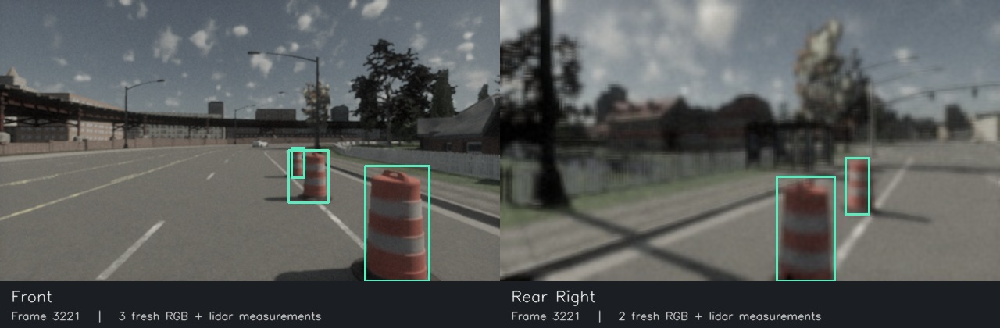

# Roadworks cone perception

The six Town03 roadworks props have the shape of orange channelizer drums. Each has a broad top, two pale reflective bands and a dark flared foot. The detector measures the colored body and estimates its center from the laser returns. Its median estimated body width was 0.655 m and height was 1.407 m on the original drive. These estimates describe the visible surface and can be biased by clipping or overlapping drums.



## Original urban-pace recording

All 3,354 synchronized exposures of seed 212 were processed in order, across the front, left, right, rear-left and rear-right cameras. Every camera stream and the sensor journal matched the original capture hashes.

- All **420 fresh measurements** matched one of the six physical drums within 0.65 m. There were zero unmatched measurements across the drive. The scorer assigned at most one measurement to each actor in a frame.
- **420 of 1,185 actor-frames** within 20 m had fresh support (35.4%). The remaining 765 include objects outside useful camera coverage, occluded or clipped stripes, and exposures without compatible recorded laser returns. This denominator includes all directions around the ego car.
- Fresh support appeared in 201 frames between frames 3107 and 3325 (89.5–111.3 seconds). Front RGB supplied 290 measurements and rear-right RGB supplied 130. Measured horizontal ranges spanned 4.18–16.84 m.
- The median horizontal center error was 0.058 m, its 95th percentile was 0.190 m and the maximum was 0.345 m. Median absolute horizontal range error was 0.036 m, its 95th percentile was 0.151 m and the maximum was 0.339 m.
- 391 measurements had at least one XYZ laser point inside the camera box. Another 29 had at least two distinct low-obstacle XY returns at a bearing and distance compatible with the visible body and foot. The original capture retained up to 180 XYZ and 300 XY samples per tick. Heightless returns remain explicitly marked.

The counts describe fresh sensor measurements. Subsequent display continuity uses a separate pass. Object references and ego-world poses are used only during independent scoring.

## Archived native controls

The original [native sample archive](../../data/barrier-recognition/town03-native.zip) contains separate fit and holdout stations. At the holdout stations the detector matched **11 of 12** positive exposures at nominal distances from 5 to 20 m. It missed one 20 m exposure and produced **zero false calls in 48 negative exposures** with an empty road, a barricade, a parked car or a planter. The fit split also scored 11 of 12 with zero false calls across 48 negative exposures. This study covers this particular native drum design.

## Current-exposure measurements

A separate native roadworks passage with the fitted speed controller supplied 38 sampled front/right camera exposures and full synchronized laser sweeps. The detector measured all six drums, with 32 of 32 outputs matched, 32 of 118 nearby actor-frames covered, and 0.031 m median absolute range error. A 36-exposure occluded-pedestrian control produced zero cone detections. [Fitted passage](fitted-cone-taper.json) · [Occlusion control](occlusion-control.json)

The detector tests for three aligned orange body sections interrupted by two lighter, less saturated bands. Camera intrinsics and mounts project ego-frame XYZ points into their image. The image box, estimated body dimensions, ground-foot intersection and projected height constrain eligible depths. A compact group of returns supplies depth. A near-shell correction estimates the body center. Confidence is an appearance score and has no probability calibration.

New surround recordings evaluate each current camera image against the full synchronized XYZ sweep. Fresh observations and the specific supporting laser coordinates travel with each replay frame. The archived drive uses a separate [frame-keyed observation file](../../web/media/urban-pace/cone-observations.json) containing the same measurements. An empty or missing observation row supplies no fresh detection. The source contains no cone locations or encounter timing.

## Reproduction

From the repository root, with the preserved native raw folder present, run:

```powershell
python -m crosswalk.cone_study out/journey-captures/long-city-drive-nxksaiij/raw --sidecar web/media/urban-pace/cone-observations.json --metrics results/cone-perception/metrics.json --review-image results/cone-perception/native-frame-3221.jpg
python -m pytest tests/test_traffic_cones.py -q
```

For a new surround capture, score the completed native measurements using `python -m crosswalk.cone_study <raw-folder> --live-measurements --metrics <output.json>`. The native journal must match its capture fingerprint. [Per-frame archive results and trip metrics](metrics.json)

For the sampled native trials, use `python -m crosswalk.cone_study <raw-folder> --sampled-packets --metrics <output.json>` with `out/roadworks-pace/fitted-cone-taper/raw` or `out/roadworks-pace/baseline-occluded/raw`.
