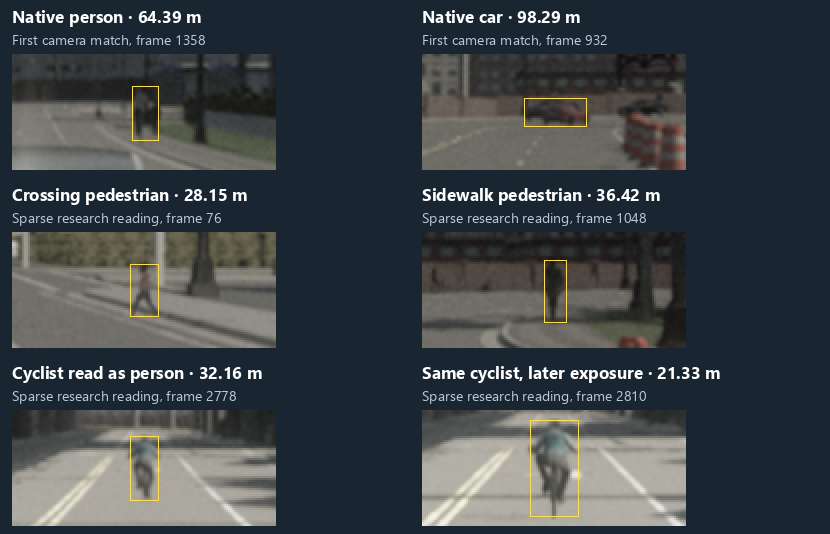
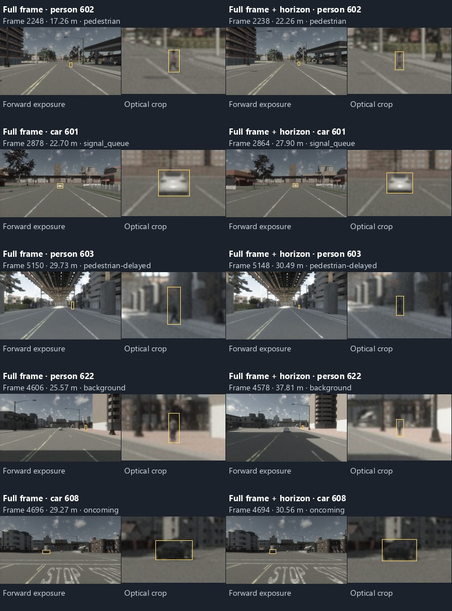
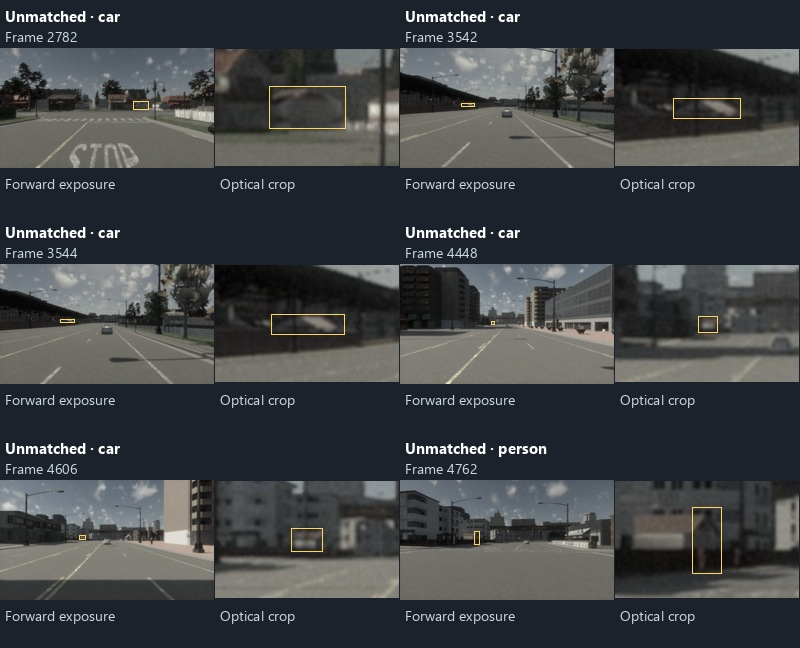
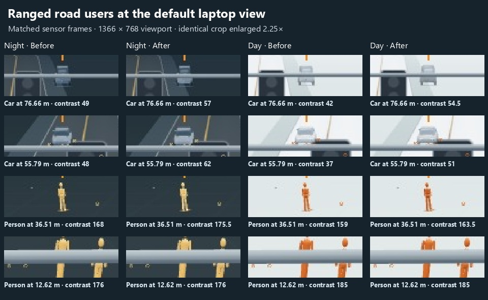

# Forward road-user awareness

ADO’s surround observer acquires a registered 1280 × 720 front image with a 90° horizontal field of view. Every 0.2 seconds it classifies the full 640 × 360 view and a second crop covering the center half of the native image width. The latter keeps the original detail in small road users ahead. It accepts road-user scores of at least 0.60, excludes clipped crop edges and preserves existing overlapping full-frame boxes. Both views use the same optical center. The driver, cones and front movie use the registered 640 × 360 working image.

The 32-channel roof lidar reaches 100 m in surround mode at its original 160,000 rays per second. The driving policy receives returns inside its trained 60 m envelope. A small unsupported optical box appears in the front camera inset as **Camera only**. The scene needs measured depth. A distant car can qualify on its first frame with an independently associated radar return, at least five lidar hits on a compact upright face, and a compatible current front camera box. The range-only input can sustain the existing tracking rules. It cannot supply a new pedestrian class.

## Native populated city drive

Across **3,320 synchronized exposures** in the corrected City Life recording, ADO optically identified a sidewalk pedestrian at **64.39 m**, 8.6 s earlier than the full-frame detector’s first correct reading at **32.57 m**. The rider sees **Person · camera only** at that first exposure. The first correctly located 3D symbol for that particular walker appeared at **13.68 m**. A different sidewalk pedestrian received a measured 3D symbol at **36.51 m**, compared with **21.18 m** using the 60 m, single-scale baseline. A moving car was first optically identified at **98.29 m** versus **67.08 m** and first drawn accurately at **41.98 m** in both variants. The van at the occluded crossing first appeared accurately in 3D at **76.66 m**, compared with **58.42 m**. [64.39 m walker exposure](https://yafi-s.github.io/ADO/inspect.html?run=city-life&frame=1358&camera=front) · [76.66 m van drawing](https://yafi-s.github.io/ADO/?run=city-life&at=21.7&camera=front) · [36.51 m pedestrian drawing](https://yafi-s.github.io/ADO/?run=city-life&at=20.6&camera=front)

The two optical scales matched **893 of 1,002** projected opportunities within 30 m (baseline 794), **561 of 1,235** at 30–50 m (455), and **312 of 4,537** at 50–100 m (167). This adds **350 matched actor-exposures with zero losses**. Unmatched camera boxes increased from **322 to 341**. At 50–100 m there were **22 matched pedestrian exposures** versus zero at full scale. These counts include all in-sector reference opportunities, including occlusion. The unchanged 3 m display accuracy gate and 50% opacity threshold measure actual rider symbols. [Representative original camera exposures](city-optics/first-optical.jpg) · [Additional unmatched optical sample](city-optics/unmatched-optical.jpg)

The baseline rider matched **1,394 of 2,002** projected actor-frames within 30 m, **558 of 2,472** at 30–50 m, and **59 of 9,070** at 50–100 m. The candidate matched **1,516**, **661** and **181** respectively. It gained **358** exact actor/frame pairs, lost **11**, and increased unmatched forward symbol-frames from **435 to 454**. All 11 losses belong to one member of a close pair of sidewalk pedestrians. That pedestrian was first drawn earlier, at 33.06 m instead of 25.05 m, but lost intermittent matches while the neighboring pedestrian gained coverage. The two nearby walking controls retained their 12.62 m and 12.36 m first symbols. The first crossing walker retained its 14.33 m first symbol. There were **32** accurate pedestrian symbol-frames at 30–50 m versus zero in the baseline, and **zero** at 50–100 m in both variants. [Every paired encounter](city-comparison.json) · [Candidate scores](city-after.json) · [Baseline scores](city-before.json) · [Sensor and display contributions](city-stage-ablation.json)

All 3,320 original track dictionaries reproduced exactly from the full-resolution lidar, five radars, ego odometry and registered camera boxes. On 26 sampled HD exposures, re-inferring the lossless crop reproduced every added box, label and confidence score. These images show the actual independent sensor pixels at the early car and pedestrian matches. [Native track reconstruction](city-native-verification.json) · [Sampled HD inference verification](city-crop-check.json)



### Sparse pedestrian depth research

Of **327** high-confidence pedestrian boxes with unsupported depth, the frozen supplemental observer emitted **27** estimates. **23** matched seven distinct pedestrians within 1.5 m. Median horizontal error was **0.12 m**, worst **0.41 m**, with correct ranges from **21.66 to 36.44 m**. All four other estimates belonged to **one cyclist**. Their surveyed range was accurate to within 0.54 m, but using a pedestrian symbol would misclassify the cyclist. Shifting the radar azimuth by 12° produced one unmatched estimate and zero correct estimates. These results support further investigation of vulnerable-road-user range. The published 3D scene uses the native tracks above, and the supplemental observer remains a research result. [Frozen method and controls](sparse-depth-protocol.md) · [Every accepted and shifted-control reading](sparse-depth-city.json)

## Sealed High city drive

The High v0.4 drive has 3,354 camera exposures and 1,677 fresh front detections. For the optical comparison both variants saw the **same decoded 640 × 360 native MJPEG exposures**. The High movie retains its originally recorded detections. Its new horizon boxes are an offline counterfactual. The 3D comparison instead replays the **identical original native camera, range and track journal** through the previous and current rider displays. Neither reconstructed range nor new simulated returns enter this historical score.

At first correct optical match, the first crossing pedestrian moved from **17.26 to 22.26 m**, a sidewalk pedestrian from **25.57 to 37.81 m**, and the delayed crossing pedestrian from **29.73 to 30.49 m**. The lead car moved from **51.25 to 54.39 m**, the queue car from **22.70 to 27.90 m** and the oncoming car from **29.27 to 30.56 m**. The native exposures below show the matching people and vehicles. The earlier cue leads the old reading by 1.0 s for the first crossing walker and 2.8 s for the sidewalk walker.



Across all registered cars, trucks, buses and pedestrians, the full-frame classifier matched 452/561 projected opportunities inside 30 m, 160/544 at 30–50 m and 42/1,886 at 50–100 m. Adding the crop changed those counts to **467, 185 and 43**. Unmatched observations rose from **246 to 252**. Of the 141 pedestrian opportunities at 30–50 m, optical matches increased from **5 to 9**. Neither variant matched a pedestrian in the 539 opportunities beyond 50 m. Scoring treats a projected actor as an opportunity even behind a building, so these are coverage counts in the forward sector, not recall on an independently visibility-labeled set.

The six additional unmatched camera boxes are included below. Frames 3542 and 3544 repeatedly label the same bright shape beneath a structure as a car. These readings show why the display retains image-only uncertainty. The 0.60 threshold was selected on this drive. At an initial 0.55, the extra optical matches and unmatched observations were 51 and 21, respectively. At 0.60 they were 41 and 6.



For the first **accurate 3D symbol**, the lead car moved from **43.14 to 49.83 m**, the occluding van from **58.58 to 61.55 m**, and a background car from **50.78 to 51.20 m**. A parked control that previously missed the display gate appeared at **30.79 m**. Nearby matched symbol-frames stayed at **914/1,116**. At 30–50 m, matches rose from **359 to 366** of 1,088. At 50–100 m, they rose from **23 to 34** of 3,767. Unmatched forward symbols stayed at **213**. No first correct symbol was lost. Neither version drew a correct pedestrian symbol at or beyond 30 m on this tape.

With the default follow camera at a 1366 × 768 laptop viewport, the 3D scene occupied 1001 × 619 pixels. At **61.55 m** the van covered 17 × 22 pixels, with 297 pixels at least 12/255 different from a second rendering with that vehicle body hidden. At **49.83 m** the lead car covered 20 × 20 pixels with 308 changed pixels. The **26.81 m** sidewalk pedestrian covered 11 × 36 pixels with 215 changed pixels. The orange line in each capture is an evaluation annotation. The range and body measurements exclude it. [61.55 m vehicle](high-laptop/frame-2471.jpg) · [49.83 m vehicle](high-laptop/frame-3452.jpg) · [26.81 m pedestrian](high-laptop/frame-3975.jpg) · [Pixel measurements](high-laptop/visibility.json)

## Distant symbols in the populated city

The range-qualified bodies keep their measured positions and physical scale. The display gradually brightens their paint at night and darkens it during the day beyond 30 m. Only confirmed bodies with a recent camera class receive this treatment. Geometry, depth testing and opacity remain under the existing object and occlusion rules.

On the corrected city drive, the first accurate van symbol at **76.66 m** remained 15 × 19 pixels, partly behind the real signal gantry. Its median visible-pixel contrast against the same rendering with that body hidden increased from **49 to 57** at night and **42 to 54.5** during the day on an 8-bit scale. At **55.79 m**, the background car improved from **48 to 62** at night and **37 to 51** during the day. A **36.51 m** pedestrian improved from **168 to 175.5** at night and **159 to 163.5** during the day. The paired **12.62 m** control image reproduced byte-for-byte in each theme. [Full measurements](city-laptop/contrast-comparison.json)



## Reproduction

The complete rider screen was also exercised through its normal replay picker, video clock and default front camera. At frame 2424 the original detector sees the van **78.59 m** away. The inset labels the optical box **Car · camera only**, 4.7 seconds before the first correctly located 3D symbol. These screenshots have no evaluation overlay. [78.59 m camera-only cue](high-laptop/home-2424.jpg) · [Van at 61.55 m](high-laptop/home-2471.jpg) · [Lead car at 49.83 m](high-laptop/home-3452.jpg) · [Sidewalk pedestrian at 26.81 m](high-laptop/home-3975.jpg)

The result files include consecutive frame intervals for every matched actor. Comparing those exact actor/frame pairs yields **41 optical gains and zero losses** and **18 accurate 3D gains and zero losses** on High.

On a separate earlier High recording, the display gained 18 correctly matched object/frame pairs and lost one background-car pair at frame 1201. Unmatched forward symbols increased from 322 to 323. The clear and occupied adjacent-lane overtaking controls retained all 58 and 218 correct pairs respectively, with zero unmatched forward symbols on either recording. [Independent recording controls](control-recordings.json)

The scorer runs the display on calibrated sensors, road geometry and ego odometry, then reads actor references. Optical matches need the correct class and one-to-one intersection-over-union of at least 0.25 with the projected reference body. The calibrated front mount and frame-synchronized six-axis ego pose register the image. This historical drive supplies actor yaw plus independently calibrated body offsets where available. Some historical actors lack a calibrated box, and the scorer uses their reported origin and extent. A marginal projection can miss a true image detection. For 3D, the symbol needs at least half opacity, the correct class, and a one-to-one reference center within 3 m on the ground plane. Distances are horizontal ego-to-reference-center distances. First sightings are chronological within the recorded encounter. This study has no human observer baseline. [Baseline results](high-before.json) · [Candidate results, per-class bands and every encounter](high-after.json)

The High journal SHA-256 is `035769ea010f15e5b89f4d1a376d5d009a8182ef7fa00fac559de337e79bfb58`. The front native MJPEG SHA-256 is `68581e383925bba76b044cf67821bcfb381acc9c5f19cde3937cb4294d0eb482`.

```powershell
$capture = 'out/journey-captures/long-city-drive-nxksaiij/raw'
$review = 'web/media/urban-pace/barrier-review.json'
New-Item -ItemType Directory -Force out/distant-awareness | Out-Null
python tools/replay_distant_optics.py $capture out/distant-awareness/front-replay.jsonl
python tools/project_distant_reference.py $capture out/distant-awareness/registration.json
node tools/score_distant_awareness.mjs $capture out/distant-awareness/before.json --memory-revision 251ae057 --review $review --projection out/distant-awareness/registration.json
node tools/score_distant_awareness.mjs $capture out/distant-awareness/after.json --paired out/distant-awareness/front-replay.jsonl --review $review --projection out/distant-awareness/registration.json --examples out/distant-awareness/unmatched.jsonl
python tools/illustrate_distant_optics.py $capture out/distant-awareness/after.json out/distant-awareness/unmatched.jsonl out/distant-awareness
python tools/check_distant_visibility.py $capture out/distant-awareness/after.json out/distant-awareness/laptop --review $review --targets 606 604 621
```

### Populated city release sensor tape

Run from the matching ADO source release with Python, its bundled model dependencies and Node installed. Extract the optional native range/crop asset, then set `$tape` to the directory containing `raw`, `sweeps` and `reference`. The numeric studies use the sensor journal, each frame’s full range sweep and the synchronized ego pose. Each HD optical check uses the original lossless sensor crop saved alongside that exposure. The normal front movie is a 640 × 360 presentation view.

```powershell
$tape = 'A:/ADO-City-Life-Range-Sweeps'
$raw = Join-Path $tape 'raw'
$sweeps = Join-Path $tape 'sweeps'
$baseMemory = Join-Path $tape 'reference/object-memory-before.mjs'
$work = 'out/city-life-range-reproduction'
New-Item -ItemType Directory -Force $work | Out-Null
python tools/project_distant_reference.py $raw "$work/registration.json"
python tools/ablate_distant_range.py $raw $sweeps "$work/native-verification" --verification-only
python tools/ablate_distant_range.py $raw $sweeps "$work/sixty-metre-single-scale"
node tools/score_distant_awareness.mjs "$work/sixty-metre-single-scale" "$work/before.json" --memory-file $baseMemory --projection "$work/registration.json"
node tools/score_distant_awareness.mjs $raw "$work/after.json" --projection "$work/registration.json"
python tools/summarize_distant_comparison.py "$work/before.json" "$work/after.json" "$work/paired.json"
python tools/replay_distant_optics.py $raw "$work/crop-check.json" --native-sweeps $sweeps --stride 128
python tools/measure_sparse_pedestrians.py $raw $sweeps "$work/sparse-depth.json"
```

The ablation reads the identical native radar and camera exposures, removes the second-scale optical boxes, clips lidar to 60 m, then redoes associations and tracking from the first frame. Its full-frame camera input is the same registered 640 × 360 image used by the new observer. The native verification independently reconstructs every original track dictionary using the recorded 100 m sweep and all the original boxes. The sparse-depth study has its own frozen observer and controls. [Sparse-depth protocol](sparse-depth-protocol.md)
