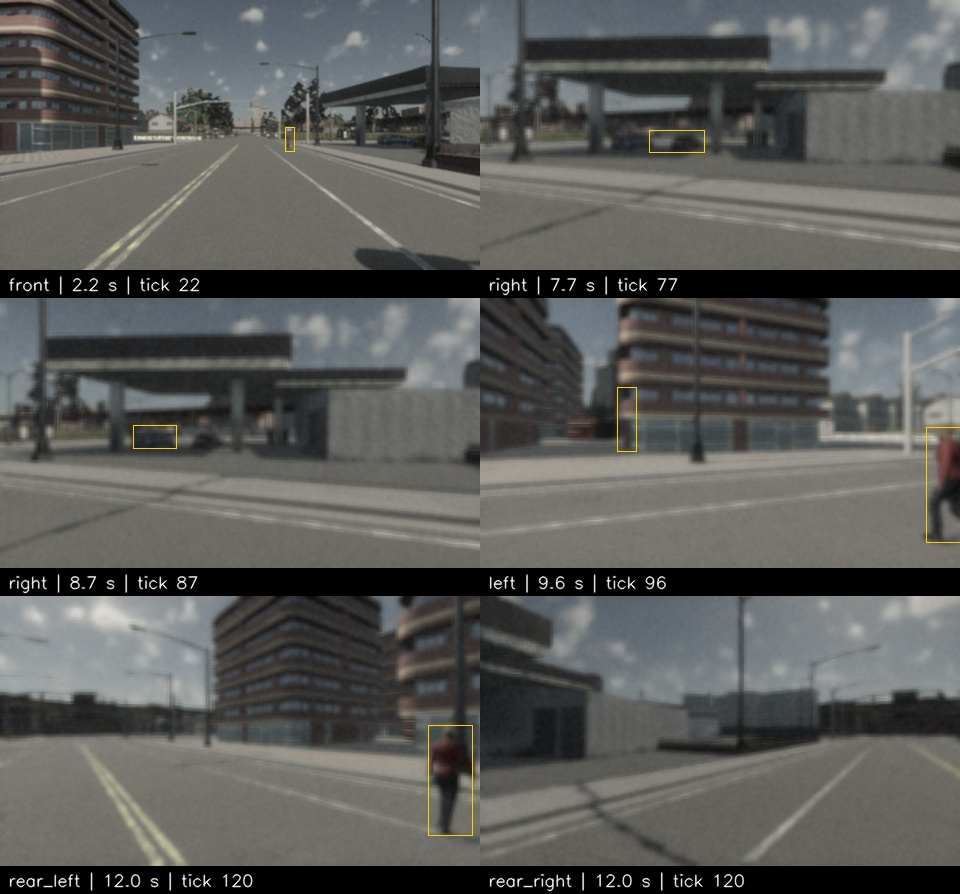
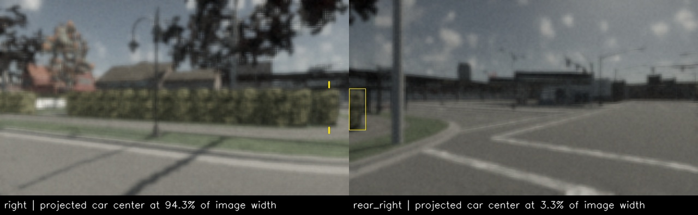
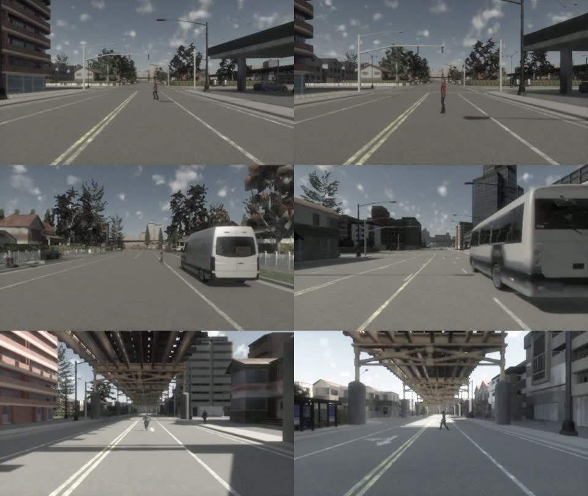

# Town03 perception audit

On the same 3,543 frames of the published 1.415 km city drive, the revised display drew the correct nearby pedestrian on 24 additional frames. Unmatched drawings stayed at 331. At 6.0 seconds, the first crossing pedestrian appeared as soon as the camera, lidar and radar supplied a joint measurement. The cyclist still went undrawn on every one of its 240 nearby frames.

## Native five-camera commissioning run

In a 155-frame sensor check on seed 211, the five-camera tracker matched the first crossing pedestrian on **120 of 155 pose-aligned frames**, compared with **38 of 155** in v0.2. The corresponding rider display matched on **113 versus 59**. The check ended at its configured frame limit after 43.34 m and tested one crossing.

| Crossing pedestrian, same ego bearing sector | Paired frames | v0.2 tracker | Five-camera tracker | v0.2 display | Revised display |
| --- | ---: | ---: | ---: | ---: | ---: |
| Front | 104 | 36 | 70 | 28 | 62 |
| Left | 29 | 2 | 29 | 29 | 29 |
| Rear | 22 | 0 | 21 | 2 | 22 |

The original tracker's crossing IDs were 6 (6.0–6.5 s), 7 (7.4–9.7 s) and 8 (9.8–10.5 s). Its display retained one ID from 7.6 to 13.4 s. The new tracker also used three IDs. It first matched at 2.2 s and missed again from 2.6 to 3.7 s. ID 5 then persisted from 4.2 through 15.3 s, including fresh front, left and rear-left camera measurements. The new display maintained one ID from 4.2 s through the last frame at 15.4 s. Median and 95th-percentile center residuals on its 113 matches were 0.063 and 0.338 m.

The observer also listed a second pedestrian on the right for 38 frames. Both new outputs missed all 38. The starting right-side images show low buildings and street fixtures in that direction and do not establish visibility of that pedestrian. The new tracker matched 90 of the 91 actor-frames with two or more sparse XY points on the footprint. The display matched 88.



The original 640×360 front and 320×180 perimeter PNGs show the crossing pedestrian moving from front into left and rear-left views. At 8.7 s the right camera points into a gas-station forecourt. CARLA's static map registry independently identifies the two visible parked cars. Track 6 is 0.216 m from a Mini Cooper and track 7 is 0.215 m from a BMW Gran Tourer. The car centers are 5.85 m apart. Both were omitted from the scenario's actor list.

Across the commissioning run, 131 of 251 tracker predictions and 214 of 327 displayed predictions had no matching scenario actor. All of those predictions match a registered parked vehicle within 3 m when the static reference is included. The tracker covered the two parked cars on 131 of their 243 nearby actor-frames, and the revised display covered them on 212. This is a short crossing with two parked cars. On the full v0.2 drive, including all 13 level vehicles reduced the tracker's unmatched count from 520 to 498, while both display versions still had 331 unmatched predictions.

### A real roadside classification error

In a separate seed-212 commissioning run, the rear-right camera labeled the edge of a hedge as a car at 24.5 seconds. The track had 10 lidar returns and 22 rear-right radar returns. Its estimated center lies 3.3% across the rear-right image and 94.3% across the simultaneous right image, in a row of shrubs. The nearest registered parked car is 34.32 m away. The nearest tagged foliage footprint is 0.19 m away. The two original images, raw track metadata and foliage bounds are saved in `seed212-hedge-source.zip`.



The encounter comparison pairs frames chronologically, maximizes the number of legal pairs and then minimizes pose error. A pair must have the same actor role and bearing sector, ego centers within 1 m, ego headings within 4°, route stations within 1.5 m and actor centers within 1.5 m in ego coordinates. Both recordings must be within 35 m of the event station and actor. For this crossing, every commissioning frame paired with a separate v0.2 frame, and the maximum ego-center displacement was 0.09 m. All paired frame numbers are in `native-preflight-aligned.json`.

## Identical recording, two display versions

The recording contains 3,241 road-user actor-frames within 35 m. Each actor present for one frame counts once. A matched drawing or track is within 3 m of one observer actor of the same broad family. Front, left, right and rear are four equal bearing sectors around the ego. These counts include actors behind obstructions and outside any recorded camera view.

| Frame-level result | Recorded tracker | v0.2 display | Revised display |
| --- | ---: | ---: | ---: |
| Matched actor-frames | 899 / 3,241 | 1,035 / 3,241 | 1,059 / 3,241 |
| Front | 885 / 1,736 | 822 / 1,736 | 846 / 1,736 |
| Left | 14 / 294 | 105 / 294 | 105 / 294 |
| Right | 0 / 325 | 93 / 325 | 93 / 325 |
| Rear | 0 / 886 | 15 / 886 | 15 / 886 |
| Matched with at least two sampled lidar points on the actor footprint | 747 / 1,930 | 882 / 1,930 | 902 / 1,930 |
| Unmatched predictions within 35 m | 520 / 1,419 | 331 / 1,367 | 331 / 1,391 |
| Reacquisitions after a missed interval | 9 | 2 | 2 |
| ID changes on adjacent matched frames | 15 | 2 | 2 |
| Median / 95th percentile center residual on matched actor-frames | 0.232 / 1.662 m | 0.223 / 1.807 m | 0.235 / 1.807 m |

Of 331 unmatched revised-display predictions, 232 were remembered and 99 were classified by the display as current or recent. This false-positive count uses the recorded observer list as its reference. A duplicate prediction, a misplaced true vehicle or a static map prop absent from the actor list can all produce an unmatched prediction. Removing the semantic-family requirement reduces the revised display's unmatched count from 331 to 238, with 1,152 actor-frames matched on position alone. This secondary score can also credit a future lidar-only unclassified obstacle. The sampled lidar diagnostic counts downsampled ground-filtered XY returns inside the oriented footprint, extended by 0.25 m on each edge. Points can land there from another surface. A zero count on this sparse plot cannot establish an empty space.

The old display retained the bus under one drawn ID while the tracker used two matched IDs. It matched 56 of its 154 nearby actor-frames, including the close approach at 214.0 seconds. Two background pedestrians had zero matched frames for both displays. The previous display study used a different denominator and matching rule. The fixed-radius, family-compatible one-to-one counts here support comparisons across versions of this scorer.

## Front-camera checks

The panels below are six decoded frames from the published policy-camera video. They run left to right, top to bottom. Each is a fresh inference frame. These selected encounters demonstrate failure modes and cannot estimate camera-visible recall across the drive.



| CARLA frame | Video time | Visible evidence and synchronized output |
| ---: | ---: | --- |
| 118 | 4.6 s | The pedestrian is in the lane, 14.86 m away. The detector returned a person box. Both displays lacked a spatial person track. |
| 132 | 6.0 s | The pedestrian is 8.97 m away. The tracker measured the person with camera, lidar and radar. The revised display showed the pedestrian with 0.038 m center residual. The v0.2 display was still waiting for confirmation. |
| 434 | 36.2 s | A person is visible crossing beside a parked van, 15.02 m from the ego. The only box and track were labeled bus. Both displays retained the van and missed the person. |
| 2212 | 214.0 s | The stopped bus fills the right of the image, 10.15 m from the ego. Tracker and both displays matched the bus. The revised display's center residual was 0.78 m. |
| 3048 | 297.6 s | A cyclist is visible directly ahead at 15.19 m. A pedestrian is also visible on the right. The detector returned zero boxes and the tracker returned zero tracks. |
| 3208 | 313.6 s | The delayed pedestrian is crossing ahead at 14.82 m. The detector returned zero boxes and the tracker returned zero tracks. |

## Reproduce

Run from the repository root with Node.js. Each JSON summary includes the input and display-source SHA-256 digests, sector and class denominators, per-actor identity counts, longest missed intervals and six frame-level probes. Add `--frames frame-matches.jsonl` to export every matched and missed actor and every unmatched prediction.

A native capture's raw stage directory can be scored as soon as it contains `town.json` and `perception.jsonl`. The scorer reads a fixed-length snapshot, reports the bytes and digest it consumed, and scores only complete newline-terminated journal records.

`tools/inspect_city_cameras.py` generates visibility spot checks independently of the tracker output. For each bearing sector it picks the three distinct actors that came closest to 15 m in an available camera, takes their closest-to-15-m frame, and selects the camera whose optical axis is closest to their projected center. The image footer gives the expected horizontal image position. A reviewer can mark each actor visible, occluded or unclear before consulting the frame-match file. With only the old front film available, this selected two clearly visible white cars and a sidewalk pedestrian at the location of a lamp post whose visibility was unclear in the image. All three had tracker and display matches.

```powershell
$probes = '--probe','118','--probe','132','--probe','434','--probe','2212','--probe','3048','--probe','3208'
$parked = 'results/perception/town03-static-vehicles.json'
node tools/audit_city_perception.mjs web/media/long-city-drive --static-map $parked --memory-revision 0ff276b --output results/perception/long-city-v02.json @probes
node tools/audit_city_perception.mjs web/media/long-city-drive --static-map $parked --output results/perception/long-city-current.json @probes
node --test tests/test_audit_city_perception.mjs
```

The original commissioning journal is included as `preflight/perception.jsonl.gz`. The same Town03 town export supplies its lane geometry. Reproduce the aligned crossing comparison with

```powershell
node tools/audit_city_perception.mjs web/media/long-city-drive --memory-revision 0ff276b --output v02-summary.json --frames v02-frames.jsonl
node tools/audit_city_perception.mjs results/perception/preflight --town web/media/long-city-drive/town.json --static-map $parked --output preflight-summary.json --frames preflight-frames.jsonl
node tools/compare_city_encounters.mjs v02-frames.jsonl preflight-frames.jsonl aligned.json
```

`town03-static-vehicles.json` is a read-only export of CARLA 1.0's Town03_Opt environment objects tagged Car, Truck, Bus, Bicycle or Motorcycle. Run `python tools/export_city_audit_reference.py <destination.json> --port <active-port>` against the same running map to repeat the export. Only the audit uses these objects.

For a capture with five recorded camera views, use its saved rig calibration when extracting inspection frames.

```powershell
node tools/audit_city_perception.mjs <recording> --output summary.json --frames frame-matches.jsonl
python tools/inspect_city_cameras.py <recording> frame-matches.jsonl camera-checks.jpg --rig <surround-evidence-frame.json>
```

For each frame, the scorer runs continuous display playback with the recorded ego pose, track data, detections, lidar and mapped lanes. It withholds observer actors from playback. It then assigns predictions to actors, maximizing the number of eligible pairs before minimizing summed horizontal center distance. A person can match a pedestrian. Wheeled classes can match one another, with the normalized class agreement reported separately. The observer van maps to the detector's car label, and cyclist maps to bicycle. Traffic cones are outside the road-user classes. CARLA's recorded actor transform is the position reference and can differ from the visual box center.

Sector and radius denominators use each actor's position for coverage and each prediction's position for false positives. A pair straddling a sector or radius boundary can contribute to different groups. Matching uses all available observer actors before scoring these denominators. Continuity resets when an actor leaves the radius or a simulator frame is missing. Position percentiles describe only matched actor-frames and are truncated by the 3 m gate. The archive has a front-camera film but lacks side and rear videos, per-pixel instance masks, and dense raw lidar for the full drive. The geometric totals therefore leave visibility unresolved outside manually inspected frames.
