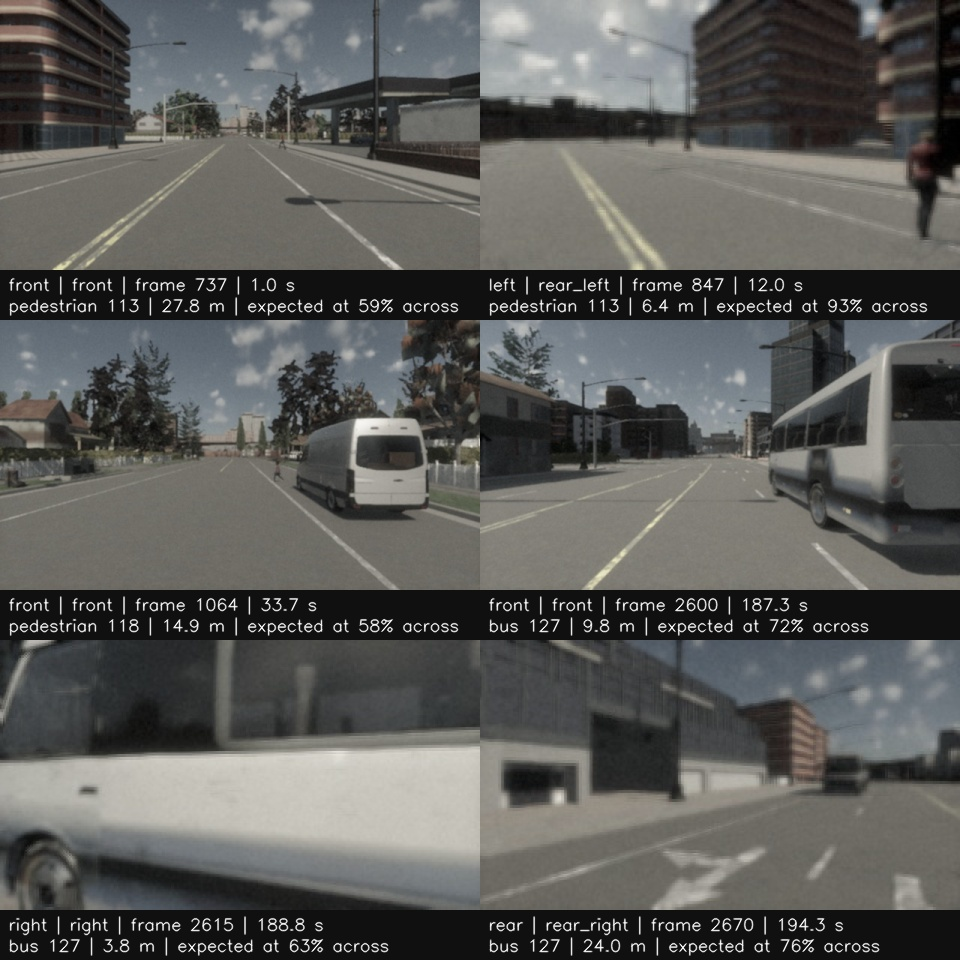
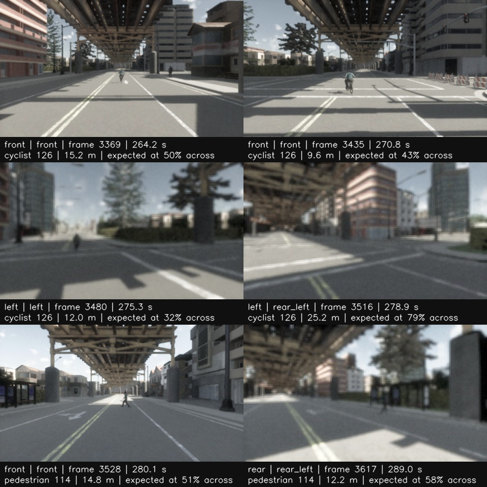
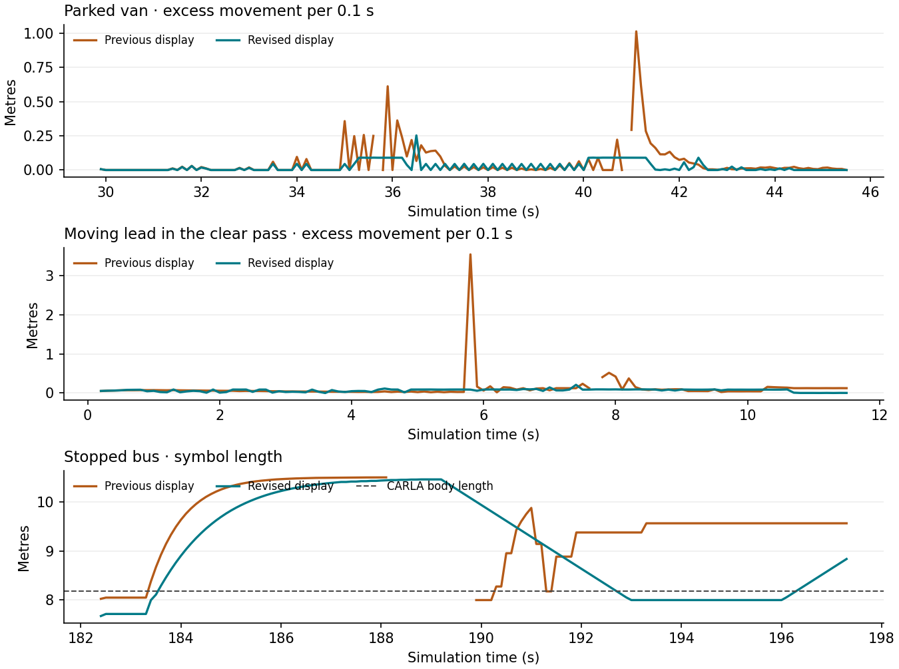
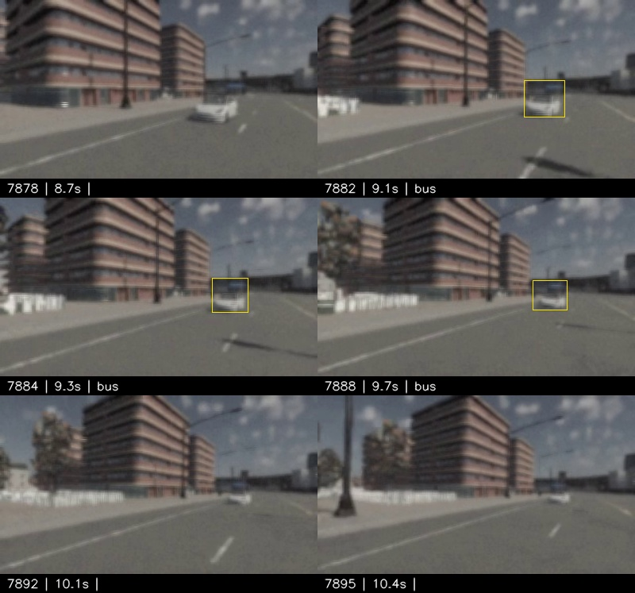
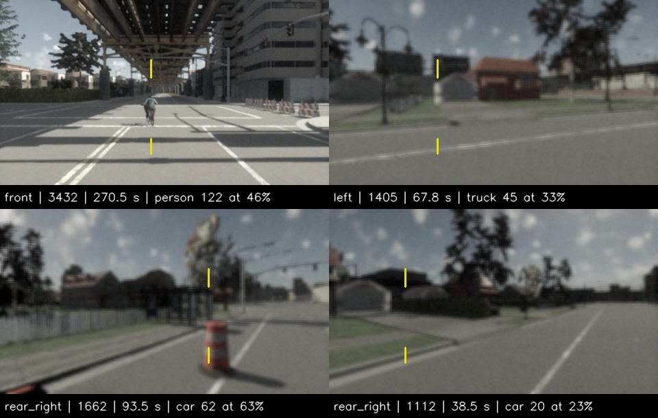
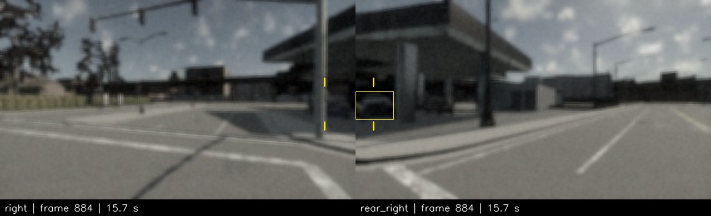

# Full Town03 High perception audit

The seed-211 city drive completed ten encounters in 3,173 CARLA frames (727–3899, 317.3 seconds). Across 2,883 nearby scenario actor-frames, the tracker matched 1,717. The revised rider display matched 1841. The four sectors below include occluded actors and use a 35 m radius. Each match is family-compatible, one-to-one and within 3 m of the recorded actor origin.

| Sector | Nearby actor-frames | Tracker matched | Display matched | Unmatched tracker / total | Unmatched display / total |
| --- | --- | --- | --- | --- | --- |
| front | 1447 | 998 | 961 | 482/1477 | 413/1376 |
| left | 253 | 129 | 135 | 279/405 | 399/540 |
| right | 310 | 199 | 197 | 595/791 | 945/1144 |
| rear | 873 | 391 | 548 | 374/777 | 681/1235 |

The coverage table scores the core spatial object list. A separate optical rider overlay corrects 23 front-sector labels using a ranged person and repeated bicycle boxes. With these 23 inferred labels the visible High display matches 1,864/2,883 nearby scenario actor-frames (2,273/4,198 including parked map vehicles). The underlying tracker still supplies no independent bicycle range. [Overlay-specific evidence](rider-final.json)

## Original and High recordings at comparable poses

| Actor | Pose pairs | v0.2 tracker | High tracker | v0.2 display | High display |
| --- | --- | --- | --- | --- | --- |
| pedestrian | 203 | 38 | 127 | 59 | 132 |
| occluder | 151 | 46 | 151 | 55 | 151 |
| occluded | 143 | 58 | 95 | 71 | 98 |
| signal_queue | 189 | 77 | 133 | 60 | 132 |
| lead | 126 | 104 | 126 | 109 | 126 |
| stopped_bus | 147 | 54 | 124 | 55 | 147 |
| braking | 140 | 96 | 129 | 85 | 127 |
| oncoming | 112 | 20 | 93 | 22 | 111 |
| cyclist | 239 | 6 | 0 | 0 | 0 |
| pedestrian-delayed | 208 | 44 | 115 | 66 | 123 |

The original first pedestrian used three tracker IDs. The High tracker held one ID across 127 matched frames. Original bus frame 2212 (214.0 s) pairs with High frame 2600 (187.3 s). The native right camera shows one bus beside the ego at 188.8 s, and the rear-right camera shows it behind at 194.3 s. [Matching definitions and commissioning checks](../README.md)

## When each actor appears

Elapsed times below cover the principal continuous visit within 60 m. RGB candidates pass projected-center, apparent-height and class-family checks. Occlusion or overlapping boxes can make their identity ambiguous. Sparse range means two downsampled XY returns on the footprint. Full lidar can establish range before the sparse plot shows two points. A track already present at the start is left-censored. Draw means the first spatial symbol. The next column reports when its opacity reaches 50%.

| Actor | Window starts (s) | First RGB candidate | Sparse range | First compatible spatial track | First draw | Half opacity |
| --- | --- | --- | --- | --- | --- | --- |
| pedestrian | 0 | 1 | 2.2 | 2.2 | 3.4 | 3.4 |
| occluder | 26.1 | 26.2 | 27.5 | 26.1 | 26.4 | 26.5 |
| occluded | 27 | 33.6 | 34 | 33.6 | 33.6 | 33.6 |
| signal_queue | 53 | 67.6 | 55 | 67.6 | 67.7 | 67.8 |
| lead | 110.6 | 112.2 | 111.7 | 112.4 | 113.6 | 113.7 |
| stopped_bus | 178.9 | 180.8 | 182.1 | 180.8 | 181 | 181.1 |
| braking | 201.3 | 208.4 | 206.6 | 208.4 | 208.6 | 208.7 |
| oncoming | 225.5 | 228.4 | 228.1 | 228.4 | 228.5 | 228.6 |
| cyclist | 253.5 | 265.4 | 259.3 | — | — | — |
| pedestrian-delayed | 267.4 | 275.8 | 273.2 | 278.8 | 279.2 | 279.3 |

The first crossing pedestrian is visible at 1.0 s, when its person box explicitly lacks range. The first spatial track arrives at 2.2 s and the first spatial symbol at 3.4 s. The pedestrian emerging beside the parked van is measured at 33.6 s and appears on that acquisition. [Rendered 91-frame van and pedestrian comparison](../rider-motion/README.md)

The cyclist is visible directly ahead at frame 3369. Person track 143 follows the rider. A separate person on the sidewalk is ID 147. At 3435 the overlapping person box (0.79) has depth and the bicycle box (0.72) does not. Over 239 nearby frames the tracker places a person within 3 m of the bicycle actor on 164 frames, and the core spatial display places a person there on 165. Zero spatial tracks are labeled bicycle. On frames 3435–3457 (270.8–273.0 s), overlapping bicycle and person image boxes move together on repeated front-camera observations. The screen calls the association a bicycle rider at the measured person range. All 23 associations coincide with the true bicycle actor. The left camera still shows the rider at 275.3 s. The rear-left view at 278.9 s is too indistinct to establish identity. The last two panels show the delayed pedestrian in the front and rear-left cameras.

## Motion on consecutive frames

Previous and revised replay identical High or overtaking measurements. The table uses adjacent 0.1 s ticks with the same matched display ID. Translation and yaw subtract the CARLA body’s actual movement, including longitudinal/lateral box offsets where available. Extent is the largest length, height or width change of the class-clamped symbol. Each cell gives median / P95 / maximum. Duplicate frames count an extra same-family symbol within 3 m of the actor or, separately, inside its oriented footprint padded 0.5 m.

| Actor | Display | Excess step m | Yaw step ° | Extent step m | 3 m duplicate frames | Footprint duplicates |
| --- | --- | --- | --- | --- | --- | --- |
| Stationary van | before | 0.008 / 0.257 / 1.014 | 0.000 / 0.007 / 0.069 | 0.002 / 0.137 / 0.838 | 73 | 92 |
| Stationary van | after | 0.000 / 0.090 / 0.253 | 0.000 / 0.000 / 0.286 | 0.019 / 0.065 / 0.072 | 0 | 0 |
| Stationary bus | before | 0.000 / 0.395 / 3.563 | 0.000 / 0.003 / 0.041 | 0.000 / 0.450 / 0.966 | 0 | 0 |
| Stationary bus | after | 0.017 / 0.090 / 0.091 | 0.000 / 0.286 / 0.286 | 0.054 / 0.118 / 0.283 | 0 | 0 |
| Parked BMW | before | 0.000 / 0.070 / 1.312 | 0.000 / 0.107 / 45.670 | 0.000 / 0.044 / 0.431 | 0 | 0 |
| Parked BMW | after | 0.000 / 0.045 / 0.389 | 0.000 / 0.000 / 0.152 | 0.000 / 0.029 / 0.045 | 0 | 0 |
| Parked Mini | before | 0.000 / 0.015 / 0.037 | 0.000 / 0.001 / 0.001 | 0.000 / 0.002 / 0.007 | 0 | 0 |
| Parked Mini | after | 0.000 / 0.014 / 0.038 | 0.000 / 0.000 / 0.000 | 0.000 / 0.001 / 0.004 | 0 | 0 |
| City lead | before | 0.035 / 0.427 / 1.403 | 0.011 / 2.140 / 21.810 | 0.003 / 0.050 / 0.130 | 0 | 0 |
| City lead | after | 0.008 / 0.096 / 0.308 | 0.000 / 1.552 / 3.140 | 0.002 / 0.019 / 0.055 | 0 | 0 |
| Clear-pass lead | before | 0.065 / 0.238 / 3.549 | 0.000 / 0.001 / 0.001 | 0.003 / 0.081 / 0.332 | 20 | 19 |
| Clear-pass lead | after | 0.087 / 0.095 / 0.212 | 0.000 / 0.001 / 0.001 | 0.004 / 0.065 / 0.065 | 0 | 0 |
| Yield-pass lead | before | 0.074 / 0.573 / 1.359 | 0.000 / 0.022 / 0.064 | 0.003 / 0.069 / 0.173 | 0 | 0 |
| Yield-pass lead | after | 0.064 / 0.106 / 0.176 | 0.000 / 0.002 / 0.063 | 0.003 / 0.038 / 0.053 | 0 | 0 |
| Yield-pass adjacent | before | 0.060 / 0.630 / 1.005 | 0.000 / 0.050 / 0.113 | 0.025 / 0.116 / 1.600 | 2 | 2 |
| Yield-pass adjacent | after | 0.068 / 0.217 / 0.564 | 0.000 / 0.001 / 0.001 | 0.018 / 0.065 / 0.112 | 0 | 0 |

The following screen includes every wheeled display ID within 35 m, even those without an actor match. It measures actual world-space changes per 0.1 s. A legitimate moving vehicle can exceed a screening threshold.

| Display | Adjacent ticks | World step m | Yaw step ° | Extent step m | >1 m | >15° | >0.4 m extent |
| --- | --- | --- | --- | --- | --- | --- | --- |
| Previous | 2549 | 0.000 / 0.828 / 7.003 | 0.000 / 0.518 / 179.985 | 0.000 / 0.068 / 3.600 | 41 | 6 | 16 |
| Revised | 2405 | 0.000 / 0.803 / 1.005 | 0.000 / 0.923 / 6.466 | 0.000 / 0.065 / 0.344 | 2 | 0 | 0 |

The parked van previously duplicated on 73 High frames. The revised display holds one symbol at the close pass. The physical bus measures 8.18 m long, 3.41 m high and 3.16 m wide. See the archive for center error, foot-height error, footprint-corner RMSE, visible size and exact ID transitions by actor. Footprint-corner RMSE allows a 180° reversal of an otherwise identical box.

In the clear passing replay, native rear-right frames show a single white Tesla. At 9.1 s raw car ID 4 is coasting. A fresh bus ID 5 arises from a box over the same car. All 29 sampled returns supporting ID 5 at frames 7882, 7884 and 7888 fall inside the calibrated Tesla body bounds with 0.15 m tolerance. The bus length prior shifts the fitted center behind the real car. The clear scenario staged no adjacent NPC. The revised display removes the extra moving-lead symbol for all 116 frames, matches 115 lead frames and retains six unmatched predictions across the entire pass. In the yielding replay the moving lead has zero duplicate frames, with five unmatched outputs across both nearby vehicles.

On identical High frames, previous vs revised core coverage is 1,867 vs 1,841 nearby scenario actor-frames, with 3,003 vs 2,438 unmatched predictions. Including parked map vehicles gives 2,279 vs 2,250 matched actor-frames and 2,609 vs 2,048 unmatched predictions. The pose revision therefore trades some coverage for fewer misplaced or unsupported drawings. Most of the scenario coverage loss is the city lead during a later encounter at 135.6–139.1 s. The corresponding official aligned lead encounter still matches all 126 paired frames. The optical rider overlay separately adds the 23 semantic matches described above.

## What unmatched predictions represent

With all 13 registered parked map vehicles included, 1526 of 3,450 tracker predictions remain unmatched. For the revised display the corresponding count is 2048 of 4295. This reference omits roadside structures. Duplicate fits, classification errors and estimated centers outside the distance gate also count as unmatched.

| Unmatched label | Measured tracker | Coasting tracker | Current/recent display | Remembered display |
| --- | --- | --- | --- | --- |
| car | 193 | 401 | 249 | 634 |
| bus | 40 | 94 | 12 | 14 |
| truck | 24 | 28 | 32 | 76 |
| person | 144 | 112 | 201 | 392 |
| unknown | 235 | 255 | 309 | 129 |

| Fresh tracker evidence | Unmatched predictions | All predictions with those sources |
| --- | --- | --- |
| lidar+radar+rgb | 213 | 829 |
| lidar+radar | 370 | 1096 |
| lidar | 40 | 65 |
| lidar+rgb | 13 | 31 |

At 270.5 s person 122 lies 0.20 m from the genuine rider; it fails the raw bicycle-family check. Remembered truck 45 persists for 57 unmatched frames. Its predicted bearing at 67.8 s falls on residential frontage in the left camera, with no visible truck and the nearest recorded road user 16.81 m away. Remembered car 62 lasts 58 unmatched frames and points into roadside shelter/barrel scenery at 93.5 s, 33.98 m from the nearest parked vehicle and 13.41 m from the nearest recorded cone. Car 20 at 38.5 s is the largest remaining wheeled step: 1.005 m in one tick near hedge/house frontage. It keeps its ID and class, changes heading by 0.58° and extent by 0.021 m, and switches from remembered to current. No registered parked car lies within 58 m.

Shortening unsupported retention of unclassified range clusters reduced unknown predictions from 927 to 438. Position-only matching, which ignores class, matched 19 of those 927 to a road user before the change and one of 438 afterward. Thus 18 previously position-compatible unknown outputs were lost as well as 471 with no such support. All 489 removed outputs lacked a compatible semantic road-user match. [Earlier unknown-layer scoring](rider-iter5.json) · [Final unknown-layer scoring](rider-final.json)

At 15.7 s a genuine rear-right car frame locates the parked forecourt BMW with 0.116 m center error. This car is absent from the scenario actor list and present in the static registry.

## Evidence and reproduction

The separate signal-head audit compares the actual camera classifications with CARLA's observer reference. Of 17,469 mapped head-frames, 2,640 had a scored color and 14,829 stayed unknown. The camera classifier agreed on 2,634 of those 2,640. All six disagreements reported red while the reference was green. [Full signal readings and confusion counts](../../surround-city/signal-reads.json)

[Full coverage](coverage.json) · [Exact pose-paired CARLA frames](pose-pairs.json) · [Frame-by-frame motion evidence](motion-evidence.zip)

The ZIP contains before/after metrics and per-tick actor rows for High, clear pass and yield pass, plus the complete scored High frames including unmatched outputs. Use the archived final-display.mjs with --memory-file to reproduce the exact release memory. The acquisition-level audit excludes render interpolation. Fall-through between an on-screen body and an unclassified return is visible only where its recorded ID and label permit attribution. The preceding High display is pinned to a7e516c and the final display and bicycle association to b856138d720972b33f193c87f6a4ba9aaabd37cd. The final normalized display-module SHA-256 is ab4afd7f1b069bbeb9aaa58ec4293f9ccd00f49b59a2f03e24c2026cd2ce6f91. Direct rescoring of the published replay pack (SHA-256 7fa6eea96ed07e23a1d877b291b0c62526fad7a3157126ab2ac2ff3d5581014e) exactly reproduced the native journal’s coverage, motion/error groups, per-encounter timing, all-ID step statistics and all 23 optical rider associations.

~~~powershell
$p = "results/perception/town03-static-vehicles.json"
node tools/audit_city_perception.mjs web/media/surround-city --memory-revision b856138 --static-map $p --output coverage.json --frames high.jsonl
node tools/audit_city_perception.mjs web/media/long-city-drive --memory-revision 0ff276b --static-map $p --output old.json --frames v02.jsonl
node tools/compare_city_encounters.mjs v02.jsonl high.jsonl pose-pairs.json
node tools/audit_rider_overlay.mjs web/media/surround-city --memory-revision b856138 --static-map $p --output rider.json
node tools/audit_city_motion.mjs web/media/surround-city --memory-revision b856138 --static-map $p --output motion.json --rows motion.jsonl
node tools/audit_city_motion.mjs web/media/overtake-clear --memory-revision b856138 --static-map $p --output clear.json --rows clear.jsonl
node tools/audit_city_motion.mjs web/media/overtake-yield --memory-revision b856138 --static-map $p --output yield.json --rows yield.jsonl
node --test tests/test_audit_city_perception.mjs
~~~
