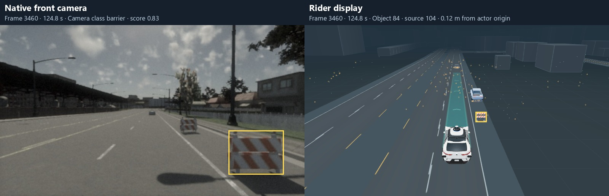
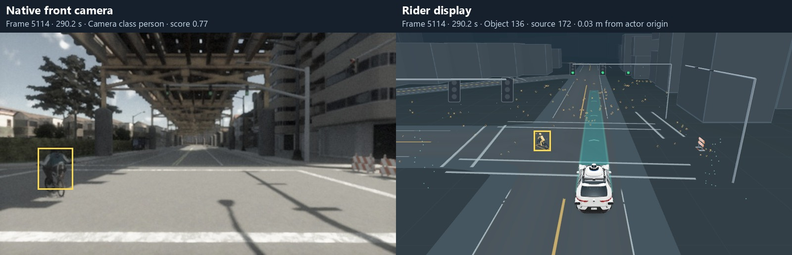
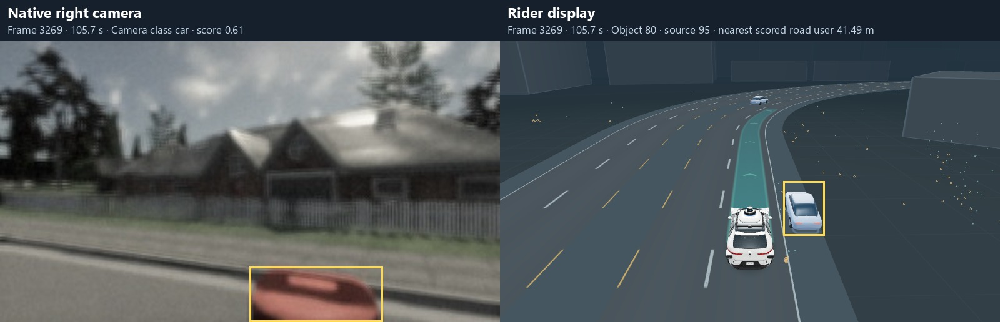

# Town03 Urban Pace perception

The final High drive covered 3,354 consecutive native acquisitions, frames 2212–5565. The tracker matched **2,080 of 3,309** nearby scenario actor-frames. The rider display matched **2,260**, including 2,256 with the exact reference label. Adding registered parked vehicles gives **2,229 of 4,565** tracker matches and **2,505** display matches. The display produced more unmatched symbols in absolute terms, 2,109 against 2,040, while its share of symbols matched to a reference rose from 52.2% to 54.2%. [Full metrics and source hashes](perception.json)

The scorer independently assigns native tracks and drawn objects to CARLA actors, one prediction per actor, within 3 m. Counts use a 35 m radius and include occluded road users. A vehicle-family match can have the wrong vehicle class. Registered parked controls account for 1,256 nearby actor-frames, with 149 raw and 245 display matches. The road-user reference omits ordinary street furniture, cones and unstaged scenery vehicles. An unmatched output therefore needs an image check before it can be called a false detection.

## Coverage around the vehicle

| Sector | Scenario actor-frames | Raw matches | Rider matches | Unmatched raw / total raw | Unmatched rider / total rider |
| --- | ---: | ---: | ---: | ---: | ---: |
| Front | 1,621 | 1,193 | 1,196 | 582 / 1,767 | 344 / 1,543 |
| Left | 265 | 132 | 162 | 330 / 459 | 285 / 450 |
| Right | 386 | 258 | 281 | 925 / 1,184 | 1,067 / 1,351 |
| Rear | 1,037 | 497 | 621 | 349 / 855 | 657 / 1,265 |

The largest coverage gain is behind the vehicle, where retaining a previously observed actor adds 124 matches. That sector also has 308 more unmatched drawings. Against the scenario reference, direct identity switches fall from 19 to four and reacquisitions from 14 to three. Median position error is 0.177 m for matched raw tracks and 0.175 m for matched drawings. The corresponding 95th percentiles are 1.701 and 1.832 m.

## Native camera and rider evidence

**Striped boards.** At 124.8 s, the front camera measures board 617 at 5.71 m from the vehicle. The matching display symbol is 0.123 m from the actor origin. Across the two planted boards the native tracker matches 191 of 369 nearby actor-frames and the display matches 185. Of 180 raw striped-board camera boxes, 155 pass the appearance and owned-lidar checks. Of 28 raw chain proposals, none qualifies for a camera label or rider symbol. The separate controlled chain study tests real suspended chains. [Barrier evidence](../barrier-recognition/README.md)



**Cyclist and pedestrians.** The raw tracker reports a correctly located bicycle for 32 of the cyclist's 239 nearby frames. The release display labels 78 correctly, 32 with current or recently refreshed native mounted-rider evidence and 46 while the same ranged identity continues. All 78 nearby displayed bicycle symbol-ticks match the cyclist. The native class source is shared rider/bicycle lidar. The display's retained classification adds no independent wheel depth. A separate single low-confidence ordinary bicycle reading appears over the first crossing pedestrian at frame 2342 and coasts through 2345. The raw sensor list and image observation remain available. The 3D rider scene holds one person there. Across all pedestrians the tracker matches 737/1,369 and the rider matches 817/1,369. The delayed pedestrian is an exception, with 153 raw matches and 144 display matches. [Cycle tracking and walker control](../perception/cycle-range-v04/high212.json)



The first evaluation of this completed drive exposed a display identity defect. Native source 172 occasionally reported a person between mounted bicycle observations. Its two class families created overlapping person and bicycle symbols on 71 nearby cyclist frames. A two-person regression fixture independently reproduced the defect. The repair attaches the mounted classification to the same ranged person identity. Rescoring the completed drive gives one source, one display ID and zero such duplicates, with exact bicycle coverage rising from 72 to 78 frames. Before the repair, total scenario display matches were 2,254 and unmatched predictions including parked controls were 2,186. These final results include a repair informed by this drive. [Retained first evaluation](perception-before-mounted-repair.json)

**Remaining false car.** At 105.7 s, the right-camera car box covers a near orange roadworks object at the bottom of the image. Source 95 yields a car symbol 4.19 m from ego. The nearest staged cone is 1.94 m from the symbol and the nearest registered road user is 41.49 m away. No passenger car is visible in the box. The display identity has 53 unmatched nearby symbol-ticks, including 19 current/recent ticks. Separately, some unmatched barrier symbols are visibly real, unstaged striped boards. The report includes the source camera and frame for each ranked case.



## Reproduction

The native journal SHA-256 is `035769ea010f15e5b89f4d1a376d5d009a8182ef7fa00fac559de337e79bfb58`. The barrier review SHA-256 is `b239338aac001703bf15fe18ccdb75259eda43218dcb08a73666eb990357e91f`. The scorer streams the journal once. The display receives recorded camera, lidar, radar, track and ego-pose data plus surveyed road geometry. CARLA actor references are assigned after the display emits its objects. Counts describe positive-opacity symbols at native acquisition times. The images use the production WebGL scene and the synchronized source JPEG. Yellow outlines identify the corresponding camera box and rendered symbol.

```powershell
$capture = 'out/journey-captures/long-city-drive-nxksaiij/raw'
$review = 'web/media/urban-pace/barrier-review.json'
node tools/audit_urban_hero.mjs $capture $review out/hero-perception.json out/hero-vru.jsonl
py -3.12 tools/capture_hero_object_evidence.py $capture $review out/hero-perception.json out/board.jpg
py -3.12 tools/capture_hero_object_evidence.py $capture $review out/hero-perception.json out/cyclist.jpg --case cyclist
py -3.12 tools/capture_hero_object_evidence.py $capture $review out/hero-perception.json out/unmatched.jpg --case unmatched --example 2
```

Independent rescoring of the released replay pack, SHA-256 `d38b98a40cf165058ec86a5cee5b8fb4b318d3853caa9762603f2fe9699ad956`, reproduced every native-journal metric and selected evidence case. Source-quality image extraction requires the native MJPEG streams. The display and scorer hashes are recorded in the metrics. [Identical-input regression against the previous High drive and both overtakes](../perception/object-continuity/README.md)
