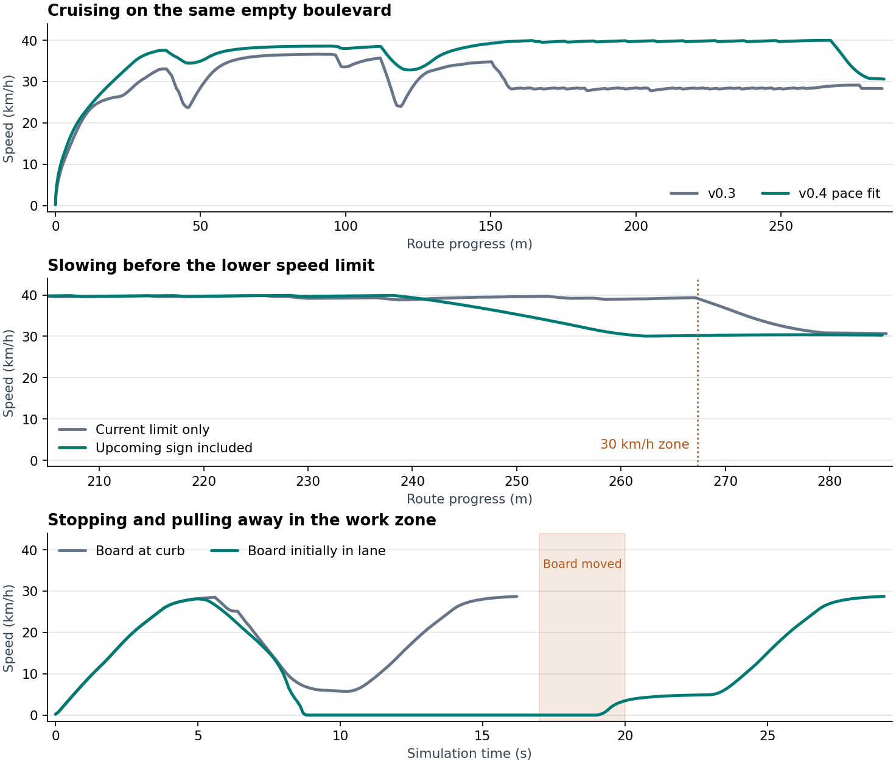

# ADO v0.4 city drive and frame review

ADO drove **1,416 m in 5 minutes 35 seconds** in CARLA Town03. The learned city driver handled all **11 staged encounters** and crossed all **11 junctions**. CARLA recorded zero collisions, red-light violations, missed yields or moving frames within one metre of a reference hazard. Chase and five onboard cameras share the clock of all 3,354 native exposures. The recording covers pedestrian crossings, a red-light queue, roadside construction, a stopped bus, traffic ahead and a cyclist. [Watch from the start](https://yafi-s.github.io/ADO/?run=urban-pace) · [Inspect the two barriers at frame 3460](https://yafi-s.github.io/ADO/inspect.html?run=urban-pace&frame=3460&camera=front) · [Run score and encounter list](../city-pace/seed-212/summary.json)

## Cruising, braking and passing

- **An empty street.** On the same 285 m boulevard, median speed in the segment permitting 40 km/h rose from **28.42 to 39.58 km/h**. Speed variation fell from 3.37 to 1.75 km/h. The revised driver held 38–40 km/h for 11.5 consecutive seconds. One false camera reading still triggered 0.7 seconds of braking. In a separate matched test with an upcoming 30 km/h sign, previewing its mapped position reduced entry speed from 39.35 to **30.16 km/h**. [Native measurements, conditions and traces](../city-pace/README.md)
- **City traffic.** Clear straights in the featured drive had a 29.72 km/h median across all speed zones and a **35.53 km/h** median where the limit permitted at least 35. The car reached 39.08 km/h on the matched boulevard segment. Its strongest half-second deceleration was 4.46 m/s² while stopping behind a lead vehicle. It stopped for all three pedestrians, with a 3.71 m minimum gap at the occluded crossing. On the matched Low route, the faster driver had *more* speed variation through the mixed-traffic segment. [Featured speed trace](speeds.json) · [Low and High comparisons](../city-pace/README.md)
- **Blocked lane or open lane.** A board across the lane produced a 9.9-second stop, with 3.19 m bumper clearance. When the lane reopened, the car resumed to 28.72 km/h. With the same board alongside the road it slowed but continued. Both tests also passed in wet conditions with reduced wheel grip. The controller used measured obstruction and clearance. The display's barrier class was graded separately. [Watch both approaches and read the wet-surface results](../workzone-stop/README.md)
- **Overtaking.** On a second configured legal passing corridor, the planner waited 7.5 seconds with zero throttle for adjacent traffic, then committed with a 31.62 m gap. It also passed an unobstructed lead and held its original lane when there was nobody to pass. The tests used two designated straight corridors. Finding suitable passing opportunities anywhere on a map remains untested. [Second-corridor movies and measurements](../tactical-pass/v04-road67/README.md)

## What the screen saw

The 3D display uses camera, lidar and radar observations with short-term track memory. The inspection view keeps the original measurements alongside the presented symbols. CARLA's independent actor poses are used to score the display. The calibrated five-camera rig, roof lidar and five radars are described in the sensor documentation. [Sensor layout, coverage and timing](../../docs/surround-city.md)

- **Barrier shapes and range.** Striped boards scored 12/12 on held-out exposures at 5–20 m with zero false detections on 48 matched controls. On the full drive, both staged boards appeared in the front and rear-right cameras. Of 155 fresh qualified board tracks, 153 fell within 0.65 m of a staged or mapped physical board. One crowded scene had a 7.78 m distance error. A width check rejected a streetlight and also withheld one correctly located sparse board. On a separate set of 18 linked-chain exposures, 9 had supporting camera and lidar geometry and **6** met the final display threshold. In the featured recording, one set of laser returns had also produced a weak car drawing over the farther board. Once the camera and lidar confirmed the board, assigning those returns to its measured surface removed 35 unmatched car drawings without reducing matched road-user coverage. Fine chains remain easy to miss. [Examples, native inputs and all scoring gates](../barrier-recognition/README.md)
- **Object identity.** An identical-frame replay revealed that the display could draw both a pedestrian and bicycle for the same measured rider. Keeping one displayed body per mounted source removed all **71** duplicate frames in the featured cyclist encounter. The correct bicycle class appeared on **78 of 239** nearby frames. In many other frames only the rider's body had enough evidence. On the full drive, the 3D view matched 2,260 of 3,309 nearby scenario actor-frames, versus 2,080 from raw tracks. Including registered parked cars, it also produced 2,074 unmatched symbol-frames versus 2,040 from raw tracks. Landmarks outside the scoring register and genuine false tracks can both contribute to unmatched counts. [Full-drive images and score](PERCEPTION.md) · [Before the identity repair](perception-before-mounted-repair.json) · [Native cyclist study](../perception/cycle-range-v04/README.md)
- **Turning.** All 3,354 movie exposures joined to the correct recorded pose. Across eight major turns, the follow camera's 95th-percentile heading error fell from **8.39° to 0.62°**. Its measured lag fell from 333 ms to below the 16.7 ms measurement interval. Peak and RMS angular jerk decreased. The 95th percentile at exposure boundaries rose slightly. [Per-turn measurements](follow-turns.md) · [Watch the comparison](https://yafi-s.github.io/ADO/media/turn-camera.mp4)
- **Traffic lights.** On the same native RGB frames, the conservative display reader reduced wrong color readings from three to zero across 18,385 mapped signal-head observations. Correct readings also fell from 2,570 to 2,057, and the staged green appeared 0.4 seconds later. Most heads remained unknown. A separate pole at 25 m still produced 38 wrong readings. The driving controller has its own signal input. [Per-head counts, input crops and failures](../surround-city/signal-reader-transition.md)

## How far the results transfer

The featured drive used a development route with staged, moving hazards. Another full town run passed the same eleven encounters with different timing and rendering. Six focused crossing and yielding challenges also finished cleanly. The first pace model collided with a pedestrian emerging from behind a van. Its trace is retained with the later successful runs. [City driving studies](../city-pace/README.md) · [Initial collision](../city-pace/development-occlusion-211/)

On Town01, the revised yield controller passed 16 focused checks, including six earlier failures, four previously passing controls and six fresh challenges. One passing control still had 0.31 m clearance. The published 100- and 50-drive cohorts belong to the earlier version. [Town01 cases and timing](../town01-yield-gated-v04/README.md)

The featured driver uses CARLA training demonstrations. In separate research with a model trained on Waymo data, both the CARLA-only calibration and the calibration using a Waymo forecast succeeded in all four paired development scenarios. This comparison showed no additional successful outcomes from adding the forecast. These experiments measure simulated behavior on specified roads and conditions. They provide no estimate of real-road safety or commercial-system parity. [Waymo transfer and calibration](../../waymo_training/CARLA_SPEED_CALIBRATION.md) · [Research and asset credits](../../docs/research.md)

## Recording provenance

The featured recording used Town03_Opt, seed 212, High rendering, 0.1-second simulation steps and a 0.5-second pedestrian departure delay. The CARLA server captured cameras simultaneously with the controls in one closed-loop drive. The native chase master is 1920 × 1080. The downloadable data preserve the raw readings. A separately fingerprinted retrospective barrier review uses saved image and range evidence, and the final rider renderer evaluates the sealed sensor journal. Both updates can change what the screen presents while preserving what the vehicle measured and did. [Exact capture source](capture-source.zip) · [Capture revision](https://github.com/yafi-s/ADO/tree/e9865e03736dcf2be51805f8751f6a96aa18d6b5) · [Original 1080p camera master and Windows build](https://github.com/yafi-s/ADO/releases/tag/v0.4.0)
