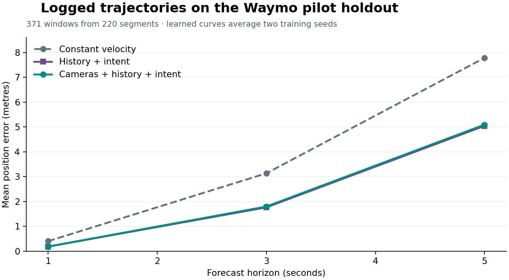

# Waymo E2E pilot results

We trained two waypoint predictors from scratch on Waymo's real driving logs using a Colab Tesla T4 with 15 GiB of GPU memory and TensorFlow 2.21.0. Both learned models reduced held-out trajectory error relative to constant velocity. Adding three camera views yielded slightly higher mean error than history and routing alone, with a paired interval spanning zero.

## Sample and model

- **Training:** 1,598 windows from 1,091 official training segments.
- **Pilot development:** 202 windows from 110 official validation segments.
- **Pilot holdout:** 371 windows from 220 different official validation segments.

The extraction validated 4.75 GiB of shard prefixes. Segment and frame-index checks found zero duplicate windows or cross-split segment overlap. All 2,171 embedded timestamps were zero, so the checks used the frame index in the record name. Prefix sampling favors early records, and 306 of the 371 holdout windows were labeled straight.

The models predict 20 two-dimensional rear-axle waypoints from 0.25 to 5 seconds. Both learned models use 16 ego-history samples and a supplied route command. Waymo derives this command from the next 10 seconds of the driven route, so the results measure forecasting given that command. The camera model uses three synchronous views (front, front-left and front-right) from the current frame. Extraction decodes the JPEGs at reduced size and area-resizes them to 96 × 64 pixels per view. The model then uses a 2 × 2 mean pool to reach 48 × 32 pixels per view. [Waymo WOD-E2E paper, §3.1.3](https://arxiv.org/html/2510.26125v1#S3.SS1.SSS3)

## Held-out logged trajectory error

These are window-weighted errors in meters. Learned model scores average the errors from seeds 41 and 73. Each checkpoint was selected by development ADE.

- **Constant velocity:** 2.984 m ADE and 7.780 m FDE.
- **History and routing:** 1.780 m ADE and 5.042 m FDE.
- **Camera, history and routing:** 1.808 m ADE and 5.092 m FDE.

Paired ADE differences below average once per segment. The 95% bootstrap intervals resample the 220 holdout segments and are conditional on the two fitted seeds. Negative values favor the first condition.

- **History minus constant velocity:** −1.189 m, 95% interval [−1.464, −0.924] m.
- **Camera model minus constant velocity:** −1.173 m, 95% interval [−1.441, −0.909] m.
- **Camera model minus history:** +0.016 m, 95% interval [−0.014, +0.048] m.
- **Shuffled triplets minus original triplets:** −0.013 m, 95% interval [−0.038, +0.010] m.

Swapping the complete camera triplet with one from another segment moved predictions by 0.274 m per waypoint for seed 41 and 0.267 m for seed 73 on average. The model responded to the input change. The error comparison gives no evidence that the original images improved predictions in this pilot.

The 573 sampled validation windows contained two frames with usable preference scores, six scored candidates in total. Their optional coordinate fields provided zero dense 20-point candidate paths. The pilot therefore reports logged ADE and FDE. Waymo's official benchmark uses human-rated path alternatives for its primary Rater Feedback Score and the highest-rated path for its ADE tie-breaker. [Waymo WOD-E2E paper, §3.5](https://arxiv.org/html/2510.26125v1#S3.SS5) · [Official metric schema](https://github.com/waymo-research/waymo-open-dataset/blob/master/src/waymo_open_dataset/protos/end_to_end_driving_metrics.proto)

## Portable inference and preliminary simulator transfer

The portable export uses the camera checkpoint for seed 41, selected by development ADE. Compared with Keras inference on 32 holdout windows across 31 segments, the maximum absolute coordinate difference was 0.00000763 m and the mean waypoint difference was 0.000000308 m.

- **Portable model SHA-256:** `4757047aa66ba141d9485ecbc956424e0dd87af84056190e12096088a08a7503`.
- **Source camera checkpoint SHA-256:** `ce12751edc37302cdc6a16a006e706e6d5d28559ea079594c6f634408cd089e9`.
- **Feature snapshot SHA-256:** `086311fc5a39e2bec502ba3712440888998f7196ff650580fbbcd25f5b7a0e62`.

The separate closed-loop transfer check used the portable Waymo-trained predictor in CARLA 1.0 Town01 across clear-road, pedestrian and lead-vehicle scenarios. All three starts from rest made zero route progress and timed out after 30 seconds. All three 3 m/s handoffs departed the lane after 13.58–25.06 m of route progress. The pedestrian trial ended before its crossing activated. All six trials ended without contact.

A fixed path follower used pure pursuit on the one-second waypoint and pedal feedback on the speed inferred from the 0.5-to-1-second path segment. The simulator supplied rendered cameras with different calibration, measured ego history, and a route command derived from the planned route. The Waymo-trained predictor and this path follower form a separate system from the published CARLA-trained driver. The failures characterize this transfer setup.

## Follow-up transfer with calibrated speed feedback

The follow-up used the same checkpoint and three scenarios. For the 3 m/s handoffs, the setup collected 4.8 seconds of measured CARLA motion at steady speed. The path follower used measured throttle response, limited acceleration commands, and feedback from observed acceleration. All six trials ended in lane departures without contact.

- **From rest:** Model-controlled driving advanced 4.70–4.71 m along the route before departure. Summed rear-axle travel was 5.21–5.22 m.
- **3 m/s handoff:** Setup contributed 14.36 m of route progress before control passed to the model. Model-controlled driving advanced another 8.22–8.23 m along the route. Summed rear-axle travel after handoff was 8.73–8.74 m.

The pedestrian stayed at the curb in the stationary trial. In the rolling trial the pedestrian began crossing and was still crossing at termination. Neither trial recorded the pedestrian in the driving path within 12 m, so the trials did not evaluate close-range yielding.

One 35-frame CARLA-generated clip illustrates what the frozen Waymo-trained model actually did in the revised stopped-vehicle test. At the closest in-path observation the gap was 11.98 m, speed was 5.55 m/s and brake was zero. The following tick ended the run in lane departure. The public illustration carries its research notice and the Waymo agreement. The complete transfer archives are private. [Watch in ADO](https://yafi-s.github.io/ADO/?run=waymo-research-v2-lead-seed41-start3) · [Simulated footage, controls and attribution](../web/media/waymo-research-pilot/README.md) Waymo records, extracted features and learned weights are excluded from the published branch. [Waymo attribution and non-commercial terms](NOTICE.md)
